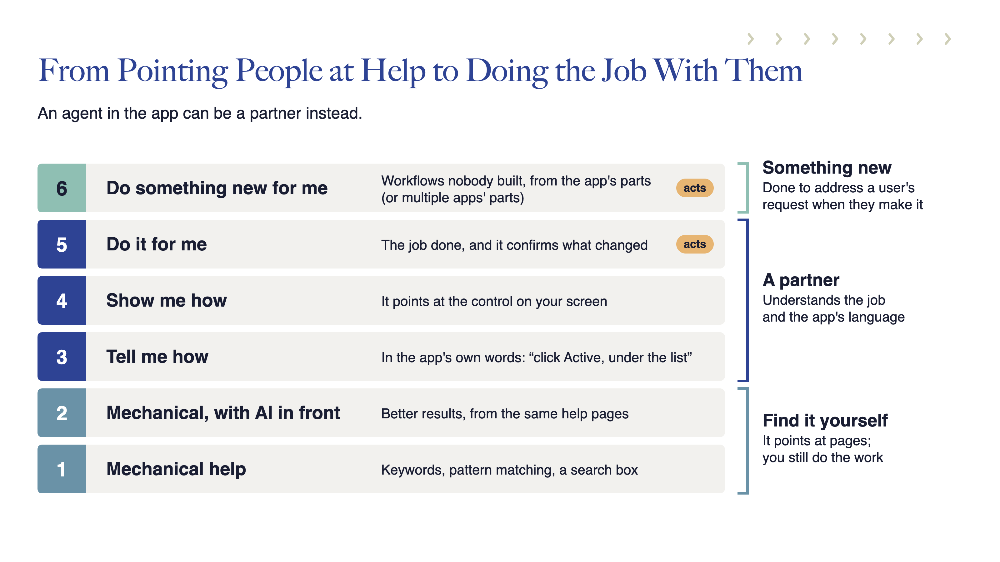
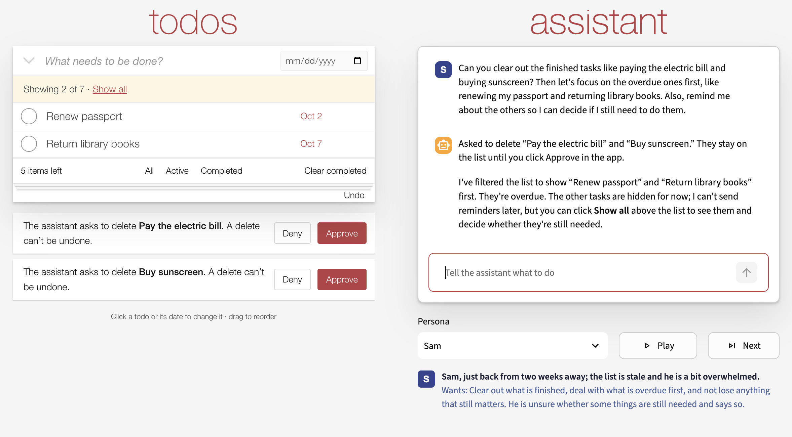

# Building Helpful, Trustworthy Agents Into Your Application

Principles, a working example, and evaluation tools from Eliassen Innovations to help you
build or improve an agent inside your application or website.

## Contents

- [Why build an agent, and what this sample demonstrates](#help-people-get-the-job-done)
- [Configuring LLMs](docs/guides/models.md)
- [Running the app](#setup)
- [Adding Langfuse (optional)](docs/guides/langfuse.md)
- [Running tests and evaluations](#test)
- [Running exploratory personas](#watch-personas-or-run-them-unattended)
- [Reading the evaluation report](#read-the-report)
- [Finding your way through the code](#follow-the-implementation)

## Help people get the job done

Your application may already have the capabilities people need. Finding them, learning the
controls, and working out which steps to take can still get in the way. An agent inside the
application can help people understand their options, show them what to do, and carry out
work with them.


When people struggle with a task, they increasingly expect AI assistance. Their expectations
are shaped by the best experiences they have elsewhere. That creates an opportunity to make
more of your application's capabilities useful to more people.

But adding a chat box is only a beginning. If the agent misunderstands requests, changes the
wrong data, or claims to have done something it hasn't, the experience can become more
frustrating than doing the work unaided.


Building useful assistance means connecting the agent to the working application, keeping
control over what it may do, and examining whether it actually helps. This repository shows
how those pieces fit together, with code you can inspect and principles you can adapt.

## From finding help to working together

Keyword search and AI-assisted help retrieval can both help people find instructions.
The person still has to translate those instructions into actions. An embedded agent can
also understand the current application state, point to a control, and perform an authorized
operation. It can combine existing capabilities to handle requests without a dedicated button.

[](docs/images/levels.png)

These are different kinds of assistance. Sometimes the person wants an explanation;
sometimes a demonstration; sometimes they want the work done. A helpful agent distinguishes
those requests and leaves the person in control.

## Learn the design in a deliberately small application

The example uses a familiar [TodoMVC](https://todomvc.com/)-style task list so you can focus on
the agent integration without first learning a complicated product. The todo domain keeps
the implementation small enough to inspect. The patterns are intended for your own application
or website, where helping people use its capabilities may have much greater value.

The central design is **build each capability once, then control who can use it**. The UI and
the agent use the same underlying operations, data, validation, and business process. Their
authority can differ: in a trading application, for example, a person might place a trade
through the UI while an agent may only propose it for approval enforced by application code.

The sample makes that distinction visible. It also shows how to give an agent knowledge of
the current screen, let it change the view, return results from application code, and recover
from some failures. The [walkthrough](docs/guides/walkthrough.md) explains each design problem,
shows the implementation, and identifies what to carry into another application.

The approval example uses todo deletion. That is a teaching choice: ordinary todo deletion
is rarely high-impact, and a real todo app could make it recoverable. Choose safeguards for
your application based on consequences and recoverability. Shared implementation does not
require identical permissions for the person and the agent.

## How do you know the agent is helping?

A successful demonstration is a starting point. You also need to check whether the agent
understood the request, selected the right work, changed the intended data, and described
what actually happened. This sample combines code tests, repeated model evaluations, and
exploration to answer those questions.

### Start by exploring yourself

Try ordinary requests, ambiguous wording, and changes of mind. Compare the conversation
with the screen and saved result. The exploratory tester gives you a scratch list for this
work. Here, a person probes a merge and a request containing several tasks.

[](docs/images/exploratory-tester.png)

### Use personas to broaden the exploration

People testing an app can run out of ideas or fall into familiar patterns. A persona is a
simulated user with a situation and goals, generating requests and reacting to the agent.
Sam, shown below, demonstrates how exploratory testing can be automated.

[](docs/images/persona-sam.png)

Run personas visibly to watch the interaction, or headlessly to collect conversations
without watching each turn. Inspect flagged findings and sample the rest. Close human
inspection still catches subtleties that automated checks miss. The [evaluation guide](docs/guides/evaluation-results.md#from-exploration-to-human-judgment)
shows how focused questions help reviewers decide whether a proposed action fits the request.
These screenshots are individual interactions, not evidence that every request succeeds.

## Read the report

**[Open the evaluation report](https://bobfischer.github.io/beyond-chat-todo/)** to see the other
part of the process: repeat a fixed set of cases, inspect the evidence, and examine variation
across runs. No setup, model credentials, or Langfuse server is needed.

[](https://bobfischer.github.io/beyond-chat-todo/)

The example contains 20 real runs and selected conversations for review. It deliberately
retains the original grades and unresolved grading concerns. Its limits are illustrative
candidates, not an accepted quality baseline. A stable failure rate does not establish that
performance is good enough—or that the grader is right.

Use ordinary tests to investigate broken code expectations. Use comparable repeated evals
to distinguish expected variation from unusual changes, while still addressing failures
that violate your acceptance criteria. Twenty full runs are a baseline-building exercise,
not a requirement after every edit. The [evaluation guide](docs/guides/evaluation-results.md)
explains that distinction and what happens when code, models, or graders change.

For offline review, open `examples/evaluation-review/index.html` from a downloaded or cloned
copy of the repository. [Example instructions](examples/evaluation-review/README.md) explain
how to inspect and save review notes.

## Start with one useful capability in your own app

You can use the documents whether you are building a new agent or improving an existing one:

1. Read the [design principles](docs/principles/principles.md) and decide how they apply to your users and product.
2. Follow the [sample walkthrough](docs/guides/walkthrough.md) to see the choices in working code.
3. Use the [implementation guide](docs/principles/implementation.md) to scope a capability and check the result.
4. Use [Evaluating agents](docs/principles/evaluating-agents.md) to plan evidence that the assistance is useful and reliable enough for its consequences.

The accompanying document series is called **Beyond Chat**. The [documentation index](docs/README.md)
provides a reading path. The [sample assessment](docs/guides/sample-assessment.md) compares this
implementation with the guide's detailed checks and records its limitations. This is a local,
single-user teaching sample, not a complete production architecture.

You can inspect its shared operations without installing dependencies or providing credentials.
From a downloaded or cloned repository, with Python 3.11 or later, run:

```bash
python3 -m todo.walkthrough
```

To try the actual agent, continue with setup below.

## Setup

Python 3.11 or later is required.

```bash
./setup.sh
.venv/bin/python -m streamlit run todo/app.py --server.address 127.0.0.1
```

Setup installs the dependencies and creates `.env` from `.env.example` if absent. It does
not edit shell profiles or access a credential vault. The list works without API keys.
For chat and paid evaluations, choose `EVALBASICS_PROVIDER=openai` or `anthropic` in `.env`
and supply that provider's API key. The profile selects models for all roles; only one key is needed.
Conversation and list data are sent to the model provider when you use chat. The example
configuration enables intent and action guards for completion, dates, deletion requests,
and unnamed merges. The OpenAI profile uses the Decisions API for its merge guard. The Anthropic profile
uses boolean judgments for all guards; neither changes the code-enforced approval rules. Existing installations should copy the
`EVALBASICS_GUARDS` selection from `.env.example` if they already specify a smaller set.
See the model guide for configuration and provider compatibility.

Langfuse is optional. Configure this project's own keys if you want synthetic evaluation
or persona traces; no credentials are borrowed from other repositories. Ordinary app chats
are not exported to Langfuse.

For model selection, provider compatibility, credentials and comparison runs, see
[Bring your own model](docs/guides/models.md).

For this app’s optional tracing setup, see [Langfuse integration](docs/guides/langfuse.md).
For evidence completeness, run history, control limits, and acceptance criteria, see
[reading evaluation results](docs/guides/evaluation-results.md).

## Test

```bash
.venv/bin/pytest                          # the app, the agent's permissions, every grader; no model calls
.venv/bin/python -m evaluations.evals --max-tokens 2000000  # visible cases x 3; paid calls with a token allowance
.venv/bin/python -m evaluations.evals --case read-fresh --repeat 5
```

Each case runs several times, because a model does not answer the same way twice; the report
is a pass rate. Code checks saved outcomes; model judges check claims, abilities, approvals, and whether
each request received an answer. A code check verifies the application receipts. Missing
required judgments make an attempt inconclusive, never a pass.
Failed attempts, crashes included, print with their conversation, so the report can be read
without Langfuse; with Langfuse, each links to its trace.

A full evaluation creates `runs/evals.html`. To regenerate it without model calls:

```bash
.venv/bin/python -m evaluations.evals_page runs/RECORD.json
```

## Watch personas or run them unattended

Set `EVALBASICS_PERSONA_PLAYER=true` in `.env` to show the visible player without enabling
trace export (the sample configuration includes it). It lets you watch a persona interact
with the actual screen. Pick a persona, then use Next or Play to watch. Each persona
uses a scratch list; pick None to return to your own list. The command-line runner uses the same persona prompts,
screen description, and approval actions, with a separate scratch list for each session:

```bash
.venv/bin/python -m evaluations.personas --persona sam --turns 8 --max-tokens 50000
.venv/bin/python -m evaluations.personas --replay runs/personas/RECORD.json
```

The first command makes paid calls for the persona, application agent, and claim judge.
It saves JSON checkpoints throughout the conversation and creates a standalone HTML review
beside the record. The second command regenerates that review without making model calls.
Use Previous/Next to inspect the recorded conversation, approval clicks, and state changes.
It does not rerun actions or reproduce the visual interface. Older persona JSON records
can also be reviewed; evidence they did not record is identified as missing.

`--max-tokens` is shared across all selected personas and all three model roles.
It stops further calls after reported usage reaches the allowance;
a call already underway can exceed it. Missing usage stops further calls too. This is
**not a hard dollar billing cap**; provider retries and charges without returned usage may
not be measurable locally. Choose a small turn limit for an initial exploration.
Ctrl-C retains the latest checkpoint. A record left with status `running` after a forceful
termination is incomplete, not a successful session.

Langfuse is an optional example integration, not a requirement or recommendation over other
tools. Headless exploration exports no traces unless you add `--trace` and configure your
own project keys. Local records and HTML review work without a Langfuse account or server.
The Python dependencies still include its SDK. Ordinary application chats are not exported.

Persona frustration and judge warnings are **candidate findings for human review**, not
fixed-suite failures. Review flagged conversations and a sample of apparently successful ones,
decide whether they expose a real problem,
then add a regression case and a separate held-out variant. Do not mix exploratory persona
sessions into the fixed-suite control chart. Headless exploration does not verify rendering,
layout, or interaction through actual browser controls; the visible player remains valuable.

## Follow the implementation

The repository is organized by purpose:

- **todo/** — the application, shared capabilities, guards, and UI assets.
- **evaluations/** — evals, model judges, persona runner, report tools, and grading fixtures.
- **tests/** — offline regression tests.
- **docs/** — the principles, walkthrough, model configuration, and evaluation guidance.
- **examples/** — a self-contained evaluation report you can open without setup.

Run commands from the repository root. Local configuration stays in `.env`; saved tasks
stay in `todos.json`, and new evaluation records go in `runs/`. These are ignored by Git.


| File | Responsibility |
| --- | --- |
| `todo/capabilities.py` | Shared action declarations and execution policy |
| `todo/todos.py` / `todo/view.py` | Saved tasks and screen state |
| `todo/agent.py` / `todo/app.py` | Model interaction and visible application |
| `evaluations/evals.py` / `evaluations/judge.py` | Fixed cases and code/model checks |
| `todo/model_usage.py` / `evaluations/run_evidence.py` | Local usage and configuration evidence |
| `evaluations/eval_monitor.py` / `evaluations/evals_page.py` | Monitoring rules and local review |
| `evaluations/personas.py` / `evaluations/persona_report.py` | Exploration and offline session review |
| `todo/langfuse_setup.py` | Optional tracing configuration |

## What about Jev and other decisions models?

The todo app uses a narrow decisions-model guard before merging tasks: it checks whether
the user identified which tasks to merge. We have also used decisions models in other
contexts. Model checks also compare proposed completion, date, and deletion requests
with the user’s intent. We have used Jev in other contexts; this sample does not require it.
See [conversational LLMs and decision models](docs/guides/models.md#conversational-llms-and-decision-models) for the distinction, scope, limitations,
and provider requirements. These checks supplement the app’s validation and approval rules.

## License

The sample's original code and accompanying documentation are licensed under [MIT](LICENSE).
The styling in [todo_view.css](todo/assets/todo_view.css) is adapted from
[TodoMVC app CSS](https://github.com/tastejs/todomvc-app-css), copyright Sindre Sorhus,
under [CC BY 4.0](licenses/todomvc-app-css.txt). We changed its layout and sizing and added
styles for dates, approvals, undo, and other app controls. The TodoMVC attribution does not
imply endorsement of this sample.
The license does not grant trademark rights in the Eliassen Innovations name or branding.
