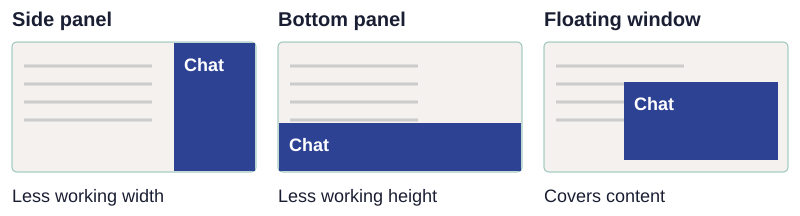
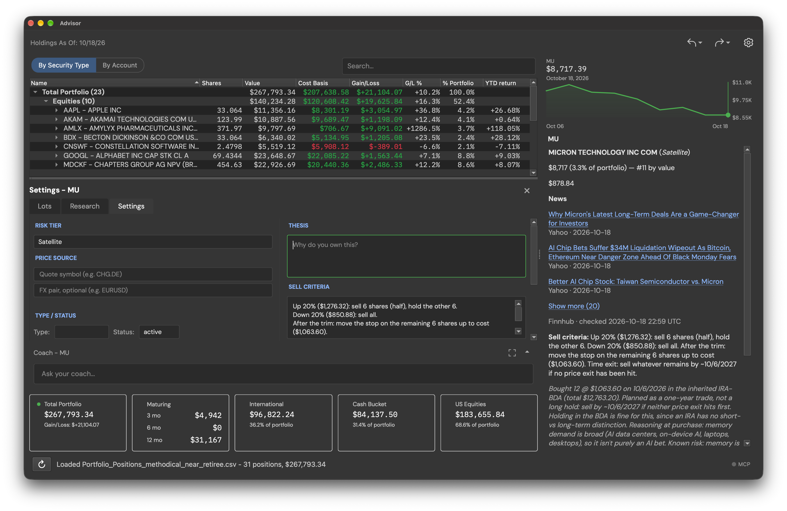
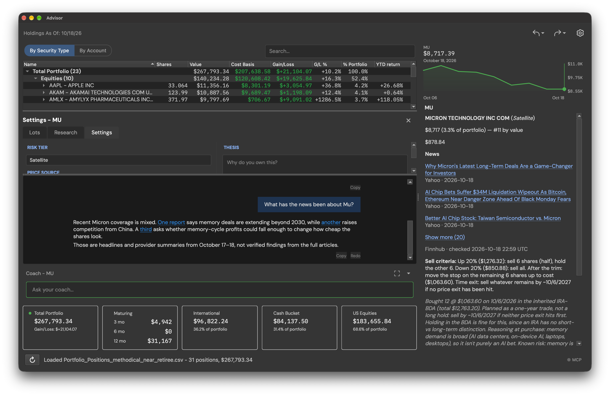
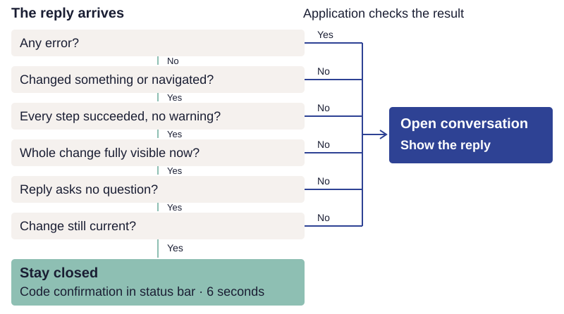

# Design the agent’s place in the UI

An embedded agent needs a place in the application. Familiar chat controls provide a useful
starting point, but placement, size, and behavior should support the work people are doing.
Sometimes the conversation is the work. Sometimes it should help people reach a screen and
then leave that screen available to them.

This section offers an initial set of design choices to try. The public guidance linked
below provides established patterns; the Advisor examples illustrate particular choices,
not evidence that one layout works best for every application.

## Choose where it belongs

Start with what people need to see while using the agent. A conversation beside a document,
list, or form can let them refer to both without switching views. A bottom panel preserves
horizontal space but reduces the height available for the task. A floating window takes
less permanent space, but can cover the content or controls people need.

The Todo sample uses a side panel. Advisor uses a bottom panel. Neither placement is a
requirement of the architecture. SAP's Joule guidance describes large, medium, and minimized
panels, and advises against a full-screen panel when people need to interact with content
outside the conversation. Choose the panel size around the work. [SAP: Joule panel](https://www.sap.com/design-system/fiori-design-android/v25-4/joule/components/joule-panel)

Try the layout on a normal laptop, with realistic content. Check whether opening the agent
hides a field, compresses a table, or forces people to scroll repeatedly between a request
and its answer. Let people resize or minimize the conversation without losing it.

## Give the conversation the space it needs

One option is to let the application adjust the conversation panel to the task, while
letting the person open or close it at any time. Advisor illustrates this approach: the
coach normally starts as a header and an input line, and the application decides whether
the result of a request needs more space. A fixed panel or a panel opened only by the
person may suit another application better.

“Can you take me to where I can edit the thesis for MU?” The application opens MU's
settings and focuses the thesis field. The conversation stays minimized, leaving room for
editing. The useful result is already on the screen.

*The editor is the result. The person can start typing without reading a chat response.*

“What has the news been about MU?” This request needs a written answer. The conversation
opens to show the summary and its source links, while the holding remains visible.

*The answer needs space, so the conversation opens. Both screenshots use disguised example
data; select either image to see it at full size.*

### How Advisor makes the choice

After the agent answers, Advisor checks whether the person can already see the result.
The panel stays closed only when the agent changed something or moved to a screen, every
step succeeded without an error or warning, the whole change is visible, the reply asks no
question, and no undo or later edit has replaced the change:

When these conditions hold, the application shows a confirmation in the status bar at the
bottom of the window for six seconds. Application code writes that confirmation, following
[the principle of displaying application-written text](tools.md#show-application-written-text).
Otherwise, it opens the conversation so the person can read the reply. An error always
opens it. Sending a message alone does not open the panel; the application waits for the result.
If the person has opened the conversation, it stays open after a successful change.

Each part of the screen declares which settings and values it currently shows. Application
code compares the change with those visible values. The agent's claim that something was
“saved” cannot keep the panel closed.

Advisor also opens the coach when a person has no saved settings and an AI provider is
configured, to make it discoverable. Returning to the portfolio—for example, selecting a
category, sorting the list, or closing a holding's detail view—closes the conversation.

These choices came from the author's judgment while using Advisor and have not yet been
tested with real users. The rule behind them is to keep the work visible when it shows the
result, and to open the conversation when there is something to read.

Keep expansion and minimization predictable. Give people a way to override the choice, and
keep their conversation available. Keep questions awaiting an answer, errors, and approvals
visible until the person deals with them. Microsoft's human–AI interaction guidelines recommend
making assistance easy to invoke and dismiss and timing it to the user's context.
[Microsoft: human-AI interaction guidelines](https://www.microsoft.com/en-us/research/project/guidelines-for-human-ai-interaction/)

## Offer relevant starting points

A blank input box can leave people unsure what to ask. Small clickable suggestions—often
called suggestion chips—can show useful requests for the current screen, selection, or
conversation. For example, a product page might offer “Check compatibility” or “Compare
with another product.” Only offer requests the agent can actually handle in that context.

Nielsen Norman Group recommends relevant prompt suggestions and describes examples that
change with the conversation. It also recommends making it clear that an assistant knows
what the person is looking at. [NN/g: AI chatbot design guidelines](https://www.nngroup.com/articles/ai-chatbots-design-guidelines/)

Decide what clicking a suggestion does. It might fill the input so the person can edit it,
submit a request immediately, or start an application action. These are different interactions.
SAP's prompt library fills the input for editing before sending; Google's conversation-design
guidance describes chips that submit a response. Make the behavior apparent, and keep any
required execution checks and approvals in place.
[SAP: Working with conversations](https://help.sap.com/docs/joule/joule-work-621104a90a01407fbb2d1613db39a54d/working-with-conversations),
[Google: Suggestion chips](https://developers.google.com/assistant/conversation-design/chips)

Suggestions can be prewritten and selected by application state, generated by a model, or
selected from an approved set with model assistance. Those are implementation options, not
requirements of the visual pattern. Start with the simplest approach that produces useful,
accurate suggestions. Model-generated suggestions still need to respect available
capabilities, the current context, and the user's permissions.

## Keep the application and conversation connected

Show the result where the person will use it. Navigation should reveal the destination;
an edit should appear in the application. Chat can confirm what happened, explain a limit,
or ask for missing information. It need not repeat everything already visible on the screen.

Make it clear which item or selection the agent is working with, especially after the person
navigates elsewhere. Advisor's panel header names its scope, such as "Coach - Total Portfolio"
or "Coach - MU", and each scope keeps its own conversation. Preserve manual controls so people can continue the task directly.
Evaluate the whole interaction: the screen, focus, scrolling, suggestions, and conversation,
as well as the words in the response.

!!! practice "Practice — sketch two interactions"
    Choose one request that should take the person to a control or complete a short action,
    and one that needs a conversation. Sketch what remains visible in each case, how much
    space the agent takes, and how the person can change that. Add one useful suggestion
    and state whether clicking it fills the input or submits the request.

These choices bring the design together: shared capabilities, appropriate authority, and an
interface that supports the person's work. Next, [run the sample](start.md) to see these
ideas in a working application.
