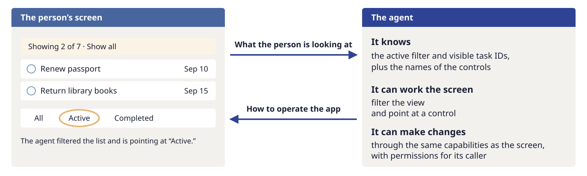

# Design the connection

Your application already provides **capabilities** through its UI and sometimes an API.
These are operations that have meaning in the application: adding an item, rescheduling
an appointment, or submitting an order. An embedded agent needs a way to use those same
capabilities, with the same implementation, validation, and data.

If you already separate UI event handlers from service or domain code, this extends a familiar
idea: an AI agent is another caller of that code. It accesses capabilities through **tools**,
each with a name, a description, and defined inputs. Tool calls still go through the
application’s validation and permission checks.

## Build the capability once

*The UI, API, and agent call the same application code for each operation. The application checks who is calling and enforces the permissions for that caller.*

For example, a person may place a trade directly through the application, while an agent
proposing the same trade must obtain the person’s approval through a dialog enforced by
application code. Both use the same trading operation; their permissions differ.

The UI and the agent’s tools translate user requests into calls to shared operations.
Because both use the same implementation, fixing an issue fixes it for both the UI and the agent.

If your application already has a service layer, the agent’s tools can call it. Otherwise,
start by moving the operations the agent needs out of UI event handlers and into code
that both can use.

Name tools for work people recognize. A tool per mouse click makes the agent reconstruct
the interface. A tool that changes any field can hide too much meaning. The useful boundary
is an operation with clear inputs, consequences, and a result the application can report.

## If you already have an API, are you done?

You may already have much of the foundation. An API (application programming interface) can expose shared operations, input
schemas, access checks and reliable results. Reuse those contracts and implementations;
a registry need not duplicate them or introduce another service.

What remains is to inspect whether that API provides the right operations and context for
an agent, with suitable caller policies. If it already does, a small adapter that maps tool calls to API operations may be enough.
An API contract can serve as the registry or supply much of it. The principle is a shared,
inspectable contract with enforced rules, not a requirement to adopt this sample's Python class.

### API calls and a person's job are not always the same thing

*CRUD APIs provide building blocks. Tools for the main user jobs help an agent recognize and complete those jobs.*

Many APIs provide **CRUD operations—create, read, update and delete—on records**. That is a
useful foundation. But the main jobs people come to do often involve several records and
operations. A helpful agent needs tools named and described in the language of those jobs,
with implementations that handle their business process.

For example, “Reschedule my appointment” may require checking availability, reserving a new
slot, releasing the old one, and notifying participants. A dedicated `reschedule_appointment`
operation can enforce the rules, coordinate those steps, and handle failures consistently.
If the agent has only the individual building blocks, it must determine the sequence and
handle partial completion each time someone asks.

The request may also express a constraint rather than an exact value: “Move my appointment
to later in the week.” The model can interpret that phrase as a date range, using the current
date and conversation context, and pass the range to a tool that supports finding suitable
times. Application code checks availability and preserves the appointment’s duration,
participants and other requirements. The tool can return valid alternatives; if a choice
remains and no user preference or application rule resolves it, the agent asks. The person
does not have to translate their request into individual record updates.

There are two benefits here. **The name and description help the agent recognize the job.**
**The implementation handles the recurring workflow**, so the agent does not have to
reconstruct it on every request. That implementation belongs in shared application code,
where the UI can use it too; it may coordinate API calls you already have.

Sometimes clearer names and descriptions are sufficient because an existing operation already
performs the whole job. Where the process spans several calls, a dedicated operation can make
its validation, side effects and recovery explicit. General tools remain useful for requests
you did not anticipate. Evaluate both kinds against the outcomes users need.

## If you do not have an API yet

You do not need to build an HTTP service just to connect an embedded agent. The todo sample
uses in-process Python calls. What matters is a boundary around the operation that both the
UI and agent can use.

Start with one job. Find its business logic and validation. If they live inside a screen's
click handler, extract them into a shared operation, preserving current behavior with tests.
Have the UI call that operation, declare its inputs and caller policy, then connect the agent.
Move permission checks with the operation so bypassing the screen cannot bypass a rule.

If you already have a service layer, start there. If the UI state is also scattered, give the
relevant screen a shared state representation so the agent can both observe and operate it.
A full application rewrite is not a prerequisite; a realistic estimate of the required work is.

## Balance general tools with tools for important jobs

General operations such as reading, adding and editing let an agent compose work you did not
anticipate. But a common job can require several calls, each another opportunity to select the
wrong item or stop halfway. A job-specific operation can own the validation, execution and
result for that whole unit of work.

Merging two tasks illustrates the tradeoff: rename one and request deletion of the other,
or offer a merge operation that expresses the job directly. A dedicated tool is not automatically
more reliable. Its value may be the place it provides for a useful guard or transactional rule.
Measure the outcome, including effects on other jobs. Keep one tool per meaningful job, not
one per way a person might phrase the request.

## Declare what the application can do

The **capability registry is a declarative structure**: a catalog of operations and their
contracts, connected to the code that implements them. “Declarative” means that each entry
states what an operation is, what it takes, and which rules apply. Shared code reads those
declarations to offer tools, validate requests, enforce caller policy and dispatch execution.

Without that structure, the tool list, permission checks, parameter definitions and descriptions
can become separate lists that become inconsistent. The registry gives them a common source and gives
a reviewer one place to inspect what the agent can do. Declarations can live beside their
implementations in different modules; central registration does not require all declarations to be in one source file.

These declarations have different consumers. The model gets the tool description and input
schema; it does not enforce the policy. The dispatcher checks authority. In this sample,
the agent adapter performs the declared freshness and semantic checks before dispatch.
The implementation owns domain validation and saved results. A declaration has an effect only
when code consumes and enforces it; writing a rule into metadata is not enough.

### Example: placing an order

*Example: a store where an agent must request approval before placing an order.*

In this example store, placing an order cannot be undone. A person can place it; an agent
can only propose it. The declaration connects `orders.place` to one implementation and
`propose` to the approval request. Its description and facts tell the model what the operation
means. The example assumes this particular store's policy; not every store has the same
cancellation or approval rules.

The sample also declares supported interfaces, fresh-read requirements, guard names and
a versioned descriptor. These specify where an operation is available, which checks the
agent must perform, and which contract an evaluation measured. The
[walkthrough](../guides/walkthrough.md#follow-a-declaration-through-the-registry) follows those fields in the actual code.

The sample validates declarations when registering them: an agent-allowed write must declare
recovery and meet its impact rule, and an approval policy must supply a proposal handler.
On each call, shared execution checks the actual caller again. Offering a tool is a discovery
decision, not authorization to execute it. Hiding a tool is not an enforcement mechanism.

The registry is also not an authentication system. In a deployed application, trusted adapters
must establish caller identity, and existing user and data-access permissions still apply.

## Keep three decisions distinct

| Decision | Owner | Example |
| --- | --- | --- |
| May this caller perform this operation? | Application code | An agent may propose deletion but may not approve its own request. |
| Does the proposed action fit what the person asked? | An evaluated intent guard | Has the person uniquely identified the task being changed? |
| Is the result good enough? | Tests, evals and human review | Did every requested change happen, and was the explanation accurate? |

A model-based guard can make mistakes. It supplements code-enforced authority; it cannot
replace it. The sample supports guards as a normal part of its design, with narrow questions
and explicit evidence.

## Match approval to consequences

A person may be permitted to place a trade through the UI while an agent can only propose
it for code-enforced approval. The shared capability still owns the operation.

**Todo deletion deliberately stands in for an irreversible action.** This teaches how to
handle consequential actions the application cannot undo, such as transferring money,
placing a trade, or deleting a repository. It is not included because the sample needs a
better Undo button. Ordinary todo deletion would rarely justify this gate; choose safeguards
for the consequences in your own product.

Reversibility is only one consideration. Also ask how much the change affects and whether
the person is likely to notice a mistake. A recoverable bulk change may still justify a preview
or approval: undo only helps after someone notices. Show the affected items or count and the
consequences. Choose this policy for the product rather than automatically gating every write.

Bind approval to the actual proposed details. A changed task must not silently inherit an
old approval. Keep caller identity outside the model's arguments. The walkthrough shows
both controls in working code.

## Know what the person sees, and be able to change the view

*Observation and control are separate needs. A filter changes the view without deleting hidden data.*

Give the agent current view state and the names of controls, alongside tools to point to or
operate them. In this sample that means a structured description of the active filter and
visible task IDs, not a screenshot or a claim to know every pixel in the viewport.
The UI and agent change the same view state through shared dispatch. A larger application
may need a state machine for navigation and multi-step interactions; this sample does not
pretend its small view object is one.

## Report facts from the application and plan for failure

Application code should report what actually changed. In the sample, code-written receipts
are delivered directly, followed by any additional model explanation. An eval checks the
receipts and judges the explanation separately; the model can still make a false claim.

Decide what happens if a batch fails, a save fails, or the provider stops after a successful
save. The sample demonstrates atomic local actions and recovery messages. It does not
provide durable operation IDs or safe replay of uncertain network writes. Those are explicit
limits to address when taking this design into a service.

!!! practice "Practice — trace the existing operation"
    For your chosen job, write down the screens or API calls involved today. Mark where
    validation, saving and permissions happen. Circle any sequence that must succeed as one
    operation. Use that sketch to decide what the UI and agent should share and what each
    caller may do differently. You do not need to write a registry yet.

Continue with [understanding and completing the request](requests.md), or [run the sample](start.md) to see these boundaries in code.
