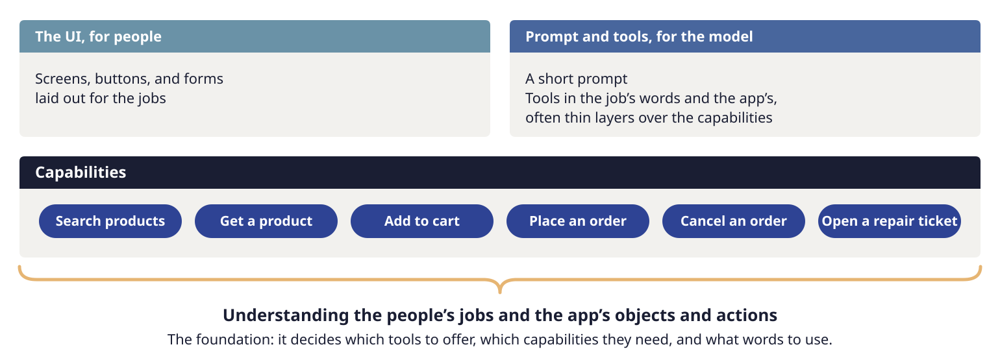
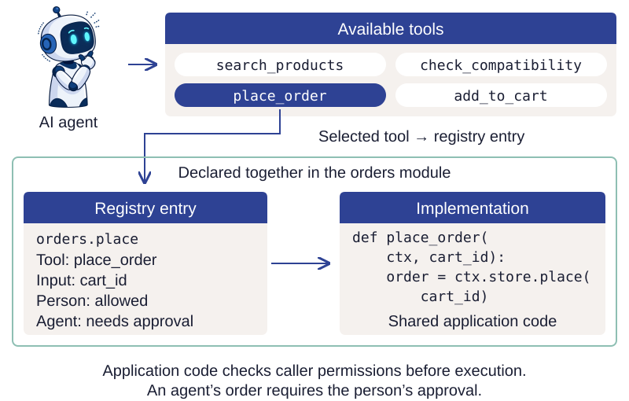
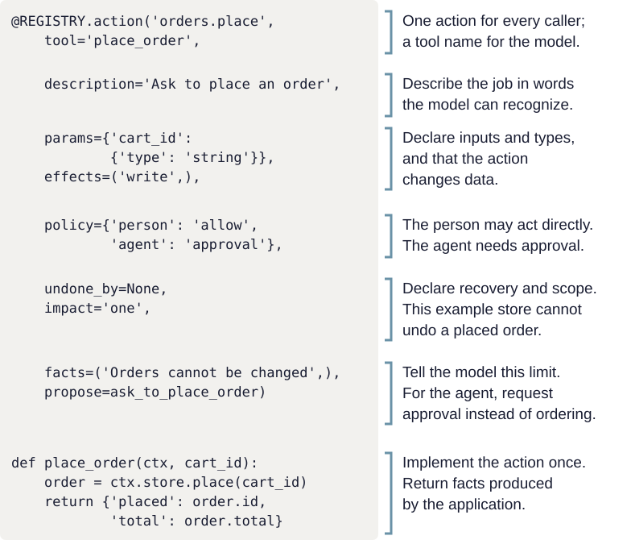
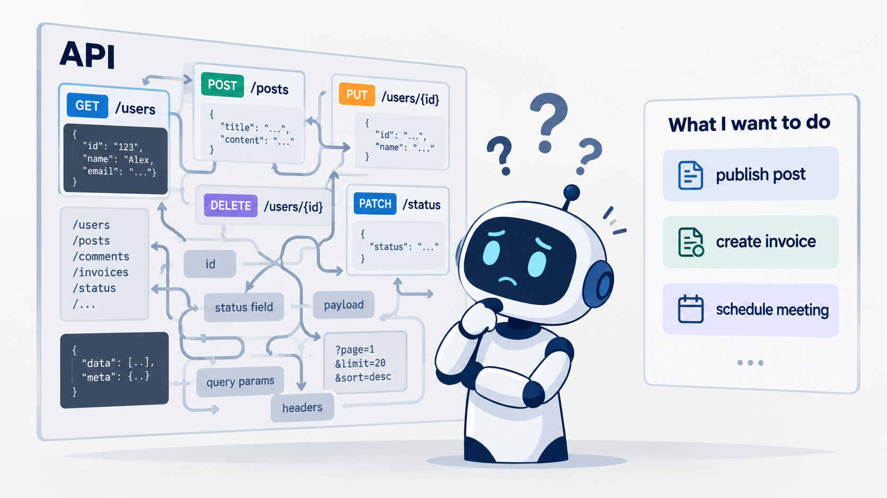

# Shared capabilities and the registry

Your application already provides capabilities through its UI and sometimes an API.
These are operations that have meaning in the application: adding an item, rescheduling
an appointment, or submitting an order. An embedded agent needs a way to use those same
capabilities, with the same implementation, validation, and data.

If you already separate UI event handlers from service or domain code, this extends a familiar
idea: an AI agent is another caller of that code. It accesses capabilities through tools,
each with a name, a description, and defined inputs. Tool calls still go through the
application's validation and permission checks.

## Build the capability once

*The UI, API, and agent tools connect to shared capabilities, with permissions for each caller.*

For example, a person may place a trade directly through the application, while an agent
proposing the same trade must obtain the person's approval through a dialog enforced by
application code. Both use the same trading operation; their permissions differ.

The UI and the agent's tools translate user requests into calls to shared operations.
Because both use the same implementation, fixing an issue fixes it for both the UI and the agent.

If your application already has a service layer, keep using it. If operations currently live
inside UI event handlers, move them into code that both the UI and agent can use. The UI
and agent also need one shared description of what each operation does and how to use it.

## Describe each capability in one place

When a person completes a purchase through the UI, the UI calls the application's
order-placement capability with their cart. An agent can reach that same capability through
a tool. The tool's name, description, and inputs tell the model how to request the operation.
In the store illustrated below, application code allows a person to place an order directly
but requires approval for an agent's request. The tool description also tells the model that
placed orders cannot be changed or undone.

These details must agree wherever they are used. If the tool description promises that an
order can be changed but the implementation cannot change it, the agent may mislead the
person. If permissions are checked only in a screen's event handler, another caller may
bypass them. Separate descriptions and checks make those inconsistencies harder to find.

A capability registry brings each operation's description, inputs, rules, and implementation
together. Code reads these declarations to build tool definitions and check requests before
calling the implementation. The declarations can live beside the implementations in separate
modules. The registry collects them into one set that application code can read.

*The agent selects place_order from the available tools. Its declaration and implementation
live together in the orders module.*

The model receives tool
descriptions and input schemas. When a call arrives, application code checks the caller's
permissions, validates the inputs, and performs the operation or requests approval. In the
Todo sample, code also checks that the agent has read the latest application data through
a tool before acting. It invokes declared intent guards: model-based checks that a proposed
action fits what the person asked. Each rule in the registry needs code that applies it.
[Authority and recovery](authority.md#check-intent-with-declared-guards) explains how guards
work alongside permission checks.

### Example: placing an order

*Example: a store where an agent must request approval before placing an order.*

In this example store, placing an order cannot be undone. A person can place it; an agent
can only propose it. The declaration connects `orders.place` to one implementation and
`propose` to the approval request. Its description and facts tell the model what the operation
means. Set the cancellation and approval rules to match your store's policy.

The Todo sample includes declarations beyond those shown here: which interfaces can use an
operation, whether the agent must read current data first, which guards to invoke, and a
version identifying the declaration used during an evaluation. The
[walkthrough](../guides/walkthrough.md#follow-a-declaration-through-the-registry) follows those fields in the actual code.

The Todo sample also checks the declarations when they are registered. For example, an
operation requiring approval must provide code to create the approval request. An operation
that an agent may execute directly must meet the sample's recovery and impact requirements.
Application code checks permissions on every call, including calls made directly by name.
In a deployed application, trusted code establishes the caller's identity before passing
the request to the shared operation, which applies existing user and data-access permissions.

### Use declarations beyond tool calls

A registry can describe more than tool inputs and permissions. The same declarations can
support tools for external agents through Model Context Protocol (MCP), command-line
interfaces, navigation, input corrections, checks on proposed actions and responses, and
onboarding. Each declaration serves a specific part of the application; code reads it to
produce the corresponding behavior.

The appendix, [How to build and extend your registry](../reference/capability-declarations.md),
shows what to declare, which code uses it, and what that enables. It includes worked examples
and checks you can use when designing your own registry. Start with the declarations your
application will use, and add others as the need arises.

## Build on an existing API

An API (application programming interface) can expose shared operations, input schemas,
access checks and reliable results. Reuse those definitions and implementations when
building the registry.

What remains is to inspect whether that API provides the right operations and context for
an agent, with suitable caller policies. If it already does, a small adapter that maps tool calls to API operations may be enough.
An API definition can serve as the registry or supply much of it if code can read the
definition and enforce its rules. The sample's Python class is one way to express that information.

### Connect API operations to a person's job

*CRUD APIs provide building blocks. Tools for the main user jobs help an agent recognize and complete those jobs.*

Many APIs provide CRUD operations—create, read, update and delete—on records. That is a
useful foundation. The main jobs people come to do often involve several records and
operations. A helpful agent needs tools named and described in the language of those jobs,
with implementations that handle their business process.

For example, "Reschedule my appointment" may require checking availability, reserving a new
slot, releasing the old one, and notifying participants. A dedicated `reschedule_appointment`
operation can enforce the rules, coordinate those steps, and handle failures consistently.
If the agent has only the individual building blocks, it must determine the sequence and
handle partial completion each time someone asks.

The request may also express a constraint rather than an exact value: "Move my appointment
to later in the week." The model can interpret that phrase as a date range, using the current
date and conversation context, and pass the range to a tool that supports finding suitable
times. Application code checks availability and preserves the appointment's duration,
participants and other requirements. The tool can return valid alternatives; if a choice
remains and no user preference or application rule resolves it, the agent asks. The person can ask in familiar terms while application code handles the record updates.

The name and description help the agent recognize the job. The implementation handles
the recurring workflow consistently across requests. That implementation belongs in shared application code,
where the UI can use it too; it may coordinate API calls you already have.

Sometimes clearer names and descriptions are sufficient because an existing operation already
performs the whole job. Where the process spans several calls, a dedicated operation can make
its validation, side effects and recovery explicit. General tools remain useful for requests
you did not anticipate. Evaluate both kinds against the outcomes users need.

## Start with shared operations

An embedded agent can call application code directly, as the Todo sample does with
in-process Python calls. Give each operation a clear boundary that both the UI and agent
can use.

Start with one job. Find its business logic and validation. If they live inside a screen's
click handler, extract them into a shared operation, preserving current behavior with tests.
Have the UI call that operation, declare its inputs and caller policy, then connect the agent.
Move permission checks with the operation so they apply to every caller.

If you already have a service layer, start there. If the UI state is also scattered, give the
relevant screen a shared state representation so the agent can both observe and operate it.
Move the needed operations incrementally, estimating the work for each.

## Balance general tools with tools for important jobs

General operations such as reading, adding and editing let an agent compose work you did not
anticipate. A common job can require several calls, each another opportunity to select the
wrong item or stop halfway. A job-specific operation can own the validation, execution and
result for that whole unit of work.

Merging two tasks illustrates the tradeoff: rename one and request deletion of the other,
or offer a merge operation that expresses the job directly. A dedicated operation can check
that the selected tasks match the request and ensure the whole merge succeeds or leaves
both tasks unchanged. Evaluate whether those checks improve reliability, including effects
on other jobs. Add one tool per job; different phrasings of the same request should reach
the same tool.

## Keep three decisions distinct

| Decision | Owner | Example |
| --- | --- | --- |
| May this caller perform this operation? | Application code | An agent may propose deletion but may not approve its own request. |
| Does the proposed action fit what the person asked? | An evaluated intent guard | Has the person uniquely identified the task being changed? |
| Is the result good enough? | Tests, evals and human review | Did every requested change happen, and was the explanation accurate? |

Application code enforces authority, while a model-based guard checks the interpretation
of the request. Evaluate the guard's mistakes as well as its successes. The sample gives
each guard a narrow question and explicit evidence.

## Match approval to consequences

Declare approval requirements on each capability and enforce them in the shared code.
Choose them according to the scope of the change, how readily a person would notice a
mistake, and how it can be recovered. [Authority and recovery](authority.md#enforce-policy-and-approval)
explains how to choose safeguards and bind approval to the exact proposed change.

## Share screen state and actions

When a job involves navigation or screen controls, give the agent current view state and
named actions that use the same code as the UI. [Interfaces and views](interfaces.md#observe-and-operate-the-screen)
shows how observation and control connect to shared application state.

## Report facts from the application and plan for failure

Have each capability return what actually happened, including any partial or uncertain
outcome. [Tools and current evidence](tools.md#return-facts-and-structured-decisions) explains
how code-written confirmations reach the person, while
[Authority and recovery](authority.md#protect-data-and-handle-interrupted-work) covers
interrupted saves and safe retries, including the limits of this local sample.

!!! practice "Practice — trace the existing operation"
    For your chosen job, write down the screens or API calls involved today. Mark where
    validation, saving and permissions happen. Circle any sequence that must succeed as one
    operation. Use that sketch to decide what the UI and agent should share and what each
    caller may do differently. This sketch is the starting point for your registry.

Continue with [understanding and completing the request](requests.md), or [run the sample](start.md) to see these boundaries in code.
