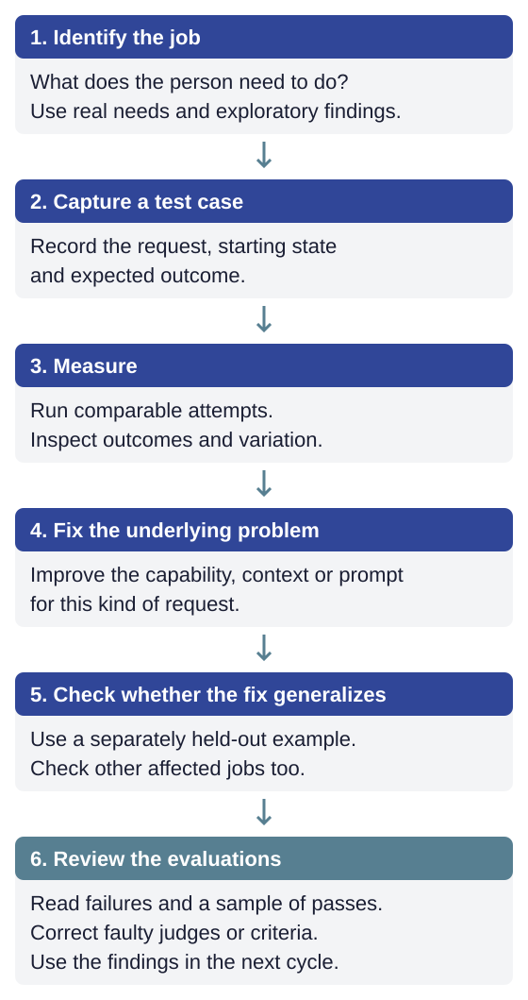

# Evaluate outcomes

How do you know the agent helps users—and keeps working as you change it?
An **evaluation**, often called an **eval**, checks how the agent handles a user request
from a defined starting situation. It checks both the response and the changes made
against criteria for success.

A tool can execute correctly while changing the wrong task. A fluent answer can omit half the request. Evaluate the person's request, the actions, the saved result and the delivered answer together.

Use three kinds of evidence:

- Deterministic tests: code checks of application rules, with the same expected result each time.
- Scripted conversations: repeated measurements of known jobs.
- Human or persona exploration: testing situations you have not anticipated.

Keep their results separate. Persona satisfaction and reviewer opinions help identify what
to investigate; they are not pass/fail verdicts from the fixed evaluation suite.

If you already write software tests, retain them. Code can establish that an operation
validates and saves correctly. An **evaluation case** adds a starting situation, a user request
and criteria for the whole interaction. Repeating it measures how reliably the model chooses
and explains the right work. A **judge** is a model used to assess language against those
criteria; it is part of the measuring system and also needs checking.

This chapter covers the essentials. Two reference pages hold the detailed method:
[Judges, test cases and experiments](../guides/evaluation-method.md) and
[Review results and understand variation](../guides/evaluation-results.md).

## Define success before judging it

Check every part of the request, what must remain unchanged, and what the person needs to know. Record whether the user had to correct a mistake even if the final state is right. A necessary question about an ambiguous request is not such a correction.

Fail responses for meaningful problems: incorrect claims, unauthorized changes, omitted work or misleading next steps. Do not fail a reasonable answer merely because it differs from preferred wording. When reasonable people disagree, show the exact request, starting state, action and answer; resolve the criterion before tuning a model to satisfy it.

Use code for saved state, identifiers, arithmetic, permissions and delivery of application-written receipts. Use model judges for judgments that require interpreting language. Do not ask a judge whether the agent copied text that application code should have delivered directly.

!!! practice "Practice — judge the whole request"
    A person says, "Show overdue tasks first, and remove the completed ones." The app shows
    all active tasks without distinguishing overdue ones and creates deletion proposals for
    completed tasks. The reply says the deletions await approval.

    Write a verdict for each part: overdue priority, completed-task removal, and accurate
    reporting. What evidence would you inspect before giving an overall verdict?

The deletion may correctly remain pending under the application's approval policy, and its
report may be accurate. Showing all active tasks has not addressed "overdue first." Inspect
the actual view, which tasks were proposed for deletion, and the policy before grading the
whole response. A correct statement about one part cannot make the other part complete.

## Decide which failures to prevent before showing a reply

Some failures must never reach the user, such as an answer that breaks a policy or reports a change that did not happen; stop those in the application before the answer is shown. The checks that stop them can miss a failure or stop a good answer, so measure them like any other check. Others are matters of quality or style, such as an answer that is longer than it needs to be. Measure those in evaluation. Do not rewrite answers in production each time one falls short.

## How to judge

**Code runs the conversation and collects the evidence.** It records the state before and
after, the tool calls, and which text the application wrote. Code checks run first. Judges
then read the model's answer alongside that evidence. Label application-written text so
judges can distinguish it from the model's answer.

**Check a judge against people before relying on it.** Compare its verdicts with examples
that people have marked acceptable and unacceptable, and inspect both false failures and
missed failures. [Choose and check the judges](../guides/evaluation-method.md#choose-and-check-the-judges)
covers that comparison, repeated judgments, and the choice of judge model.

**Missing judgment is missing evidence.** Record an unreadable or unavailable verdict as ungraded. An attempt cannot pass until all required checks are complete. A known failure remains a failure even if another check is missing. Show graded, failed and incomplete counts with each score; missing evidence must not improve the apparent pass rate. Mark a release decision inconclusive when required evidence is absent. A required runtime guard that cannot answer must not let the protected change proceed.

**Judges follow the same data rules as the agent.** Anything that reads a user's conversation must run on a provider the organization has approved to process that data, and prohibited data is removed before it reaches a judge.

## How to read the results

Read the recorded request, actions, and outcome before interpreting summary scores. Repeated
runs help distinguish ordinary variation from a change in behavior. Different failures have different consequences: an unauthorized action should not be averaged together with a minor issue in wording when deciding whether to release.

**Distinguish a defect from a change in the measured rate.** Investigate deterministic failures and serious individual incidents directly. For a stable set of evaluations whose results can vary between attempts, small differences between runs can be ordinary variation. [Review results and understand variation](../guides/evaluation-results.md) explains how repeated runs, a reviewed baseline and a control chart separate ordinary variation from a change that needs investigation.

**A perfect score on a few attempts is weak evidence.** Many fixes are assessed with only
5 or 10 attempts at one case. A Wilson confidence interval estimates the uncertainty in a
measured pass rate. At 95% confidence, its lower bound is about 57% for 5 passes out of 5,
and about 72% for 10 out of 10. Those perfect observed scores still leave considerable
uncertainty. Treat a small before-and-after comparison as an initial indication. Confirm
the fix with more attempts or with held-out requests: cases not used to develop it.

**Start every attempt from the same saved state**, so one attempt cannot change what the next one finds.

**Report whether every attempt succeeds, where consistency matters.** A pass rate says how often one attempt succeeds. A user who does the same job every week cares whether it works every time. [pass^k](../guides/evaluation-method.md#report-consistency-and-find-the-cause-of-variation) measures whether all k attempts at the same job succeed; report it beside the pass rate for those jobs.

**Decide before the run what would block a release.** Before running the suite for a release, write down who decides, which failures block the release (such as an answer that reports a save that did not happen), what failure rate is accepted for the rest, and what makes a run inconclusive, such as too many ungraded judgments or a required check that did not run. Report cost and time for each completed job as well as for each model call: an agent that needs many calls to finish a job costs more than its cost per call suggests.

**Read a sample of failed and successful cases.** Failures get read because someone has to fix them, but a passing case can hide a problem too: a check that is too lenient, or an answer that is right for the wrong reason. Read a sample of both. Inspect the exact model request as well as the answer: stale state, conflicting instructions and grader criteria that repeat a test answer can otherwise remain hidden.

**Make each conversation easy for a reviewer to read.** If you use a tool to record conversations between people and the agent, make sure each record carries the context a reviewer needs. The most important piece is the state after each turn: the list, the record, or the plan as the user saw it. Then the conversation reads in order: what was said, what the agent did, and what changed. Without it, a reviewer has to mentally reconstruct what the application looked like at each point. When the state is recorded, reviewers often notice that a change nobody asked for came from the turn before.

## Check that a fix generalizes

Create a separate case for the same job with different data and wording. Keep it out of the development session, and run it after development of the fix is complete. Keep its contents and detailed results outside the development process. Once that evidence is used to diagnose or improve the system, move it into the visible set and replace it with a fresh held-out case. Running a held-out case without reading its contents or results does not use it up. Review tool descriptions for phrases copied from failing examples; the tool should describe a class of jobs.

A useful report lets a reviewer move from a run's totals to the request, the state after each turn, the tool results and the grader's reason. Neither a large score table nor a trace without application state supplies that context.

## Detailed method

These sections are reference reading:

- 
  [How to keep test cases valid and independent](../guides/evaluation-method.md#how-to-keep-test-cases-valid-and-independent):
  test one hypothesis at a time, inject tool failures, retire a wrong case under a new
  name, and use real conversations only with the organization's approval.
- 
  [Where evaluations live and who reads the results](../guides/evaluation-method.md#where-evaluations-live-and-who-reads-the-results):
  keep cases, graders and judges in the repository, and send copies to a tracing tool.
- 
  [Let a coding agent run budgeted experiments](../guides/evaluation-method.md#let-a-coding-agent-run-budgeted-experiments):
  give it a scope and an evaluation budget, and keep the evaluation procedure fixed.
- 
  [Reassess added mechanisms after substantial model changes](../guides/evaluation-method.md#reassess-added-mechanisms-after-substantial-model-changes):
  disable one prompt rule, context step or model check and compare the same cases.
- 
  [Everyday checks are not a new baseline](../guides/evaluation-results.md#everyday-checks-are-not-a-new-baseline):
  which tests and evaluations to run for each kind of change.

Next, [apply the approach to your application](apply.md).
[Optional tracing](../guides/langfuse.md) supplements the local reports; it does not own the cases or grading rules.
