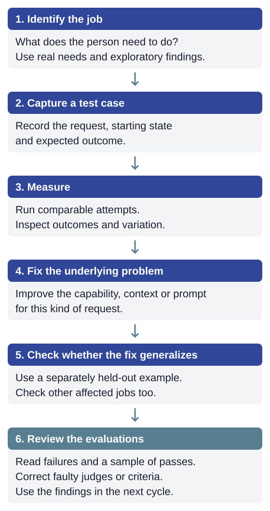

# Evaluate the user's outcome

A tool can execute correctly while changing the wrong task. A fluent answer can omit half the request. Evaluate the person's request, the actions, the saved result and the delivered answer together.

Use three kinds of evidence: deterministic tests for application rules, scripted conversations for repeated measurements of known jobs, and human or persona exploration for situations you have not anticipated. Keep their results distinguishable. Persona satisfaction and reviewer opinions are useful signals for investigation, not fixed-suite pass/fail verdicts.

## Define success before judging it

Check every part of the request, what must remain unchanged, and what the person needs to know. Record whether the user had to correct a mistake even if the final state is right. A necessary question about an ambiguous request is not such a correction.

Fail responses for meaningful problems: incorrect claims, unauthorized changes, omitted work or misleading next steps. Do not fail a reasonable answer merely because it differs from preferred wording. When reasonable people disagree, show the exact request, starting state, action and answer; resolve the criterion before tuning a model to satisfy it.

Use code for saved state, identifiers, arithmetic, permissions and delivery of application-written receipts. Use model judges for judgments that require interpreting language. Do not ask a judge whether the agent copied text that application code should have delivered directly.

## Calibrate the judges

A narrow judge can check one failure type, such as claiming a save that did not happen. A broader outcome judgment can find omissions the narrow checks do not cover. Choose the combination by measuring it; require each verdict to identify evidence.

Compare verdicts with human-reviewed labels on both acceptable and unacceptable answers. State how labels were produced: a person labeling every case is different from a person reviewing a sample of model labels. Inspect both false failures and missed failures. Reserve separate examples for evaluating a changed judge so that calibration does not become memorization.

## What to evaluate

**Block serious failures before the user sees them; measure the rest.** Some failures must never reach the user, such as an answer that breaks a policy or reports a change that did not happen; stop those in the application before the answer is shown. The checks that stop them can miss a failure or stop a good answer, so measure them like any other check. Others are matters of quality or style, such as an answer that is longer than it needs to be. Measure those in evaluation. Do not rewrite answers in production each time one falls short.

## How to judge

**Code runs the conversation and collects the evidence.** It records the state before and after, the tool calls, and which text the application wrote. Code checks run first; judges then read what the model wrote, with that evidence beside it, and text the application wrote is marked so they can tell the difference.

**Grade quality against the user's goal.** When a judge grades quality, it looks at relevance, specificity, permitted next steps, tone, and coherence against what the user wanted and knew. Require examples and reasons, so a person reading a score can find the turn in the conversation that caused it.

**Code combines the verdicts.** Code merges every verdict into one report and writes any feedback to the agent from a template, so the feedback the agent receives is fixed text that people have read and tested, rather than wording a judge chose. A wrong verdict can still choose the wrong template, which is one reason the judges themselves are checked against people.

**Ask a judge more than once only when its mistakes vary.** Asking the same judge several times and taking the majority answer reduces mistakes that change from one asking to the next. It does not fix mistakes the judge makes every time; in studies of models answering questions, more votes made hard questions worse, because the wrong answer became more consistent. [27](https://arxiv.org/abs/2403.02419) So ask a judge several times and take the majority answer only when checking it against people shows its mistakes vary between askings.

**Reduce repeated mistakes by changing the judge or its input.** Judges that compare two answers tend to favor whichever is shown first; for those, ask twice with the order swapped. [11](https://arxiv.org/abs/2306.05685) For other repeated mistakes, judges from different model families help, [28](https://arxiv.org/abs/2404.18796) though different models often share mistakes, including when they act as judges, [29](https://arxiv.org/abs/2506.07962) so checking judges against people is still needed.

**Measure before choosing a judge model.** Compare candidates against human-reviewed examples, including good answers that should pass and bad answers that should fail. A larger or newer model is not automatically a better judge. Include cost, latency, unavailable responses and disagreement patterns in the comparison.

**Missing judgment is missing evidence.** Record an unreadable or unavailable verdict as ungraded. An attempt cannot pass until all required checks are complete. A known failure remains a failure even if another check is missing. Show graded, failed and incomplete counts with each score; missing evidence must not improve the apparent pass rate. Mark a release decision inconclusive when required evidence is absent. A required runtime guard that cannot answer must not let the protected change proceed.

**Simulated users and reviewers do not grade.** Simulated users produce conversations no one scripted, and an independent reviewer on a different model gives a person a second opinion while reading a conversation. Neither produces a pass or a fail.

**Judges follow the same data rules as the agent.** Anything that reads a user's conversation must run on a provider the organization has approved to process that data, and prohibited data is removed before it reaches a judge.

## How to read the results

**Distinguish a defect from a change in the measured rate.** Investigate deterministic failures and serious individual incidents directly. For a stable set of stochastic evaluations, small differences between runs can be ordinary variation. Use control-chart signals to investigate changes in that process; a stable rate can still be unacceptable. Define and freeze a baseline after reviewing it, and mark changed models, tools, cases or graders as new comparison periods. See [evidence and variation](../guides/evaluation-results.md) for the chart, limits and practical testing cadence.

**A perfect score on a few attempts is weak evidence.** Most fix decisions are made on one case at 5 or 10 attempts. By the Wilson interval, a standard way to put a range around a pass rate measured on few attempts, at 95% confidence, 5 of 5 is still consistent with a true pass rate as low as about 57%, and 10 of 10 with one as low as about 72%. Treat one case's before and after as a direction, and confirm a fix with more attempts or with held-out requests not used to develop it.

**Report whether every attempt succeeds, where consistency matters.** A pass rate says how often one attempt succeeds. But a user who does the same job every week cares whether it works every time. pass^k measures that: whether all k attempts at the same job succeed. [10](https://arxiv.org/abs/2406.12045) [21](https://www.anthropic.com/engineering/demystifying-evals-for-ai-agents) For jobs where consistency matters, report it beside the pass rate, and say what k was. To calculate it, make n attempts at each job, k or more, and count the c that succeed; for that job, pass^k is the number of ways to choose k attempts from the c successes divided by the number of ways to choose k from all n, and the suite's pass^k is the average over its jobs. Start every attempt from the same saved state, so one attempt cannot change what the next one finds.

**When the noise itself is the problem, fix its source.** Sometimes the variation is the problem: a test case that passes about half the time, or an answer that is difficult to classify under the grading rule. More runs will not settle this. Find where the variation comes from before changing anything: the application may be unreliable at this job, the test environment may differ between runs, or the grader may disagree with itself. Fix the application when it is the source, and change the test case or the rule only when they are.

**Decide before the run what would block a release.** Before running the suite for a release, write down who decides, which failures block the release (such as an answer that reports a save that did not happen), what failure rate is accepted for the rest, and what makes a run inconclusive, such as too many ungraded judgments or a required check that did not run. Report cost and time for each completed job as well as for each model call: an agent that needs many calls to finish a job costs more than its cost per call suggests.

**Keep a record behind each reported improvement.** When a report says a change helped, link the claim to a short record of the experiment: what changed, the versions of the model and the application, which cases were run and how many attempts each, the grading criteria, the result, and what the experiment could not show. Without the record, nobody can check the claim later, including the people who made it.

## How to keep test cases valid and independent

**Test one hypothesis at a time.** Treat each change as an experiment. State the hypothesis first: "Rewording the move tool will stop the agent from choosing the wrong position." Change only that, and keep everything else the same: the model, the starting data, the other tools, and the grading rules. Record what each run actually used, including the model that served each call and the application's version, so you can tell later whether anything else changed. Save each failure, not just the totals, so you can see which conversations improved or became worse. [10](https://arxiv.org/abs/2406.12045)

**Run the suite with failures injected.** Real tools fail: a read errors, a save fails, a call times out. Run all the test cases with failures like these injected on purpose, and compare the result with a normal run. The agent should report each failure truthfully and recover where it can. In one published benchmark of 14 models, injected failures barely changed how often an agent succeeded at least once in three attempts, but cut how often it succeeded all three times by up to 24 percentage points. [22](https://arxiv.org/abs/2604.06132)

**Retire test cases; never edit them.** Sometimes a test case turns out to be wrong: its expected answer was a mistake, or its script makes no sense. Do not fix it in place, because then earlier runs measured something different from later ones, and nobody can tell. Move it to a retired list with the reason, and add a corrected case under a new name.

**Use real conversations only after the organization has approved it.** Many companies record and analyze customer phone calls and learn a lot from them. They can do this because legal, risk, and compliance teams have decided how the recordings are captured, stored, and used, and who can see them, and because callers are told. Grading real users' conversations with an agent needs the same decisions, and users should get an explicit choice to opt in. Until those decisions are made, use only test data and synthetic conversations from simulated users. The cost is that a failure in real use reaches the team only when someone reports it or a simulated user happens to find it.

## Where evaluations live and who reads the results

**Keep evaluations in the repository and make their evidence inspectable.** A local report or an optional tracing tool such as Langfuse is a place to read what happened in a conversation and to compare runs. It is also a shared place where developers and their coding agents can inspect the same evidence: a person clicks through a conversation, an agent reads it through the tool's API, and either can point the other to the turn that matters. Keep the test cases, the graders, and the judges in the repository, and send copies to the tool rather than editing them there. Then if the tool went away, the next run would still execute and grade, and you would lose only its screens. Moving to a different tool then means changing the code that sends records to it, not rewriting the evaluations. Tools in this field change quickly, and the evaluations should keep working when one is replaced.

**Read a sample of failed and successful cases.** Failures get read because someone has to fix them, but a passing case can hide a problem too: a check that is too lenient, or an answer that is right for the wrong reason. Read a sample of both. Inspect the exact model request as well as the answer: stale state, conflicting instructions and grader criteria that repeat a test answer can otherwise remain hidden.

**Make each conversation easy for a reviewer to read.** If you use a tool to record conversations between people and the agent, make sure each record carries the context a reviewer needs. The most important piece is the state after each turn: the list, the record, or the plan as the user saw it. Then the conversation reads in order: what was said, what the agent did, and what changed. Without it, a reviewer has to work out in their head what the application looked like at each point. When the state is recorded, reviewers often notice that a change nobody asked for came from the turn before.

**Let a development agent run the experiments.** Evaluation exists to improve the model, the tools, the prompts, and the judges until the results are good enough. People and models both suggest good improvements. Testing each one, one hypothesis at a time, is work a development agent does well and quickly; set an explicit budget for the work. The person sets the direction, makes each decision when there is a choice between approaches, and reads the conversations; the agent runs the experiments. If the agent fixing a problem also writes the held-out cases, they are no longer unseen, so have a separate session write them.

## Check that a fix generalizes

Create a separate case for the same job with different data and wording. Keep it out of the development session, and run it after the fix is frozen. Once its results have informed changes, it is no longer unseen evidence: move it into the visible set and replace it with a fresh held-out case. Review tool descriptions for phrases copied from failing examples; the tool should describe a class of jobs.

Read failed cases and sample passing ones. A useful report lets a reviewer move from a run's totals to the request, the state after each turn, the tool results and the grader's reason. Neither a large score table nor a trace without application state supplies that context.

Next, [run the evaluations and read evidence and variation](../guides/evaluation-results.md). [Optional tracing](../guides/langfuse.md) supplements the local reports; it does not own the cases or grading rules.
