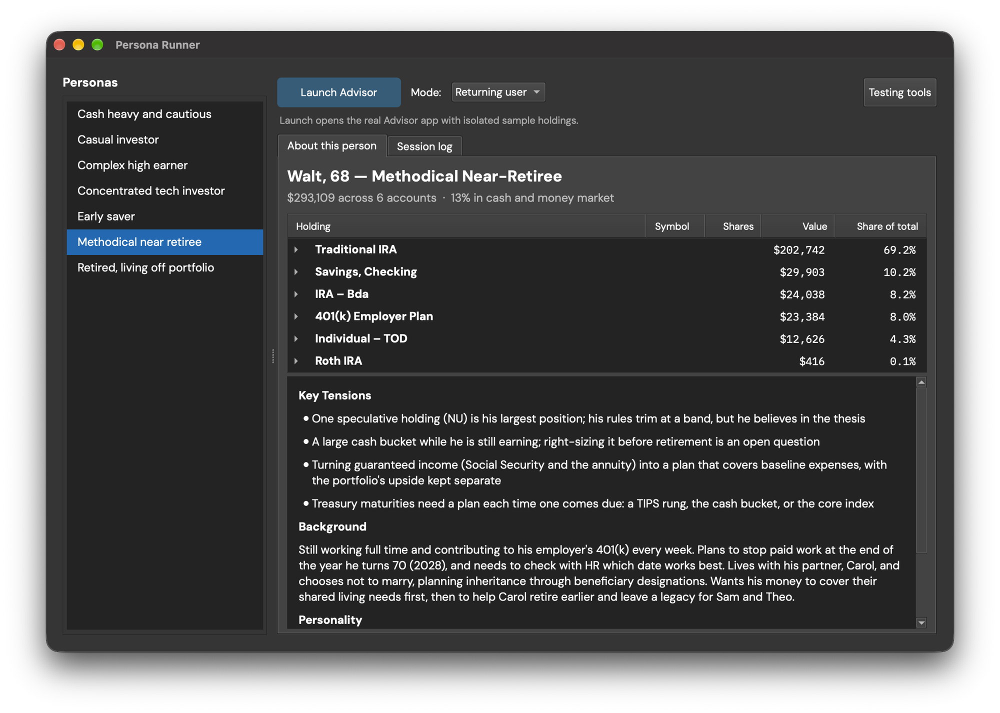
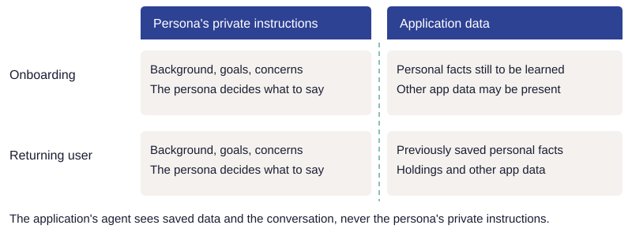
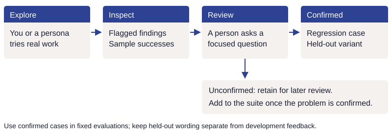

# Explore the experience

Fixed cases tell you about questions you already thought to ask. Exploration finds questions
you missed. Start by using the application yourself: combine requests, change your mind,
refer to todos indirectly, and compare the explanation with the screen and saved state.

## Start with exploratory testing

[](../images/exploratory-tester.png)

The exploratory tester gives you a separate test list. Use it to test the interaction without
changing your own list.

!!! practice "Practice — explore beyond the expected path"
    On a separate test list, write one request containing two operations. Follow it with a
    correction, then ask how to do something without asking the agent to do it. Record
    the request, what changed, and what surprised you. Choose one observation to investigate;
    an unexpected response is not automatically a defect.

## Broaden the exploration with personas

Human testers may have difficulty thinking of new scenarios or may repeat familiar ones. A persona is another
model playing a person with a situation and goals. Sam demonstrates automated exploratory
testing, not a claim that people need an agent to manage a simple todo list.

[](../images/persona-sam.png)

Set `EVALBASICS_PERSONA_PLAYER=true` in `.env` to show the visible player without enabling
trace export; `.env.example` already sets it. The player appears when a model key is configured.
It lets you watch a persona interact with the actual screen. Pick a persona, then use "Next"
or "Play" to watch. Each persona
uses a separate test list; pick None to return to your own list. The command-line runner uses the same persona prompts,
screen description, and approval actions, with a separate test list for each session:

```bash
.venv/bin/python -m evaluations.personas --persona sam --turns 8 --max-tokens 50000
.venv/bin/python -m evaluations.personas --replay runs/personas/RECORD.json
```

The first command makes paid calls for the persona, application agent, and a judge that
checks whether the assistant's claims match what actually changed.
It saves JSON checkpoints throughout the conversation and creates a standalone HTML review
beside the record. The second command regenerates that review without making model calls.
Use Previous/Next to inspect the recorded conversation, approval clicks, and state changes.
It does not rerun actions or reproduce the visual interface.

`--max-tokens` is shared across all selected personas and all three model roles.
See [model costs and allowances](../guides/models.md#try-a-replacement-and-measure-it)
for how this limit works. Choose a small turn limit for an initial exploration.
Ctrl-C retains the latest checkpoint. A record left with status `running` after a forceful
termination is incomplete, not a successful session.

Langfuse is optional. Headless runs export traces only with `--trace` and your own project
keys; local records and the HTML review work without it.

The review page flags the persona's frustration and reason, claims of changes that did not
happen, and turns without a usable judgment. These are candidates for human review. Follow
[the review process below](#review-findings-and-create-test-cases) before treating one as a
regression. Keep exploratory sessions separate from the
[fixed suite's run-to-run results](../guides/evaluation-results.md).

Headless exploration checks the conversation and saved state. Use the visible player and
human testing to examine rendering, layout, and interaction through browser controls.

## Design personas that explore useful situations

- Base situations on real work: support-call reasons, abandoned workflows, and observed
  questions. A persona can reveal a failure; real-user evidence tells you how common it is.
- Give the persona goals and circumstances, with freedom to choose what to say.
- Put facts the application should already know into its initial data. Keep private
  background in the persona's instructions until it chooses to mention it.
- Vary starting data, patience, indirect references, and changes of plan. Describe specific
  circumstances rather than relying on demographic stereotypes.
- Give some personas situations in which they ask for more than they are allowed, or include
  hostile instructions in their messages. Keep those conversations for review.
- Sample conversations to check that the personas behave plausibly.

Let the simulated person use the same operations available to a real person. The sample
models typed messages and approval choices. Human testing also covers rendering, navigation,
and other interactions beyond those operations.

Keep synthetic test recording separate from real-user recording, show when capture is active,
and follow the organization's data and consent policy. Repeat exploration after meaningful
application or model changes, then review the findings using the process below.

## Explore with richer application context

The Todo personas work with a small list. Advisor's persona runner shows the same approach
with more context: a person's background, goals and concerns, alongside holdings distributed
across several accounts.

[](../images/advisor-persona-runner.png)

*Advisor's persona runner, with Returning user selected, shown with disguised example data. The runner launches the application with isolated sample holdings. Select the image to see it at full size.*

That context gives the simulated person something substantial to discuss. A question can
refer to an existing holding, a personal goal, or a tension between the person's preferences
and their saved plans. The reviewer can inspect whether the agent uses the available
information, asks for what is missing, and responds appropriately when the person changes
direction.

Test different stages of use. For onboarding, the persona knows its own background and the
application learns it through the conversation. For a returning user, populate the application
with the data and saved context that someone would have accumulated through use.

[](../images/persona-context-modes.svg)

The application's agent receives application data and what the persona says during the
conversation. Keeping the persona's private instructions separate lets the test exercise
how the application learns about the person.

These modes test different responsibilities: learning enough to help a new user, and using
what is already known to help an established one. See [Onboarding, when needed](onboarding.md)
for the design behind that distinction. Advisor is a separate application; its runner is an
example here, while this repository supplies the smaller todo implementation.

## Review findings and create test cases

The persona returns structured fields for messages, approval choices and reactions; the
[walkthrough explains the turn format](../guides/walkthrough.md#how-a-persona-takes-a-turn).
Satisfaction is the simulated person's opinion, not proof that the application worked.

[](../images/exploration-to-regression.svg)

Review flagged findings and sample apparent successes. If reviewers disagree with one another
or with a judge, show the exact request, starting state, and proposed action. Ask a focused
question: "Did the person uniquely identify this todo?" or "Were other items requested too?"
Keep the original judgment and the corrected one; grading uses the corrected one.

[](../images/human-review.png)

For a confirmed problem, create a repeatable regression case and a separately worded held-out
variant. Keep the variant out of development feedback according to the
[held-out case rules](../principles/implementation.md#check-6-9). Retain unconfirmed findings
for later review. Next, [evaluate the outcome systematically](evaluation.md).
