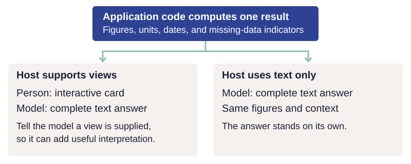

# Connect interfaces to the same capabilities

A person asks the embedded agent, "Make this easier to read." The settings screen has
separate controls for font size and contrast; the agent may offer to adjust both. Whichever
route the person chooses, the changes should use the same application operations and rules.

Each interface needs an adapter: code that translates a screen interaction, tool call, or
command into those operations and presents the result. An external agent can connect through
MCP, the Model Context Protocol, which lets a client discover and call tools. Add that
interface when it helps someone do a job.

## Decide which code handles each responsibility

The [shared-capability diagram](design.md#build-the-capability-once) shows the common
foundation. A capability defines an operation's inputs, validation, changes, and result.
Shared execution enforces permissions and approval, coordinates changes that must succeed
together, and records the outcome. Each interface translates requests into that shared
code and presents its results. This separation follows the
[ports-and-adapters pattern](https://alistair.cockburn.us/hexagonal-architecture).

Interfaces can group actions differently while preserving their meaning. The screen may
keep font size and contrast separate while a tool accepts both. A command named "add"
should preserve existing data in the same way as the corresponding screen operation.

### Give each caller the context it needs

Advisor's embedded agent receives current application state with every request, including
screen context and onboarding progress. An external agent can read onboarding progress
with `get_onboarding`, following the server instructions. Advisor does not expose its
current screen state to external agents. The host receives those instructions when it
connects; the application does not
push its embedded agent's per-turn context into that external conversation.

| Context | Advisor's embedded agent | External agent through Advisor's MCP server |
| --- | --- | --- |
| Onboarding progress | Included with each request | Read with `get_onboarding` when its guidance calls for it |
| Current screen | Included with each request | Not available through Advisor's external tools |
| Guidance for choosing tools | Assembled into the agent's instructions | Supplied in the server instructions at connection |
| The person's words | Available to the application's conversation-based checks | Remain in the external host's conversation |

In the Claude desktop setup used to test Advisor, the host retained its tools and server
instructions until restarted. After changing them, reconnect or restart the host as needed
and verify what it actually received.

That context difference also changes which checks can run. Advisor's write check and its
guards compare a proposed save with the person's words. Its MCP server receives the tool
call without that conversation, so those checks cannot run there. Choose permissions and
safeguards for the evidence available to each caller, as described in
[authority and recovery](authority.md#account-for-evidence-available-to-each-caller).

## Observe and operate the screen

*Shared view state connects the screen, the agent's observations, and actions such as
changing a filter.*

In the Todo sample, the agent receives a structured description of the active filter and
visible task IDs. The UI and agent change that view state through shared dispatch. Filtering
changes which tasks are shown while preserving the underlying list.

For jobs that involve the screen, give the embedded agent both an observation of what the
person sees and named actions that can change that view. A central state store or state
machine can coordinate selection, navigation and filters. Each UI component declares the
actions it owns; clicks and agent calls use the same dispatch. Keep screen state distinct
from saved domain data.

The [assistance levels](why.md#from-finding-help-to-doing-the-job-together) include explaining
a control, pointing to it, opening its screen, and performing its operation. Build directions
from actual control labels. In the Todo sample, the agent changes the active filter through
application-owned screen actions, using the same dispatch as the screen controls.

Preserve partial work and conversation when navigating. If leaving a screen would discard
work, application code asks the person to confirm before navigating. The person supplies
that confirmation through the application's control; the agent cannot supply it on their
behalf. An application that preserves the draft can navigate while keeping the work available.

## Separate listing from execution

An embedded agent shares the person's screen. An external agent may only need data reads
and writes; a headless process has no screen to operate. Offer screen actions only where
they can work and where the person expects them. Explicitly designed external screen
control is possible, but should not be an accidental consequence of exposing the
application's tools.

Listing determines which tools a model is offered. Execution policy determines which
operations a caller may run, including calls made directly by name. A data read omitted
from the embedded agent's list may still be permitted. An operation forbidden by policy
must be refused even if the caller knows its name.

For example, Advisor distinguishes these two cases:

| Operation | Offered to this caller? | What execution permits |
| --- | --- | --- |
| Position-summary read for the embedded agent | Omitted from its tool list | Still permitted if called by name |
| Embedded screen actions for an external agent | Omitted from its tool list | Refused even if called by name |

These are examples of a chosen policy. Test both the advertised tool list and direct calls
to verify the distinction in your application.

## Return a view and a complete text answer

An MCP Apps view is an interactive page supplied with a tool's result for a supporting
host to display in the conversation. It is separate from controlling the original
application's screen. The Todo sample does not implement an MCP server; these are
requirements for adapting the shared capabilities to that interface.

Negotiate view support when the client connects. Send view metadata only to clients that
announce support. Supply a complete text answer to both kinds of client, including every
figure the view presents. Compute the figures once in application code, with dates, units
and missing-data indicators, and use that result for both presentations.

*One computed result supplies both presentations. Complete text also preserves the answer
if the view fails to display.*

When a view is supplied, tell the model that the person can already see it and ask for
useful interpretation rather than repetition. Keep the text complete even then, because
rendering may fail. Test both connections: view support present and absent. Check that
presentation metadata is scoped to the connection, so one client's capabilities do not
affect another's result.

Advisor provides a practical reason for an external interface: a person can use Claude's
desktop conversation to combine web research with reads of their portfolio. The external
host contributes a workflow that extends beyond the application's own screen.

!!! consider "Consider — does another interface serve a real job?"
    Write down who would use an external agent or command line for your chosen job and what
    they would gain. If there is no concrete benefit, keep the embedded interface for now.
    If there is, list which data and screen operations that caller actually needs.

The [acceptance checks](../principles/implementation.md) provide a review reference.
Continue with [the running sample](start.md).
