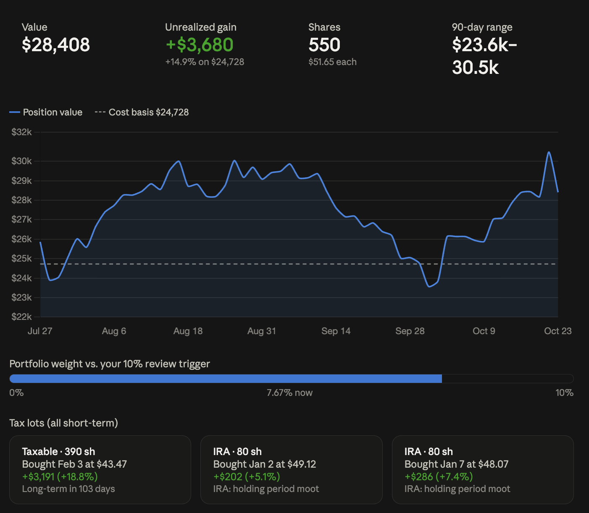
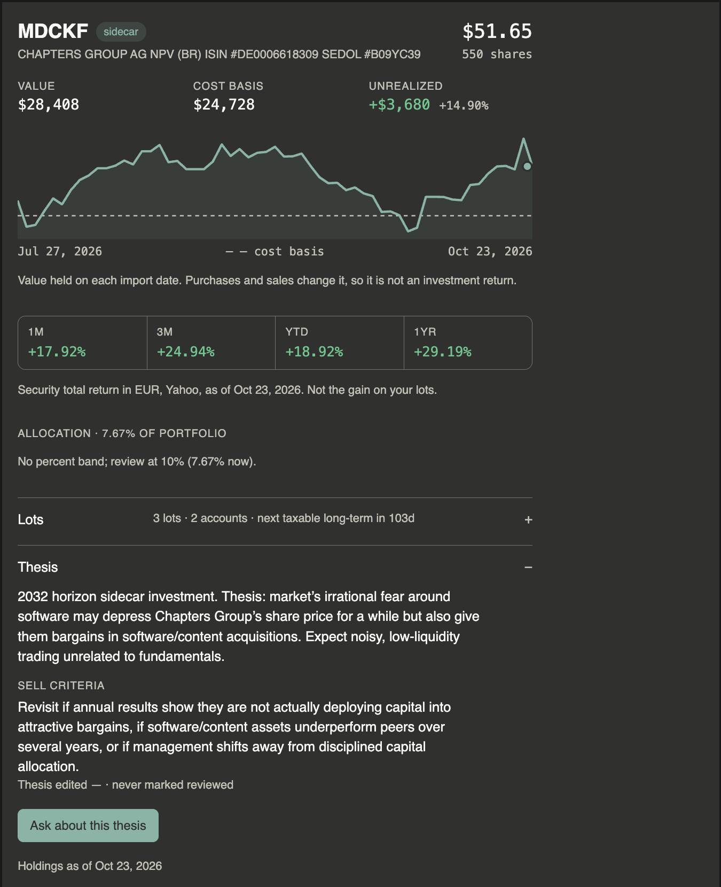

# Interfaces and views

A person asks the embedded agent, "Make this easier to read." The settings screen has
separate controls for font size and contrast; the agent may offer to adjust both. Whichever
route the person chooses, the changes should use the same application operations and rules.

Each interface needs an adapter: code that translates a screen interaction, tool call, or
command into application operations and presents the result. These interfaces can serve a
local application or a hosted web application.

## Bring the application's capabilities into another workflow

People may already work in ChatGPT or Claude, bringing together research, documents, and
information from several applications. An external interface lets them use your application's
current data and operations within that work. MCP, the Model Context Protocol, gives hosts
a common way to discover and call the tools your application offers.

Advisor provides a practical example: a person can combine web research with reads of their
portfolio in Claude's desktop conversation. A hosted customer-management application could
similarly provide account records and permitted updates while a person prepares for a
meeting using documents from elsewhere. Add the interface when that combined workflow helps
someone accomplish a job, and route its calls through the application's shared operations.

## Choose where the MCP server runs

An MCP server can run on the person's computer or as a remotely hosted service. Advisor is
a local application with a local MCP server. A hosted web application can expose its shared
capabilities through a server alongside its existing backend services, using the service's
authentication and permissions to control access to each person's data and operations.

Choose the connection according to where those capabilities run and their data is stored and which hosts
must reach them. MCP supports local process connections through standard input and output
(stdio), and network connections through Streamable HTTP. HTTP can also serve local
connections. A desktop host can connect to a remote service; the location of the screen
alone does not determine where the MCP server belongs.
[MCP SDK: server transports](https://ts.sdk.modelcontextprotocol.io/server)

## Decide which code handles each responsibility

The [shared-capability diagram](design.md#build-the-capability-once) shows the common
foundation. A capability defines an operation's inputs, validation, changes, and result.
Shared execution enforces permissions and approval, coordinates changes that must succeed
together, and records the outcome. Each interface translates requests into that shared
code and presents its results. This separation follows the
[ports-and-adapters pattern](https://alistair.cockburn.us/hexagonal-architecture).

Interfaces can group actions differently while preserving their meaning. The screen may
keep font size and contrast separate while a tool accepts both. A command named "add"
should add the new item without overwriting or reordering existing items, just as the
corresponding screen operation does.

## Give each caller the context it needs

Advisor's embedded agent receives current application state with every request, including
screen context and onboarding progress. An external agent can read onboarding progress
with `get_onboarding`, following the server instructions. Advisor does not expose its
current screen state to external agents. The host receives those instructions when it
connects; the application does not
automatically send its embedded agent's context to that external conversation on each turn.

| Context | Advisor's embedded agent | External agent through Advisor's MCP server |
| --- | --- | --- |
| Onboarding progress | Included with each request | Read with `get_onboarding` when its guidance calls for it |
| Current screen | Included with each request | Not available through Advisor's external tools |
| Guidance for choosing tools | Assembled into the agent's instructions | Supplied in the server instructions at connection |
| The person's words | Available to the application's conversation-based checks | Remain in the external host's conversation |

In the Claude desktop setup used to test Advisor, the host retained its tools and server
instructions until restarted. After changing them, reconnect or restart the host as needed
and verify what it actually received.

Because the person's words remain with the external host, Advisor's MCP server cannot run
checks that need that conversation; see [authority and recovery](authority.md#account-for-evidence-available-to-each-caller).

## Observe and operate the screen

*Shared view state connects the screen, the agent's observations, and actions such as
changing a filter.*

In the Todo sample, the agent receives a structured description of the active filter and
visible task IDs. The screen controls and agent change that view state through shared
dispatch: code that routes both kinds of request to the same operation. Filtering changes which tasks are shown while preserving the underlying list.

For jobs that involve the screen, give the embedded agent both an observation of what the
person sees and named actions that can change that view. A central state store or state
machine can coordinate selection, navigation and filters. Each screen component declares the
actions it owns; clicks and agent calls use the same dispatch. Keep screen state distinct
from saved application data.

In a hosted web application, the browser can send the current view, selection, and unsaved-work
state with each message. Server-side application code runs the agent's tool loop and enforces
permissions against trusted records. Screen actions return to the browser as named requests
that use the same dispatch as screen controls. Check that the intended view is still current
before applying them. Browser-supplied context helps interpret the request; the server
establishes identity and authority independently.

Assistance can include explaining a control, pointing to it, opening its screen, and
performing its operation, as illustrated by the
[assistance levels](why.md#from-finding-help-to-doing-the-job-together). Build directions
from actual control labels.

Preserve partial work and conversation when navigating. If leaving a screen would discard
work, application code asks the person to confirm before navigating. The person supplies
that confirmation through the application's control; the agent cannot supply it on their
behalf. An application that preserves the draft can navigate while keeping the work available.

Applications that save each edit as it is made, as Advisor does, have no unsaved work
to protect when navigating; undo covers mistakes instead. Applications with Save and
Cancel need the confirmation above.

## Offer tools that fit each interface

Give each agent tools that serve its job and work in the interface where the person is
using it. The embedded agent can navigate the application's screen. An external agent
may need a view displayed inside its own conversation.

Advisor's holding data was already available to external agents as text. Its `show_position`
tool adds a card for hosts that support MCP Apps, including ChatGPT and Claude. A host that
does not support the extension still receives the data as text. The built-in coach already
works alongside Advisor's screen and reads holding details through `get_position_detail`,
so it has no use for a card rendered in an external conversation. Tools for navigating
Advisor's screen belong with the embedded coach.
[MCP Apps: supported hosts and views](https://apps.extensions.modelcontextprotocol.io/)

Application code checks permissions whenever a call arrives. Choose the tools offered to
each caller for usefulness, and enforce what that caller may do in code. Test both the
tool list and permission checks. See [Authority and recovery](authority.md#limit-operations-and-their-scope)
for enforcing the policy.

## Choose who builds the presentation

An application-supplied MCP Apps view gives people a consistent, designed experience:
the application controls its labels, layout, and available interactions. Supporting hosts
render that view, with some differences in sizing and display.

A chat agent can instead create a visualization from returned data. Different hosts,
models, or requests may produce different representations. The person can ask for changes
in the conversation: "Compare it with last month," "Use a table," or "Show just these
two accounts."

Choose the balance that suits the task. A designed view has a defined shape and supports
the interactions its author builds into it. A chat-generated view can adapt to follow-up
requests, with less consistency in presentation. An application can offer both: a standard
view for familiar work and data the host can use for other representations.

*Host-generated visualization: Claude builds a presentation from Advisor's data for the
conversation. Select the image to view it at full size.*

## Return a view and a complete text answer

An MCP Apps view is an interactive page supplied with a tool's result for a supporting
host to display in the conversation. It is separate from controlling the original
application's screen. The [MCP Apps specification](https://github.com/modelcontextprotocol/ext-apps/blob/main/specification/2026-01-26/apps.mdx)
defines how hosts advertise support and servers supply views alongside tool results, with
text-only fallback for hosts that do not support the extension.

*Application-supplied view: Advisor's MCP Apps position card displayed in Claude. It labels
figures with dates and distinguishes the holding's value history from investment return. This capture
shows the card alone; select it to view at full size.*

Check whether the client supports views when it connects. Send view metadata only to clients that
announce support. Supply a complete text answer to both kinds of client, including every
figure the view presents. Compute the figures once in application code, with dates, units
and missing-data indicators, and use that result for both presentations.

*One computed result supplies both presentations. Complete text also preserves the answer
if the view fails to display.*

When a view is supplied, tell the model that the person can already see it and ask for
useful interpretation rather than repetition. Keep the text complete even then, because
rendering may fail. Test both connections: view support present and absent. Check that
presentation metadata applies only to its own connection, so one client's capabilities do not
affect another's result.

!!! consider "Consider — does another interface serve a real job?"
    Write down who would use an external agent or command line for your chosen job and what
    they would gain. If there is no concrete benefit, keep the embedded interface for now.
    If there is, list which data and screen operations that caller actually needs.

The [acceptance checks](../principles/implementation.md) provide a review reference.
Continue with [The agent in the UI](agent-experience.md) to decide where the conversation
belongs and how it stays connected to the person's work.
