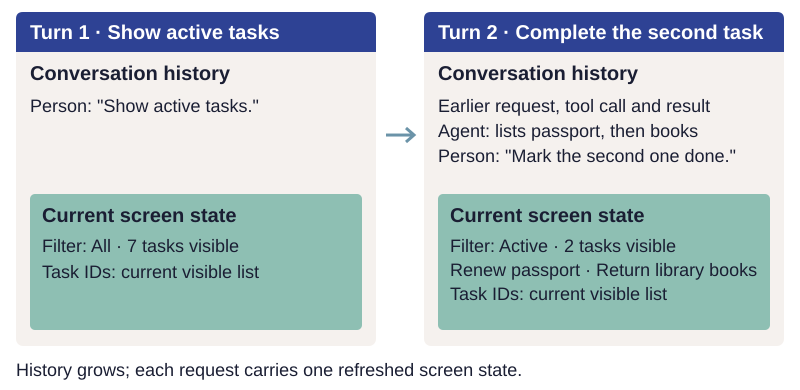
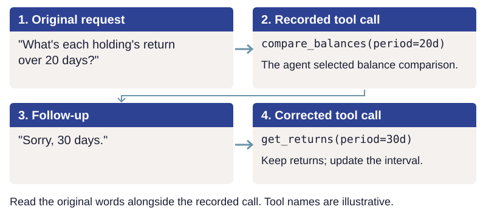

# Understand and complete the request

Design the conversation around what the person wants to accomplish. The earlier chapter
[starts with the job](why.md#start-with-the-job-people-want-to-accomplish); here, the task is
to interpret a particular request, complete it, and help the person see the result.

## Turn the request into action

Someone using a scheduling app might say "stop booking me on Friday afternoons." The agent
finds the availability capability and makes the change their permissions allow. It saves
the preference in the person's settings, where they can see it and change it later.

One request may need several capabilities. "Compare this quarter's bookings with last year's"
may require reading appointments for both periods and calculating their totals. Each
capability applies its own checks and permissions. Keep the actions within the scope of the
request: this person asked for a comparison. For workflows whose steps must succeed together,
use a [shared operation that owns the whole job](design.md#balance-general-tools-with-tools-for-important-jobs).

People use both [the words of the job and the words of the application](why.md#two-ways-people-ask).
Read the whole request and the preceding conversation to determine what assistance they want
now. "Where do I change my cancellation policy?" calls for directions and an offer to open
the setting. "Take me there" requests navigation. "Set the fee to twenty dollars" requests
a change. Preserve the conversation and unsaved work when navigating, and confirm that the
screen opened before reporting it. If navigation would discard partial work, the application
asks the person to confirm before leaving. [Horvitz: mixed-initiative interfaces](https://www.microsoft.com/en-us/research/publication/principles-mixed-initiative-user-interfaces/)

Ask a question when possible readings would lead to different results that matter. If the
agent offered two options and the person says "sure," ask which option they mean. When the
request is clear and allowed, carry it out.

## Supply current context

Send enough information for the agent to understand the screen: the current view, the selection, unsaved
work, and whether the context changed. The agent can read further details through a tool.

Compare representative requests with different amounts of context. A small application may
supply its whole list; a larger one may supply a summary and tools for further reads. Choose
the amount that helps the agent complete the request accurately.

When current application data accompanies each message, replace the previous screen state each
turn. Keep earlier actions and results as history, clearly distinguished from current state.
Inspect the actual model request to verify that this is what it receives.

*Illustrative Todo requests showing history and screen context; other model inputs are omitted.*

## Interpret follow-up requests

People often return to earlier topics without repeating the details. Give the agent the
person's original words, recorded tool calls and results, and relevant application state
to improve its chances of resolving those references correctly. Ask when the remaining
interpretations would lead to materially different outcomes.

Keep track of the task throughout the conversation. The same short phrase can add work, correct
an earlier value, or refer to a record already discussed:

| Follow-up | What it changes | What to preserve |
| --- | --- | --- |
| "The other event type too" | Adds to the requested scope | The original event type remains included. |
| "Sorry, 30 days" | Corrects the time interval | The requested measure and selected records remain the same. |
| "Open it so I can fix that" | Requests navigation to a previously identified problem | The record and the field needing attention; an address problem should open the address editor. |
| "Mark the second one done" | Selects an item from a list just discussed | The order of that list and the identity of its second item. |

For example, in the Todo sample, suppose the agent lists "Renew passport" and "Return library
books," and the person asks to mark the second one done. The model interprets the reference
using the conversation; application code checks the selected task and applies the change.
The reference is to the list the person just read, which may differ from the screen's current
sort order. Keep tool inputs and results so that follow-ups can be traced to the records
actually discussed. Research on conversational systems examines this dependence on prior
turns and ways to track the values a person has mentioned.
[Cheng et al.: dialog state tracking](https://aclanthology.org/2020.emnlp-main.651/)
[Andreas et al.: dialogue as dataflow](https://aclanthology.org/2020.tacl-1.36/)
Add a separate task-state component when testing shows that the conversation and recorded
calls provide insufficient context.

Preserve the person's own words alongside the agent's tool calls and their actual inputs.
This lets a correction apply to the original request even when the agent misunderstood it.
For example, suppose someone asks for each holding's return over 20 days and the agent
compares account balances instead. "Sorry, 30 days" corrects the interval for the requested
returns. The original request remains the basis for the next action.
[Balaraman et al.: repairing misunderstandings](https://aclanthology.org/2023.sigdial-1.52/)

*An investment example: preserve the requested measure while correcting the interval.
The tool names illustrate the sequence.*

### Keep explicit records when the workflow needs them

Some workflows benefit from application-owned records beyond conversation history.
"Undo that" may refer to several changes made for one request. Recording those changes as
an action group gives the agent a specific group to identify and the application a way to
check what can safely be reversed. Decide separately whether the changes must succeed
together and whether they should be undone together; preserve later edits when recovering.

Similarly, "try six years" after a loan calculation means carrying forward the amount and
interest rate while changing the term. Stored inputs and a result identifier can make that
revision reproducible. These are options for applications whose workflows need them.
The Todo sample already groups a request's changes for undo: the
[agent runtime](../../todo/agent.py) records the list before the turn, then creates one
[undo checkpoint](../../todo/todos.py) for the changes. Its local list history is simpler
than a general system of named action groups or saved calculations.

The [result-reference example](../reference/conversation-references.md) develops those options.

## Complete the job and report what happened

Make the change the person asked for. "The dentist's phone number is wrong, it should be
555-0142" calls for updating the phone number. If the correct value is missing, open that
field's editor or ask for it. If the agent makes a wrong change, explain what happened and
offer to undo it.

Handle every item in the request. "Remind me before each meeting with the clients on my
priority list" includes every client on that list. The
[tool design chapter](tools.md#return-facts-and-structured-decisions) describes one way to
make this reliable: let the agent name the whole group, and let application code find its
members.

Give the agent enough context to explain a result and offer supported alternatives when a
request is rejected. [Tools and current evidence](tools.md#return-facts-and-structured-decisions)
shows how to label results and return useful errors.

Report completed work, outstanding items, and what happens next, using the application's
actual results. "Reminders saved; two clients have no meeting scheduled yet" distinguishes
the saved reminders from the scheduling work that remains. Mention future checks only when
the application has scheduled them.
[Nielsen: usability heuristics](https://www.nngroup.com/articles/ten-usability-heuristics/)

Let application code decide where feedback appears. Confirm a change where the person can
see it: when someone asks for dark mode, the screen turning dark provides confirmation.
Use chat messages for questions, problems, and results that need an explanation. Make status
changes available to assistive technology as well.
[Fowler: GUI architectures](https://martinfowler.com/eaaDev/uiArchs.html)
[Microsoft: human-AI interaction guidelines](https://www.microsoft.com/en-us/research/project/guidelines-for-human-ai-interaction/)
[W3C: status messages](https://www.w3.org/WAI/WCAG21/Understanding/status-messages.html)
The chapter on [the agent in the UI](agent-experience.md) explores ways to give conversation
the space it needs.

## Work in the application people already know

Forms, documents, spreadsheets, presentations, and calendars provide familiar ways to enter,
check, and review information. A form marks required fields and validates them before
submission; a spreadsheet exposes formulas and cell references; a calendar shows conflicts.
Let the agent fill in the form, edit the document, or work in the spreadsheet while those
checks remain in place. Conversation can help explain why a total changed, which fields need
attention, or what changed since last week.

Show the agent's changes through the application's existing review features: tracked edits
in a document, highlighted cells in a spreadsheet, or suggested values in a form. People can
then review its work using familiar controls.

When a person needs to review something, put the item itself on screen, with the agent
beside it to explain and point to evidence. Keep the decision on the screen's own controls,
such as Approve and Reject.

An agent can also combine calendar events with company notes from another application to
prepare meeting briefings. Each application controls its own reads and writes, and the
connection needs permission to move data between them. Plan for partial completion when
one application succeeds and another fails.

!!! practice "Practice — add a follow-up"
    Write a likely request for your chosen job and one short follow-up. Underline what the
    follow-up changes. List what must stay the same and what application state the agent
    needs to interpret it. If two interpretations remain reasonable, write the question
    the agent should ask before acting.

Next, [Learn about me](onboarding.md) explains how saved personal context can improve
assistance across requests.
