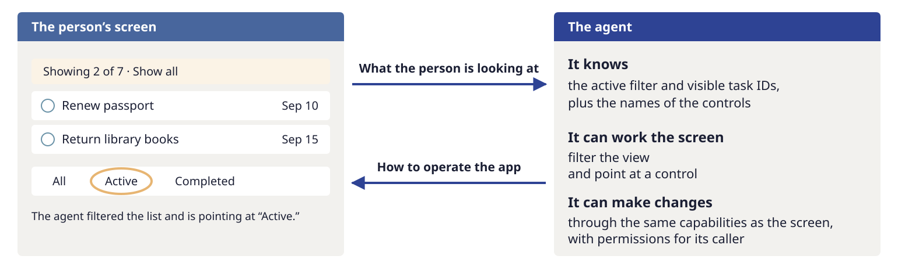
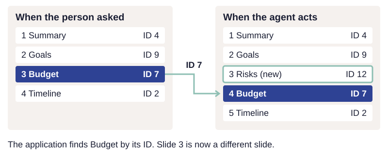
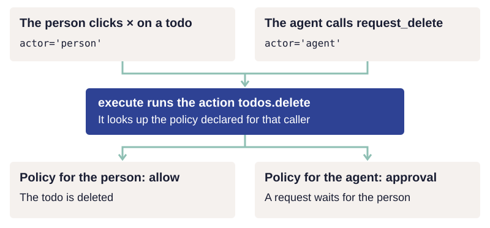

<span id="observe-and-operate-the-screen"></span>

# How the agent observes and operates the screen

The earlier chapters describe how an agent reads and changes the application's saved data
through shared capabilities. A person talking to an embedded agent is also looking at the
application's screen. The list is filtered a certain way, one item is selected, and a
field may be open for editing. People refer to that screen when they ask for help: "this
one," "what I'm looking at," "where is that?" Some requests are about the screen itself:
"take me there," "show me where," "show only what is still open."

An agent that knows nothing about the screen cannot tell which item "this one" is. It can
describe how to do something only in the model's own words, which may not match the labels
the person sees. It cannot open a screen or point to a control. Two of the
[assistance levels](why.md#from-finding-help-to-doing-the-job-together) depend on the
screen: "Tell me how," which uses the application's own words, and "Show me how," which
points to the control. "Do it for me" depends on it too when the request is to open a
place or change the view.

## An example from the Todo sample

The Todo sample has one screen: a list of todos, with the buttons All, Active and
Completed under it. Three requests in a row get three different kinds of help.

| The person asks | What happens |
| --- | --- |
| "How do I hide completed todos?" | The agent answers with directions that use the screen's own labels: the Active button, under the list. |
| "Show me where to do that." | The Active button is highlighted on the person's screen for a few seconds. The list does not change. |
| "Do it for me." | The filter changes to Active, as if the person had clicked the button. The list now shows only the open todos. |

No todo was added, changed or deleted. Everything that happened was on the screen.

## What application code supplies

The agent can do this because application code gives it three things:

1. A description of what the person currently sees, sent with each request.
2. A list of the controls and destinations on the screen, with the labels people see.
3. Tools that change the view, which run the same code as the person's clicks.

The rest of this chapter describes each of these, then four situations that need a rule:
the screen has changed since the person asked, the person asks to be shown a control whose
operation changes data, the same control gives a different result for the person and for
the agent, and the person has an edit in progress.

The examples come from three applications. The Todo sample accompanies this guide and has
one screen. Advisor, the desktop investment application
[introduced on the cover page](../index.md), has tabs, a settings drawer and menus, so its
agent navigates between places. The third is an application that runs in a browser, with
its agent running on a server. It appears here for the techniques a browser application
needs.

[](../images/screen-context.svg)

*Shared view state connects the screen, the agent's observations, and actions such as
changing a filter.*

## Separate screen actions from changes to saved data

A screen action changes what is shown: the filter, the selected item, the open tab, the
field that has the cursor, or a highlight. It leaves saved records as they were. Keep
screen state in its own object and declare screen actions as such in the registry, so code
can apply different rules to them.

The Todo sample keeps the filter in a `View` object, separate from the list of todos. Its
two screen actions are declared with `effects=('presentation',)`. Because nothing is saved,
they need no approval and no fresh read of the data. Advisor's navigation creates no entry
in the change history and no undo step.

| Kind of screen action | Example request | What application code does | Example |
| --- | --- | --- | --- |
| Change which items are shown | "Show only what is still open" | Sets the list filter, the same state the All, Active and Completed buttons set | Todo sample, `show_todos` |
| Point at a control | "Show me where" | Highlights the control for a few seconds and runs nothing | Todo sample, `point_at` |
| Open a destination | "Take me to where I can edit the thesis for MU" | Selects the holding, opens its Settings tab, puts the cursor in the Thesis field and scrolls the field into view | Advisor, `navigate_ui` |
| Reveal a menu command | "Where is the import command?" | Opens the menu with the command highlighted and does not run it | Advisor, `navigate_ui` |
| Move the view to an item | "Go to the third section" | Scrolls the document to that item, as a click in the outline does | The browser-based application |

Offer screen actions only to an agent that shares the person's screen. The Todo sample
offers `point_at` to the embedded agent alone, and Advisor withholds both of its screen
tools from its MCP server. [Interfaces and views](interfaces.md#offer-tools-that-fit-each-interface)
explains that choice.

## Tell the agent what the person sees

Send a small description of the current screen with every request. The Todo sample sends
the active filter and the IDs of the visible todos. Advisor sends these fields:

| Field | What it holds |
| --- | --- |
| `scope` and `subject` | Whether the person is looking at one holding, a filtered group, or the whole portfolio, and which one |
| `selected_symbol`, `selected_account` | The current selection |
| `security_panel` | The open tab, its holding, and whether it has unsaved work |
| `drawer_open` | Whether the settings drawer is showing |
| `drawer_edit_in_progress` | Whether the person is editing something in the drawer |

Advisor labels this block as application state, not instructions, and places it before the
conversation. The agent reads figures and settings through read tools when a request needs
them. The description says where the person is and what is selected.

The browser-based application sends the item the person has in view with each message.
The person can remove it before sending when the question is about something else. The
server turns it into a sentence placed before the person's words, such as "I am looking at
item 4."

None of the three applications sends a screenshot or the values of every visible field.

## Declare each control once

To give directions, the agent needs the names people see on the screen. Declare every
control once, in code, with its label, its location and what it does. The Todo sample keeps
this table in `todo/view.py`:

```python
SCREEN = {
    'due-date': ('the date', 'right side of each todo ("add date" when it has none)',
                 'click it to set, change or clear the due date'),
    'filter-active': ('Active', 'the buttons under the list', 'shows only the todos not done'),
    'clear-completed': ('Clear completed', 'under the list, on the right', 'deletes every done todo'),
    ...
}
```

The table has 14 entries, so the sample sends all of it with the prompt. The same keys are
the only values `point_at` accepts, and the page maps each key to the element it highlights.

Advisor has many more destinations: tabs, drawer sections, individual settings fields and
menu commands. Each part of the screen declares the destinations it owns, with a label, a
description and whether a holding must be named. The agent fetches the list with
`get_ui_actions` when a request needs it. A destination is listed only when the capability
that owns it names it in the registry.

In the browser-based application, each entry also holds the selector the page uses to find
the control and the phrases people use for it. A test fails when a declared selector does
not exist in the page, so a renamed or removed control is caught before release.

Build the agent's directions from these declarations. The wording then matches the labels
on the screen, and it changes when a label changes.

## Run the agent's action through the code a click runs

A screen action requested by the agent should reach the same code as the person's click.
A filter set by the agent then behaves as a filter set by the person does, and a later
click starts from the state the agent left.

[](../images/screen-action-path.svg)

*A click and a screen tool call run the same view code. The tool result reports the new view to the agent.*

In the Todo sample, a click on a filter button and a `show_todos` call both run the
registered `view.show` action.

Advisor is a desktop application. The agent's tool call runs outside the interface thread,
so the call is passed to the interface thread and waits up to 10 seconds for the result.
Selecting a holding then sends `SelectSymbol`, the event a click on the holdings list
sends, through the same state machine.

In the browser-based application, the agent's tool loop runs on the server. The tool
handler records the requested view change and increases a version number. The page
receives the change over the event stream it already listens to and calls the function
that a click in the outline calls. When no page is open, the tool call is refused and the
agent is told why.

### Give each piece of screen state one owner

Each piece of screen state that the agent can observe or change needs one owner: one
piece of code that holds it. The screen draws from that owner, the agent's observations
read it, and both clicks and the agent's actions change it there. The agent and the
screen then cannot hold different versions of the filter, the selection or the open tab.

State the agent is never told about can stay with the screen alone: hover effects, drag
feedback, animations. In the Todo sample the owned state is the list filter and whether
each of the 14 declared controls is drawn. One function, `not_on_screen` in
`todo/view.py`, decides the second. Before each draw, the application sends the page the
IDs of the visible todos and a true or false value for every control, and the page shows
or hides each control from those values. The page script has no conditions of its own. It
still keeps to itself which todo is being dragged.

Where the owner runs is a separate decision, and it depends on your interface framework.

[](../images/screen-state-location.svg)

*In a hosted web application, the view state is on the server with Streamlit and in the browser with React.*

The figure shows a hosted web application. There the agent's loop runs on the server,
because the model's API key and the checks on consequential operations have to be kept out
of the browser. A desktop application such as Advisor runs the agent and the interface in
one process, and the same two questions apply: which code owns the view state, and how the
agent reaches it.

**View state on the server.** Streamlit works this way, and so does the Todo sample. The
server holds the filter, and the page draws what it is sent. For the request "Show only
what is still open":

1. The agent reads the current filter from the server's memory.
2. The agent calls `show_todos`, and the server changes the filter.
3. The server sends the new view to the page, and the page draws it.

The agent and the view state are in one place, so nothing has to be sent between them.

**View state in the browser.** React and similar frameworks work this way. The page holds
the filter and the selection in its own store, and a click changes them without calling
the server. For the same request:

1. The page sends the person's message together with a snapshot of its view state: the
   filter, the selection and the open screen.
2. The agent calls its screen tool, and the server sends the page a named event, such as
   "set the filter to active."
3. The page passes the event to its store, through the code a filter click runs, and
   redraws. It then replies with what the screen now shows, or with the reason it could
   not make the change. The agent's tool waits for that reply.

The three numbered arrows in the figure are these three steps. A snapshot, an event and a
reply are the parts a browser-held design needs and a server-held design does not. The
Todo sample shows the first arrangement only. Advisor is the closer model for the second:
its view state is in the interface, and its navigation request waits for the interface's
reply.

The snapshot from the browser helps interpret the request and nothing more. The server
establishes the person's identity and checks consequential operations itself, from trusted
records.

### Report what the application did, and what is confirmed

The tool result should describe the screen after the action, so the agent's reply about it
is accurate. `show_todos` returns the filter, the titles now visible and the titles now
hidden. `navigate_ui` returns what was opened and where, with a confirmation written by
application code, such as "Opened Thesis for MU."

A result can mean three different things, and the agent should claim only the one the
application can support:

| What the result establishes | What it means | Which application |
| --- | --- | --- |
| The view state was changed | The owner of the state now holds the new value. The screen will draw from it. | Todo sample |
| The screen was sent the change | An event went to the page. Nothing has come back. | The browser-based application |
| The screen confirmed the change | The screen code applied it and replied. | Advisor |

In the Todo sample the page draws after the agent's turn has ended, so no result can say
what the browser displayed. `show_todos` reports the filter the application set and the
todos that filter selects. `point_at` reports that the highlight was requested for a
control the page is told to draw. Its result tells the model that the page highlights the
control when it shows the reply. An earlier version of the agent highlighted a control and
then offered to highlight it.

Because the page draws from the same state, the difference is small in the sample, but it
is not zero. A fault in the page script could leave a control undrawn. A test checks that
every declared control has a selector in the page script. No test runs the highlight in a
browser. When the difference matters, have the screen reply, as Advisor's does.

### Return a refusal with its reason

The agent also needs to hear when the action did not happen, and why. How that reaches
the agent depends on which code carries out the action.

When the agent's tool call goes directly to `execute`, the outcome is the function's
result. A refusal is an error that states the reason, and the agent code returns it to the
model: "The agent cannot todos.approve; only the person can."

When the screen carries out the action, the answer has to be sent back. A button's own
code usually shows an error to the person and returns nothing. Advisor's navigation
request carries an ID. The screen code replies under that ID with what was opened, or with
the reason it was not: "Finish or cancel your research edits before navigating." The
agent's tool waits for that reply.

In the Todo sample, `point_at` asks `not_on_screen` whether the page is told to draw the
control. Clear completed is drawn only when a todo is done, and Approve only when a delete
request is waiting. When the control is not drawn, the tool is refused:

```text
Clear completed is not on the screen now: it appears when at least one todo is done.
Nothing is highlighted.
```

The agent can tell the person that, and what would make the control appear. Before this
check, the tool answered that the control was highlighted when the page had nothing to
highlight.

## Check the request against the current screen

The screen can change between the person's message and the agent's action. The person may
select something else, or an item may move or be deleted.

Advisor checks the live state when the action arrives: the holding must still be held and
the destination must exist. A request that has already timed out is dropped when it reaches
the interface.

In the browser-based application, items can be reordered, so each item has a lasting ID
separate from its position. Before the model sees the screen context, the server looks the
item up by that ID. If the item has moved, the model is told both its earlier and its
current position. If the item was deleted, the model is told not to act on whatever now
has that position.

[](../images/screen-item-moved.svg)

*An item added during the conversation moves Budget from position 3 to position 4. Its ID stays 7.*

Refer to items by ID in screen context and in tool inputs. Positions and titles can change
during a conversation. [Resolve references to earlier requests](../reference/conversation-references.md)
covers references across turns.

## Show a control without running it

A request to be shown a control is a request for navigation. Pointing at Delete must not
delete anything.

- The Todo sample's `point_at` changes only the highlight.
- Advisor opens a menu with the command highlighted and leaves the person to choose it.
- The browser-based application opens the menu or panel that contains the control, scrolls
  to it, waits for the layout to settle, and then outlines it.

When the page cannot find the control, the browser-based application shows a message
saying so. It does not highlight a nearby element. The Todo sample refuses a control name
that is not in its table and lists the names that are. It also refuses a control that the
page is not drawing now, as described under
[Return a refusal with its reason](#return-a-refusal-with-its-reason).

## Record who made each request

The registry declares which callers may run each operation: the person through the
screen, the embedded agent, an external agent through MCP, or a combination. This keeps
consequential and hard-to-undo operations away from an agent.

An agent that can operate the screen adds a risk. If the agent can send the application
the event that a button sends, it can press the button for an operation the registry does
not allow it. The operation would then run as if the person had pressed it.

The fix is that every action on a control states who is acting. The registry stays the
single source of authority. In the Todo sample, a person who clicks × on a todo deletes it.
The agent's delete tool creates a request that the person approves or denies. The screen
code and the agent code do not decide this. Every request carries the caller, and the
shared execution function applies the policy declared for that caller.

[](../images/screen-caller.svg)

*The same action runs for both callers. The caller passed with the request selects the policy.*

The caller is a required argument of the one function that runs an action:

```python
def execute(registry, action_id, args, *, actor, ctx):
    action = registry.get(action_id)
    policy = action.policy.get(actor, 'forbidden')
    ...
    result = action.propose(ctx, **args) if policy == 'approval' else action.handler(ctx, **args)
```

The sample calls it from two places, and each one states the caller in code:

```python
# todo/todo_view.py: a click on the screen
execute(REGISTRY, action_id, args, actor='person', ctx=...)

# todo/agent.py: a tool call requested by the model
self.call(REGISTRY, action.id, args, actor='agent', ctx=self)
```

The caller is passed to `execute`, not to the operation. The handler for `todos.delete`
receives the todo IDs and has no code that asks who is calling. The caller is also not one
of a tool's inputs, so the model cannot supply it.

| Action | Control | When the person clicks it | When the agent requests it |
| --- | --- | --- | --- |
| `view.show` | All, Active, Completed | The view changes | The view changes |
| `todos.delete` | × on a todo | The todo is deleted | An approval request is created, and nothing is deleted |
| `todos.approve` | Approve on the request card | The requested delete is carried out | Refused: "The agent cannot todos.approve; only the person can." |

The controls that need this protection are the ones whose operations have a large effect
or cannot be undone: deleting a file, placing a trade, sending money to a bank. For
operations like these, the button on the screen is for the person. An agent that asks for
one gets an approval request for the person to decide, or a refusal.
[Authority and recovery](authority.md#enforce-policy-and-approval) explains how to set
that policy from an operation's impact and whether it can be undone, and shows the rule
the Todo sample applies.

Because the caller travels with every request, the screen code holds no list of controls
the agent may not use, and no rule is written twice. An agent can be allowed to operate
any control. The control maps to its registered action, that action runs with the agent as
the caller, and the policy declared for the agent applies.

What the agent sends must be an application event that names the agent as the caller. A
simulated mouse click or keystroke in the page carries no caller, so the application would
treat it as the person's. The agent could then delete without approval, or approve its own
request. Do not give the agent a tool that sends clicks or keystrokes into the page.

The change history takes the caller from the same argument: `execute` writes the undo
entry, so the screen code and the agent code do not record who made a change. The sample's
test `test_execution_refuses_the_agent_what_only_a_person_may_do` calls each person-only
action as the agent and checks the refusal.

### Why the agent still sees the control

It may seem simpler to hide from the agent every control it may not operate. There are
four reasons to keep the control in the agent's description of the screen.

- **Hiding does not enforce anything.** The sample leaves forbidden operations out of the
  agent's tool list, and builds that list from the registry's policy. A request for an
  unlisted operation can still arrive, so `execute` checks the policy again when the call
  arrives.
- **The agent needs the control to help the person use it.** "How do I delete the done
  ones?" is answered with the Clear completed button, which only the person can use.
- **Some operations are allowed to the agent in a different form.** Delete becomes a
  request for approval. Hiding the control would remove that route.
- **A refusal with a reason is more useful than silence.** The agent receives "only the
  person can" and can say so. An agent that was never told the control exists may say the
  application cannot do the job.

Consider an application where deleting a project is a menu command that the registry
allows only to the person. The agent's part differs with what the person asks:

| The person asks | What the agent does |
| --- | --- |
| "How do I delete this project?" | Gives directions from the declared control: the menu it is in and the command's label. |
| "Show me where." | Opens the menu with the command highlighted. The command does not run. |
| "Do it for me." | Explains that only the person can delete a project, and offers to show where the command is. |

If the registry allowed the agent to delete with approval, the third answer would be an
approval request shown to the person.

## Decide what happens to an edit in progress

The agent may be asked to navigate while the person has a field open for editing.

Advisor's screen context says whether an edit is in progress. It saves thesis and notes
drafts before it changes the selection. While a research edit or a settings-drawer edit is
open, it refuses the agent's navigation and returns the reason: "Finish or cancel your
research edits before navigating." The agent can pass that on to the person.

The Todo sample and the browser-based application save each completed change as it is
made, and undo covers a completed change that was a mistake. That does not cover text the
person is still typing. In the Todo sample, an inline edit that is open in the page is not
reported to the application, so a view change by the agent is not held back while the
person types. The sample fails [Check 1.13](../principles/implementation.md#check-1-13)
for this reason. To close the gap, the page would report an open edit with the screen
context, and the view action would be refused while one is open, as in Advisor.

An application with Save and Cancel buttons needs its own rule. It can refuse navigation
as Advisor does, keep the draft, or ask the person to confirm through one of its own
controls. The agent cannot supply that confirmation for the person.

## Test screen actions

- **The view changes and saved data does not.** The Todo sample's
  `test_show_todos_changes_the_view_only` checks this for the filter.
- **Showing does not run.** Ask to be shown a control that deletes, and verify nothing was
  deleted.
- **The caller is recorded.** Call each person-only action as the agent and verify it is
  refused. Verify no agent tool accepts the caller as an input.
- **The right kind of help.** Advisor's navigation evaluation has 22 cases. Each names
  the action expected, the tools that must not be called, and the tab that should be open
  afterward. "How do I" should produce directions; "show me where" should open the
  destination.
- **Declared controls exist.** Check each declared selector or widget against the screen.
- **One owner.** For each state of the list, verify the agent's tool and the page are given
  the same answer about which controls are drawn.
- **A changed screen.** Move or delete the item in view between the request and the action.
- **An edit in progress.** Navigate while a field is open, and verify the draft is saved,
  kept, or the navigation is refused.

The Todo sample and the browser-based application test these paths in Python. Neither
tests the highlight in a real browser, so neither confirms what the browser displayed.

!!! practice "Practice — list the screen actions for one job"
    For your chosen job, write down what the person would ask to see, to be taken to, and
    to be shown. For each, name the click that does it today and the code that click runs.
    Note which fields of screen state the agent would need to interpret "this one" and
    "here", and what your application should do when a field is open for editing.

[Check 1.13 and Check 1.15](../principles/implementation.md#check-1-13) are the acceptance
checks for this chapter. Continue with [The agent in the UI](agent-experience.md) to decide
where the conversation belongs and how it stays connected to the person's work.
