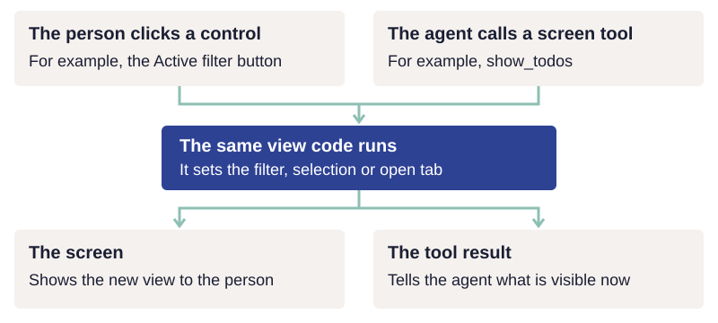

<span id="observe-and-operate-the-screen"></span>

# How the agent observes and operates the screen

A person asks, "Where do I change a due date?" Then, "Show me." Then, "Show only what is
still open." The first request needs the name and location of a control. The second needs
the application to highlight that control on the person's screen. The third changes which
items the screen shows. None of the three changes saved data.

An embedded agent can serve these requests when application code gives it a description of
what the person currently sees, a list of the controls and destinations on the screen, and
tools that change the view. This chapter shows how the Todo sample and Advisor provide each
of these, with some techniques from a third application that runs in a browser.

[](../images/screen-context.svg)

*Shared view state connects the screen, the agent's observations, and actions such as
changing a filter.*

## Separate screen actions from changes to saved data

A screen action changes what is shown: the filter, the selected item, the open tab, the
field that has the cursor, or a highlight. It leaves saved records as they were. Keep
screen state in its own object and declare screen actions as such in the registry, so code
can apply different rules to them.

The Todo sample keeps the filter in a `View` object, separate from the list of todos. Its
two screen actions are declared with `effects=('presentation',)`. Because nothing is saved,
they need no approval and no fresh read of the data. Advisor's navigation creates no entry
in the change history and no undo step.

| Kind of screen action | Example request | What application code does | Example |
| --- | --- | --- | --- |
| Change which items are shown | "Show only what is still open" | Sets the list filter, the same state the All, Active and Completed buttons set | Todo sample, `show_todos` |
| Point at a control | "Show me where" | Highlights the control for a few seconds and runs nothing | Todo sample, `point_at` |
| Open a destination | "Take me to where I can edit the thesis for MU" | Selects the holding, opens its Settings tab, puts the cursor in the Thesis field and scrolls the field into view | Advisor, `navigate_ui` |
| Reveal a menu command | "Where is the import command?" | Opens the menu with the command highlighted and does not run it | Advisor, `navigate_ui` |
| Move the view to an item | "Go to the third section" | Scrolls the document to that item, as a click in the outline does | The browser-based application |

Offer screen actions only to an agent that shares the person's screen. The Todo sample
offers `point_at` to the embedded agent alone, and Advisor withholds both of its screen
tools from its MCP server. [Interfaces and views](interfaces.md#offer-tools-that-fit-each-interface)
explains that choice.

## Tell the agent what the person sees

Send a small description of the current screen with every request. The Todo sample sends
the active filter and the IDs of the visible todos. Advisor sends these fields:

| Field | What it holds |
| --- | --- |
| `scope` and `subject` | Whether the person is looking at one holding, a filtered group, or the whole portfolio, and which one |
| `selected_symbol`, `selected_account` | The current selection |
| `security_panel` | The open tab, its holding, and whether it has unsaved work |
| `drawer_open` | Whether the settings drawer is showing |
| `drawer_edit_in_progress` | Whether the person is editing something in the drawer |

Advisor labels this block as application state, not instructions, and places it before the
conversation. The agent reads figures and settings through read tools when a request needs
them. The description says where the person is and what is selected.

The browser-based application sends the item the person has in view with each message.
The person can remove it before sending when the question is about something else. The
server turns it into a sentence placed before the person's words, such as "I am looking at
item 4."

None of the three applications sends a screenshot or the values of every visible field.

## Declare each control once

To give directions, the agent needs the names people see on the screen. Declare every
control once, in code, with its label, its location and what it does. The Todo sample keeps
this table in `todo/view.py`:

```python
SCREEN = {
    'due-date': ('the date', 'right side of each todo ("add date" when it has none)',
                 'click it to set, change or clear the due date'),
    'filter-active': ('Active', 'the buttons under the list', 'shows only the todos not done'),
    'clear-completed': ('Clear completed', 'under the list, on the right', 'deletes every done todo'),
    ...
}
```

The table has 14 entries, so the sample sends all of it with the prompt. The same keys are
the only values `point_at` accepts, and the page maps each key to the element it highlights.

Advisor has many more destinations: tabs, drawer sections, individual settings fields and
menu commands. Each part of the screen declares the destinations it owns, with a label, a
description and whether a holding must be named. The agent fetches the list with
`get_ui_actions` when a request needs it. A destination is listed only when the capability
that owns it names it in the registry.

In the browser-based application, each entry also holds the selector the page uses to find
the control and the phrases people use for it. A test fails when a declared selector does
not exist in the page, so a renamed or removed control is caught before release.

Build the agent's directions from these declarations. The wording then matches the labels
on the screen, and it changes when a label changes.

## Run the agent's action through the code a click runs

A screen action requested by the agent should reach the same code as the person's click.
A filter set by the agent then behaves as a filter set by the person does, and a later
click starts from the state the agent left.

[](../images/screen-action-path.svg)

*A click and a screen tool call run the same view code. The tool result reports the new view to the agent.*

In the Todo sample, a click on a filter button and a `show_todos` call both run the
registered `view.show` action.

Advisor is a desktop application. The agent's tool call runs outside the interface thread,
so the call is passed to the interface thread and waits up to 10 seconds for the result.
Selecting a holding then sends `SelectSymbol`, the event a click on the holdings list
sends, through the same state machine.

In the browser-based application, the agent's tool loop runs on the server. The tool
handler records the requested view change and increases a version number. The page
receives the change over the event stream it already listens to and calls the function
that a click in the outline calls. When no page is open, the tool call is refused and the
agent is told why.

In a hosted web application, the browser can send the current view and selection with each
message, and screen actions return to the browser as named requests. Browser-supplied
context helps interpret the request. The server establishes identity and authority
independently, from trusted records.

### Return what the screen now shows

The tool result should describe the screen after the action, so the agent's reply about it
is accurate. `show_todos` returns the filter, the titles now visible and the titles now
hidden. `navigate_ui` returns what was opened and where, with a confirmation written by
application code, such as "Opened Thesis for MU." Advisor shows that confirmation in its
status bar; [The agent in the UI](agent-experience.md#how-advisor-makes-the-choice)
describes when the conversation stays minimized.

After `point_at`, the Todo sample's result says that the control is highlighted now. An
earlier version of the agent highlighted a control and then offered to highlight it.

## Check the request against the current screen

The screen can change between the person's message and the agent's action. The person may
select something else, or an item may move or be deleted.

Advisor checks the live state when the action arrives: the holding must still be held and
the destination must exist. A request that has already timed out is dropped when it reaches
the interface.

In the browser-based application, items can be reordered, so each item has a lasting ID
separate from its position. Before the model sees the screen context, the server looks the
item up by that ID. If the item has moved, the model is told both its earlier and its
current position. If the item was deleted, the model is told not to act on whatever now
has that position.

[](../images/screen-item-moved.svg)

*An item added during the conversation moves Budget from position 3 to position 4. Its ID stays 7.*

Refer to items by ID in screen context and in tool inputs. Positions and titles can change
during a conversation. [Resolve references to earlier requests](../reference/conversation-references.md)
covers references across turns.

## Show a control without running it

A request to be shown a control is a request for navigation. Pointing at Delete must not
delete anything.

- The Todo sample's `point_at` changes only the highlight.
- Advisor opens a menu with the command highlighted and leaves the person to choose it.
- The browser-based application opens the menu or panel that contains the control, scrolls
  to it, waits for the layout to settle, and then outlines it.

When the page cannot find the control, the browser-based application shows a message
saying so. It does not highlight a nearby element. The Todo sample refuses a control name
that is not in its table and lists the names that are.

## Decide what happens to an edit in progress

The agent may be asked to navigate while the person has a field open for editing.

Advisor saves thesis and notes drafts before it changes the selection. While a research
edit or a settings-drawer edit is open, it refuses the agent's navigation and returns the
reason: "Finish or cancel your research edits before navigating." The agent can pass that
on to the person. The Todo sample and the browser-based application save each change as it
is made, and undo covers mistakes.

An application with Save and Cancel buttons needs its own rule. It can refuse navigation
as Advisor does, keep the draft, or ask the person to confirm through one of its own
controls. The agent cannot supply that confirmation for the person.

## Test screen actions

- **The view changes and saved data does not.** The Todo sample's
  `test_show_todos_changes_the_view_only` checks this for the filter.
- **Showing does not run.** Ask to be shown a control that deletes, and verify nothing was
  deleted.
- **The right kind of help.** Advisor's navigation evaluation has 22 cases. Each names
  the action expected, the tools that must not be called, and the tab that should be open
  afterward. "How do I" should produce directions; "show me where" should open the
  destination.
- **Declared controls exist.** Check each declared selector or widget against the screen.
- **A changed screen.** Move or delete the item in view between the request and the action.
- **An edit in progress.** Navigate while a field is open, and verify the draft is saved,
  kept, or the navigation is refused.

The Todo sample and the browser-based application test these paths in Python. Neither
tests the highlight in a real browser; that part is checked by hand.

!!! practice "Practice — list the screen actions for one job"
    For your chosen job, write down what the person would ask to see, to be taken to, and
    to be shown. For each, name the click that does it today and the code that click runs.
    Note which fields of screen state the agent would need to interpret "this one" and
    "here", and what your application should do when a field is open for editing.

[Check 1.13 and Check 1.15](../principles/implementation.md#check-1-13) are the acceptance
checks for this chapter. Continue with [The agent in the UI](agent-experience.md) to decide
where the conversation belongs and how it stays connected to the person's work.
