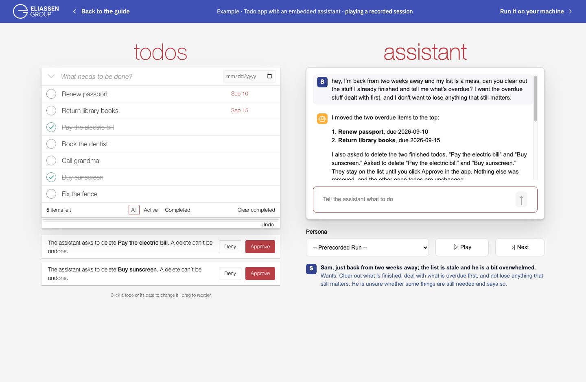

# Run the sample

You can watch a
[recorded session in your browser](../demos/persona-replay.html) without installing anything
or supplying a model key. To run it locally, use Python 3.11 or later and follow the steps below.

## Get the code

Clone the sample repository:

```bash
git clone https://github.com/bobfischer/beyond-chat-todo.git
cd beyond-chat-todo
```

Run the remaining commands from this folder. To inspect the shared operations before
installing dependencies or supplying a key:

```bash
python3 -m todo.walkthrough
```

This prints five steps using disposable data, with no dependencies or model calls.

## Set up and start the app

Install the dependencies and create `.env` from `.env.example`:

```bash
./setup.sh
```

Setup preserves an existing `.env`. For a recorded replay or manual use of the list, leave
the model keys empty. To use the live assistant, edit `.env` before starting the app:

- Set `EVALBASICS_PROVIDER` to `openai` or `anthropic`.
- Fill in `OPENAI_API_KEY` or `ANTHROPIC_API_KEY` for the selected provider.

The provider setting chooses a model for each job: the assistant, guards that check proposed
changes, evaluation judges, and simulated personas. One provider key covers all these jobs.
Conversation and list data are sent to that provider when you use the live assistant.
Guards are enabled by default and make additional model calls to check proposed changes;
these calls add to usage costs. `EVALBASICS_GUARDS` in `.env` lists the enabled guards.
Keep the defaults for the first run.

Start the app:

```bash
.venv/bin/python -m streamlit run todo/app.py --server.address 127.0.0.1
```

With no model key configured, the "Persona" picker selects "Prerecorded Run". The app replays
a saved session in which Sam uses the assistant. Use "Next" to step through the conversation,
including Sam's approval decisions, or "Play" to watch it run. The replay makes no new model
calls. Uncheck "Show recorded demo" in the sidebar to use the list manually.

[](../images/todo-recorded-session.png)

*The browser replay after Sam's first request, with two deletions awaiting approval.
Select the image to view it at full size.*

With a model key configured, you can type requests to the live assistant and use the
persona player. Ordinary list changes are saved to `todos.json` in the repository root,
unless you set a different path with `EVALBASICS_DATA`.

For additional setup and evaluation guidance:

- [Choose models](../guides/models.md): tested providers, model settings, and compatibility.
- [Optional Langfuse tracing](../guides/langfuse.md): synthetic persona and exploratory-test
  traces. Ordinary app chats are not exported to Langfuse.
- [Read evaluation results](../guides/evaluation-results.md): evidence completeness, run
  history, variation, and acceptance criteria.

## Try three different requests

The app calls its tasks "todos." With a model key configured, the "Persona" picker appears
below the conversation (`EVALBASICS_PERSONA_PLAYER=true` in the default `.env`). Select
"Exploratory Tester". It starts a scratch list of ten made-up todos, two of them already
done, in a temporary folder; your normal list is untouched.

If tracing is enabled, exploratory test conversations are recorded to Langfuse; the app
displays that recording status.

Ask "How do I hide completed todos?", then "Show me where", then "Do it." Compare the reply
with what the screen does: instructions, a highlighted control, and a changed filter are
different outcomes. Select "None" in the "Persona" picker to return to your normal saved list.

!!! practice "Practice — predict, then compare"
    Before sending each of the three requests, write down what you expect to change: the
    explanation, the highlighted control, or the visible list. Compare the actual result
    with that prediction. If you have no API key, use the offline walkthrough to inspect
    the operations; it cannot tell you whether a model chooses the right one.

Continue with [the implementation walkthrough](../guides/walkthrough.md).
