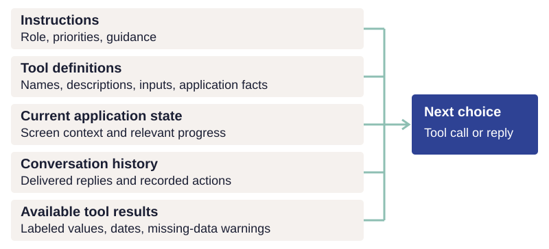
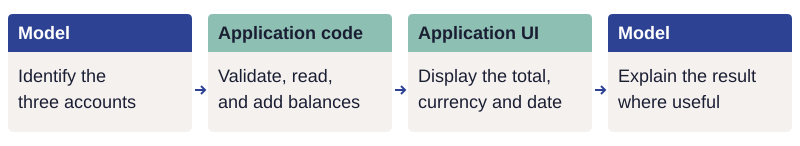

# Tools and current evidence

The model chooses its next action from the instructions, tools, application context, and
conversation it receives. This chapter explains how to make those inputs clear, return
evidence it can interpret, and assign calculations and confirmations to application code.

*The application assembles each model request. Tool results become available after calls;
the current state and available tools depend on the application and host.*

## Make tool choices clear

Improve the tools before adding prompt rules or answer checks. Expect to spend most of your effort here. Inspect the tool description, inputs and returned evidence before assuming another prompt rule will fix the problem. Anthropic reports the same for its SWE-bench agent: "we actually spent more time optimizing our tools than the overall prompt." [Anthropic: building effective agents](https://www.anthropic.com/engineering/building-effective-agents)

When the agent gets a job wrong, inspect the tool descriptions it received, the inputs it
sent, and the results or errors returned. A tracing tool such as Langfuse records this
information for review (see [evaluation](evaluation.md)). Check three things:

- Is the tool's purpose clear?
- Can the agent distinguish it from similar tools?
- Does an error explain what to do instead?

Fix unclear descriptions and errors. Move predictable work and input checks into code. [OpenAI: function-calling best practices](https://developers.openai.com/api/docs/guides/function-calling#best-practices-for-defining-functions)

Add a rule to the prompt, or another model to review the agent's answers, only for problems that remain, and check that each one is worth the time and complexity it adds.

In Advisor, a question about how fast MU was dropping initially received a cautious answer
based on a single quote. The missing evidence was a series of prices over time. Adding a
price-history read, with changes and lows calculated in code, let the coach answer with
those figures. Inspecting what the agent could read revealed the work the application
needed to provide.

Tools are read together, so one change can affect other jobs. The model receives tool descriptions alongside instructions, results and conversation history. Adding or rewording one tool can change its choices elsewhere. Evaluate affected jobs during development and run the broader suite before accepting a behavior change.

In Advisor testing, adding onboarding guidance led the external host to read onboarding
progress even for a question about a single holding. The extra read was harmless in that
case, but showed why guidance needs testing across jobs beyond the one it was written for.
Follow the [testing schedule](evaluation.md#scale-testing-to-the-change) when changing tools
or instructions.

Tool order may change which tool the agent picks. Studies find that some models prefer tools listed earlier, especially when several tools fit a request about equally well. [Blankenstein et al.: tool selection bias](https://arxiv.org/abs/2510.00307) Model vendors do not document this, so it can change with any new model or update. Do not depend on it: keep the set of tools small, avoid tools that overlap, and write descriptions that make the right choice clear. [Anthropic: writing effective tools](https://www.anthropic.com/engineering/writing-tools-for-agents) [OpenAI: function-calling best practices](https://developers.openai.com/api/docs/guides/function-calling#best-practices-for-defining-functions) Reorder tools only if clearer descriptions and a smaller tool set do not resolve the problem.

Put guidance where the caller can use it. Keep the agent's role, priorities, and general
approach in its instructions; put operation-specific meaning and input formats in tool
descriptions, and result-specific limitations beside the returned data. Give any model
reviewing the answer the same priorities and relevant application facts. Application code
enforces permissions and approval, as described in [authority and recovery](authority.md).

Tool discovery also depends on the host. In the Advisor tests described here, the external
host could choose a tool by name before loading its full description. Renaming
`get_position_summary` to `show_position` changed which tool it selected. Name tools for
what they do for the person, and put guidance needed before tool selection in the server's
instructions. Check what each supported host actually sends its model; discovery behavior
can vary by host and version.

Advisor's capabilities declare agent guidance once. The application uses those declarations
to assemble its coach's instructions and the MCP server instructions for external agents,
with audience-specific guidance where their tools or context differ. The
[registry appendix](../reference/capability-declarations.md#give-guidance-to-the-right-agent)
shows how to make that connection. Evaluate placement and wording with the models and
hosts the application supports.

## Return facts and structured decisions

Tool results need the context that a person would get from labels on the screen. Compare:

| Returned data | What the agent can safely infer |
| --- | --- |
| `change: 1250` | Too little: the measure, unit, interval and scope are unknown. |
| `measure: account balance change; amount: 1250; currency: USD; period: May 1–31; includes deposits and withdrawals` | The balance increased by $1,250 during that period. This does not establish investment return. |

This is the same responsibility as labeling a chart or API field: define the measure, units, time period, and scope alongside its type.

When a tool rejects a request, say what it can do instead. If a tool supports returns for
one month, three months, year to date, one year, and three years, an error for a 20-day request
should list those choices. The agent can then offer a supported period and ask which would
help.

Let the model and application code each do their part. Asked for the combined balance of
three accounts, the model identifies which accounts the person means. Application code
validates that selection, reads the balances, and adds them. The application displays the
calculated total with its currency, scope, and date. The model can explain what the result
means in the conversation. Each calculation can be tested independently of the model.

*An example division of work: the model interprets the request, while the application
calculates and displays the result from its data.*

Show the application's own text instead of asking the model to repeat it. When application code can produce the exact text, display it directly. Examples include
save confirmations, directions to a setting using the screen's labels, and the previous
position of a moved item.

"Where do I change my cancellation fee?" needs the model to work out which setting the user means. The path to it, "Settings → Payments → Cancellation fee," is already known to the application and should reach the user exactly as written. Asking the model to retype that text adds only a chance to get it wrong: even current models sometimes fail to copy text exactly, even when it is well within what they can read. [Wen et al.: copying errors](https://arxiv.org/abs/2607.16072)

If the model retypes the path, every answer needs its own check that the copy is exact. When the application shows the text, the words are exactly what the application wrote, so they can be tested once in code like any other output, and what remains to test is whether the model picked the right setting.

In the Todo sample, receipts reach the person directly, followed by any additional model explanation.
An evaluation checks the receipts and judges the explanation separately, so it can detect
an inaccurate model claim even when the operation and its confirmation were correct.

Use structured responses when code reads a model's answer. A judge's verdict, a persona's next action, and a guard's decision need named fields with defined types and allowed values. Use the provider's supported schema mechanism rather than trying to infer those fields from free-form prose. Validate the result in application code, including values and relationships that a schema cannot establish. A refusal, an incomplete response, or an invalid result is unavailable evidence, not a
successful decision. The [model chapter](../guides/models.md) describes the sample's provider adapters.

Let the agent name a whole group. A request such as "every open ticket in this sprint" should be expressible as selection criteria that application code uses to find the matching records. This avoids having the model copy a long list of identifiers and accidentally omit members. Validate those selection criteria, show the affected scope, and apply the same authority and transaction rules as other writes. Keep selection criteria general, rather than matching the wording of one evaluation case.

## Read current state and keep the history accurate

Read before answering, from the source that owns the fact. Before the agent makes a claim about the application's data, it should read that data with a tool, from the part of the application that owns it. The code that runs the agent can require the read; a prompt can only ask for it. If the read fails, the agent should say so and limit its answer. [Yao et al.: ReAct](https://arxiv.org/abs/2210.03629) The conversation records what was said, not what is still true, so read again whenever the data may have changed, including changes the user made on another screen.

Give the agent the same warnings about old or missing data that the user sees. If the application would show the user that data is out of date, missing, or could not be checked, through a date, a warning, or a dash in place of a value, its tool results should tell the agent the same thing. Otherwise the agent will state an old earnings date, or a missing value, as current fact.

Include information about when the data was recorded and whether it is current: a quote result can name its observation time, whether the market is open, and whether it is the latest available quote.
That helps the agent explain the evidence accurately when the market is closed.

Check what the agent passes to a tool before changing anything. The inputs to a tool come from a model, so they can be nearly correct but still invalid, or refer to something that does not exist. Correct small known differences, such as a ticker typed in lower case; check that identifiers exist and values are allowed; and when an input could mean more than one record, reject it and say which records it could mean, rather than guess.

Keep the conversation history true to what the user saw. The agent reads the earlier conversation to decide what to do next, so that history has to match what actually happened. This matters most when anything between the agent and the user can change an answer, such as an answer check that requests a rewrite. Keep the version the user actually saw, and keep failed actions too. Otherwise, on the next turn, the agent may assume the user saw an answer they never received, or that a change was made when it failed. See [Interpret follow-up requests](requests.md#interpret-follow-up-requests) for preserving the person's words alongside tool calls and results.

!!! practice "Practice — inspect one tool result"
    Choose one result your job needs. Write the measure, units, time period and missing-data
    behavior beside it. Add one example error and the valid alternatives the tool should
    return. Check whether a reader could explain the result without guessing.

Next, [connect other interfaces](interfaces.md), or [run the sample](start.md).
