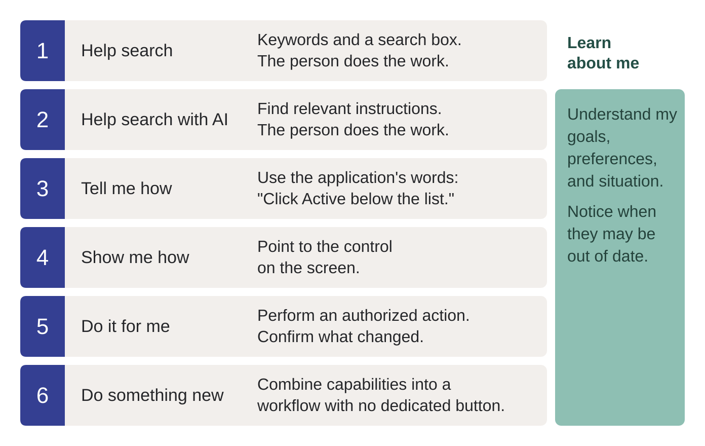
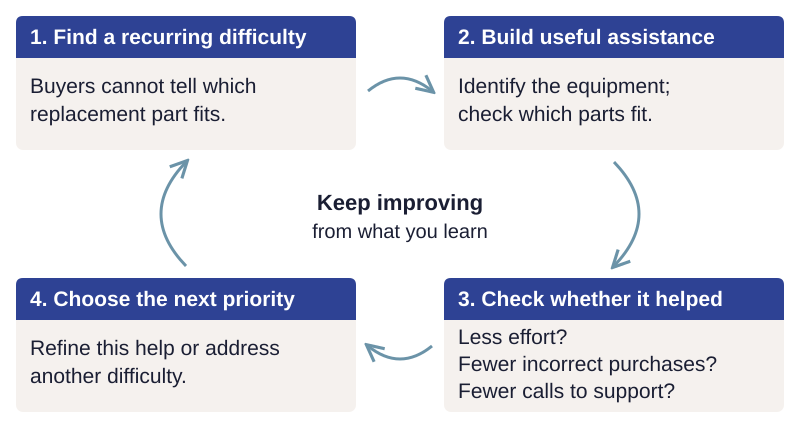
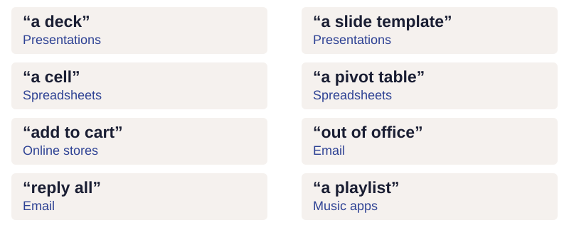

# Why put an agent in the application?

Today, many people reach for AI first when they need to get something done. They have
experienced how much faster it can be to compare options, understand something unfamiliar,
or work through an everyday task.

They bring those expectations to your application. If it leaves them searching through
menus, reading help pages and working out every step themselves, it can feel outdated—even
when its underlying capabilities are excellent.

An embedded agent can help people put those capabilities to work.

The opportunity is especially clear for useful features people encounter infrequently,
workflows spanning several screens, and workplaces where new staff repeatedly have to learn
the same application. Start with a job where that friction matters, not with a goal to add chat.

## Connect that expectation to your application

Your application may already do what a person needs. The difficulty is often discovering
that capability, learning its controls, and working out the sequence that completes the job.
An embedded agent can help people make that connection.

On an ecommerce site, a person might want to find a product that fits their needs, check
whether other buyers recommend it, complete a purchase, resolve a problem, or return
something unsuitable.

In a photography application, they might want to improve a poorly lit photo, find pictures
from a particular trip, organize a growing collection, or share selected photos with friends.

Each of these jobs may require several application capabilities. The person knows what they
want to accomplish, but may not know which controls to use or in what order.

!!! consider "Consider — where could an agent help first?"
    If you had an agent in your application or website, where would it help your users first?
    What are they struggling to accomplish today?

    Write down one example and what tells you it matters: support calls, repeated questions,
    abandoned tasks, or watching someone use the application.

## Poor assistance can make the experience worse

An agent that changes the wrong thing, invents an ability, or says it saved something when
it did not adds uncertainty to an already difficult task.

Getting an agent to help with a few requests can be relatively easy. Making it reliably
helpful across the range of situations and language your users bring can require extensive
work. People leave things unstated, use different terms, change their minds, and assume the
application understands their situation. Providing the capability is only part of the job;
the agent must also recognize when and how to use it—or when to ask a question.

That requires a deep understanding of your users, careful testing, and repeated improvement.
It also means learning from real use: with users’ permission and appropriate privacy
protections, examine production interactions to see where people struggle, where the agent
misunderstands, and what needs to change. Plan how to capture and review those interactions
under your organization’s policies, rather than treating production use as the end of the work.

## From finding help to doing the job together

*The first two levels find instructions. The later levels connect assistance to the working application.*

Search is useful when it quickly gets people to the information they need. Basic keyword
search can return many irrelevant results, especially for common terms. AI-assisted search
can improve relevance, but the person still has to understand the information and apply it
in the application.

An embedded agent can connect that information to what the person is doing—explaining the
next step, pointing to the relevant control, or carrying out an authorized task. It can also
combine operations into a workflow nobody provided a dedicated button for.

These are choices, not a requirement to automate everything. “How do I?” asks for instruction.
“Show me” asks for a demonstration. “Do it” asks for action. Treating all three as permission
to change data would make the agent less helpful.

## Start with the job people want to accomplish

Start with what the person is trying to accomplish, rather than the features your
application provides. A person does not arrive wanting to use search, filters and comparison
controls. They want to replace a broken washing machine with one that fits their space and
budget, will last, and can be delivered before the laundry piles up.

Understanding that job helps you decide where an agent could help and which capabilities
it needs: checking dimensions, comparing products, reviewing information about reliability,
confirming availability and arranging delivery. The agent can help assess likely durability
using available evidence; it cannot promise how long the machine will last.

A **job to be done** is what someone is trying to accomplish in a particular situation.
It is a way to understand the need before choosing a feature or a solution. You do not need
to adopt a formal research method to use that distinction here. Jim Kalbach's
[*The Jobs To Be Done Playbook*](https://rosenfeldmedia.com/books/jobs-to-be-done-book/)
is a practical introduction to understanding customer needs and desired outcomes.

If you already use user stories, use cases, or support-call reasons, start with those.
Look past the requested feature to the result the person needs. “Add more product filters”
names a solution. “Find a replacement part that fits the equipment I own” describes a job.
People may know what is broken without knowing a model number, a part name, or how to
check compatibility.

Start with a recurring difficulty that matters to your users. For example, repeated support
calls and returns may show that people struggle to choose compatible replacement parts.
An agent could help identify their equipment and use the application's product data to
check which parts fit. Before building that assistance, decide how you will tell whether
it helps: can people find a suitable part with less effort, fewer incorrect purchases, and
fewer calls to support? Fewer calls should mean people are getting the help they need,
not that reaching a person has become harder.

*Check the result before deciding what to improve next.*

Watch people use the assistance and review what happened. If they still struggle, use what
you learn to improve it. If it works well enough, address the next priority while continuing
to monitor it. A successful tool call is only a step; the question is whether the person
achieved the intended result.

!!! practice "Practice — describe one job"
    For the application you chose, write three sentences: the person's situation, what they
    want to accomplish, and how they would know it was done. Avoid naming a button or an agent
    in the desired outcome. Then note how they do it today. Keep this example for the next chapters.

## Users use two languages

The language of the application and the language of the job

Applications teach us useful ways to think about our work. Someone who has never used a
paper spreadsheet can learn to organize information in rows, columns, and sheets through
Excel. Those concepts become part of how they think, not just how they operate the software.

*Our applications have trained us. We think—and ask—in their words.*

An agent should understand both languages. A person may describe an outcome—“show me sales
by region”—or ask directly for a pivot table. Both are valid requests. The agent should help
with either, without requiring people to express everything as a job to be done.

*Both ways of asking are valid. The agent should understand and respond to either.*

A person may ask for “something to stop this pipe leaking” or “a half-inch compression fitting.”
A helpful hardware-store clerk understands both. Tool names and descriptions should similarly
connect what people want to accomplish with the familiar names of the application's controls
and operations. When someone names a specific operation, the agent should respect that choice;
when the request is unclear, it should ask for the information it needs.

!!! consider "Consider — what language do your users already use?"
    Which terms from your application have become part of how users describe their work?
    Listen for both the outcomes they want and the controls or operations they name.
    Your agent should understand both.

For the todo sample, the value is educational: a familiar domain lets you inspect these
patterns. The intended destination is your application, where reducing this friction may
matter much more.

For an agent to help effectively, it needs access to the application's capabilities and the
ability to see and control the UI. First, consider [where the agent belongs in the interface](agent-experience.md)
and how it should share space with the person's work. Then we will look at the architecture:
shared application operations, with code enforcing the permissions and approval requirements
appropriate to each caller.
