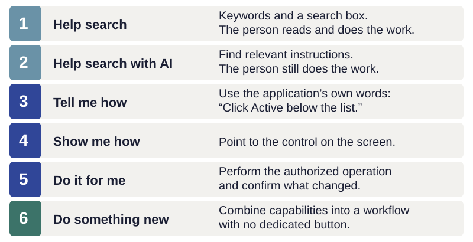
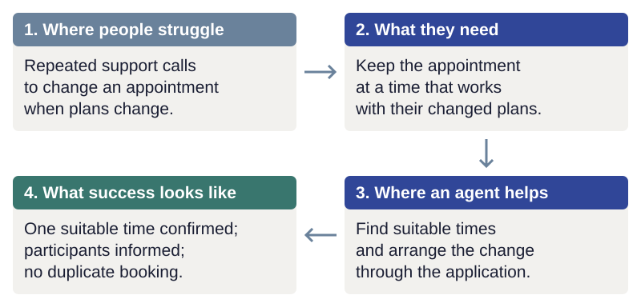
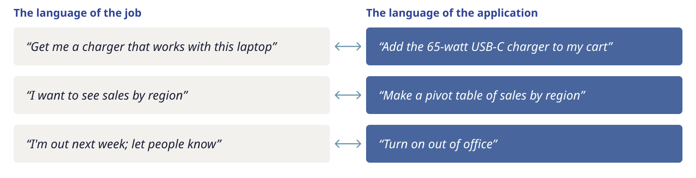

# Why put an agent in the application?

Your application may already do what a person needs. The difficulty is often discovering
that capability, learning its controls, and working out the sequence that completes the job.
An embedded agent can help people make that connection.

On an ecommerce site, a person might want to find a product that fits their needs, check
whether other buyers recommend it, complete a purchase, resolve a problem, or return
something unsuitable.

In a photography application, they might want to improve a poorly lit photo, find pictures
from a particular trip, organize a growing collection, or share selected photos with friends.

Each of these jobs may require several application capabilities. The person knows what they
want to accomplish, but may not know which controls to use or in what order.

!!! consider "Consider — where should the agent help first?"
    Where do your users spend time today trying to resolve a problem?

    Write down one example and what tells you it matters: support calls, repeated questions,
    abandoned tasks, or watching someone use the application. Where could an agent help
    first, and why?

## Expectations come from other experiences

When people struggle, they increasingly reach for AI assistance. Their expectations are set
by helpful experiences elsewhere. A capable application can feel harder to use than it needs
to when the person has to leave it to ask for help, then translate the answer back into its controls.

The opportunity is especially clear for useful features people encounter infrequently,
workflows spanning several screens, and workplaces where new staff repeatedly have to learn
the same application. Start with a job where that friction matters, not with a goal to add chat.

## Poor assistance can make the experience worse

An agent that changes the wrong thing, invents an ability, or says it saved something when
it did not adds uncertainty to an already difficult task. A convincing demonstration does
not establish that the assistance is good enough for everyday use. Build the connection and
the means to inspect its behavior together.

## From finding help to doing the job together

*The first two levels find instructions. The later levels connect assistance to the working application.*

Search and AI-assisted retrieval remain useful. They usually leave the person to perform
the steps. An agent connected to the app can explain in its own vocabulary, highlight the
relevant control, or carry out an authorized operation. It can also combine operations into
a workflow nobody provided a dedicated button for.

These are choices, not a requirement to automate everything. “How do I?” asks for instruction.
“Show me” asks for a demonstration. “Do it” asks for action. Treating all three as permission
to change data would make the agent less helpful.

## Start with the job people want to accomplish

Start with what the person is trying to accomplish, rather than the features your
application provides. A person does not arrive wanting to use search, filters and comparison
controls. They want to replace a broken washing machine with one that fits their space and
budget, will last, and can be delivered before the laundry piles up.

Understanding that job helps you decide where an agent could help and which capabilities
it needs: checking dimensions, comparing products, reviewing information about reliability,
confirming availability and arranging delivery. The agent can help assess likely durability
using available evidence; it cannot promise how long the machine will last.

A **job to be done** is what someone is trying to accomplish in a particular situation.
It is a way to understand the need before choosing a feature or a solution. You do not need
to adopt a formal research method to use that distinction here. Jim Kalbach's
[*The Jobs To Be Done Playbook*](https://rosenfeldmedia.com/books/jobs-to-be-done-book/)
is a practical introduction to understanding customer needs and desired outcomes.

If you already use user stories, use cases, or support-call reasons, start with those.
Look past the requested control to the result the person needs. “Add a Reschedule button”
names a solution. “Keep an appointment when my availability changes” describes a job that
could be served by a button, a form, or an agent. The implementation still has to preserve
the appointment's requirements and avoid losing the original booking.

*An illustrative example: start with a difficulty you can observe, then connect assistance to a result you can check.*

The job gives the agent a purpose and gives you something to evaluate. A successful tool
call is only a step; the question is whether the person achieved the intended result.

!!! practice "Practice — describe one job"
    For the application you chose, write three sentences: the person's situation, what they
    want to accomplish, and how they would know it was done. Avoid naming a button or an agent
    in the desired outcome. Then note how they do it today. Keep this example for the next chapters.

## People speak both the language of the job and the application

*Both kinds of request must reach the same application capabilities.*

A person may ask for “something to stop this pipe leaking” or “a half-inch compression fitting.”
A helpful hardware-store clerk understands both. Application users similarly switch between
their goal and the vocabulary the interface has taught them. Tool descriptions need to connect
those languages, and the agent needs enough context to recognize when more information is needed.

For the todo sample, the value is educational: a familiar domain lets you inspect these
patterns. The intended destination is your application, where reducing this friction may
matter much more. Next, [connect the agent to shared capabilities](design.md).
