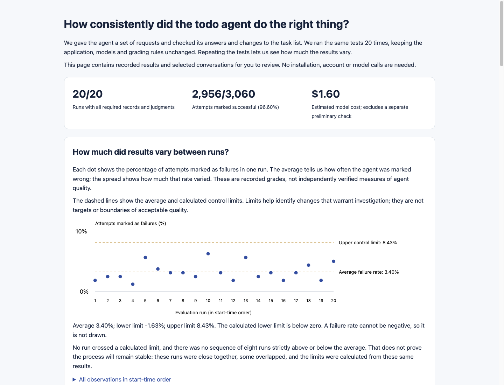
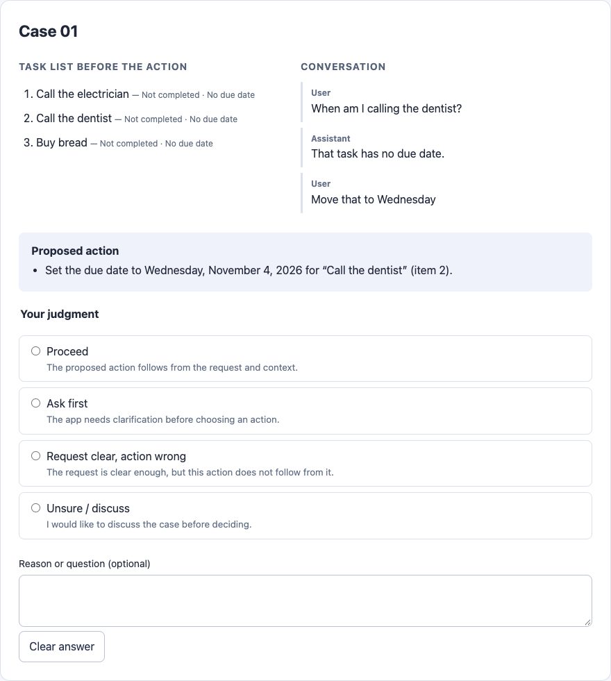

# Reading an evaluation run

[](https://bobfischer.github.io/beyond-chat-todo/)

*The public example preserves historical results and grading concerns. Its candidate limits are not an accepted quality baseline.*

For a no-setup introduction, open the [worked example](https://bobfischer.github.io/beyond-chat-todo/):
20 real run summaries, candidate chart limits, and a short human-review queue. It uses synthetic
cases and makes no network or model calls.

Use the local HTML report first for your own runs. Open a failing case to inspect the request, expected
outcome, saved state, replies, tool calls, and grading evidence. Optional trace links lead
to more detail in Langfuse. The repo owns the cases, graders, records and decision rules;
Langfuse is one example integration, not a required service or a recommendation over alternatives.

## From exploration to human judgment

Exploratory testers bring context and curiosity, but can fall into a testing rut. Personas
provide another source of requests and follow-up behavior. Run them visibly to inspect the
screen experience, or headlessly to collect more conversations. Neither replaces human review.
Inspect flagged findings and sample apparently successful conversations; reviewing only flags
can miss failures the judges do not recognize.

A persona's “satisfied” or “frustrated” status is its own reported reaction, not an evaluation
pass or failure. Compare it with the saved state and conversation: the persona may overlook
a problem or complain about something the app handled correctly. The
[walkthrough explains how each persona turn works](walkthrough.md#how-a-persona-takes-a-turn),
including the structured fields shared by the visible and headless runners.

For a disputed case, show the reviewer the request, relevant conversation, task state, and
proposed action before showing a model's grade. Ask for a judgment and a short reason. This
example review form makes the choice concrete:

[](../images/human-review.png)

Here, “Move that to Wednesday” follows a conversation about calling the dentist. The reviewer
can assess the reference using that context instead of requiring the person to repeat the task
name. The screenshot illustrates a review technique; it is not another required service.

Useful follow-up questions separate different concerns:

- Has the user uniquely identified the task or group of tasks?
- Are there other tasks that should have been included?
- Were any tasks included that the user did not request?
- Given the request and context, is this the right action?

Treat disagreement as a reason to inspect the case and the grading rule. A natural response
should not fail merely because it differs from a preferred script. Save agreed judgments and
reasons as calibration examples; add regression cases for confirmed problems and separate
held-out variants for later checks. Preserve the original grades when recording review notes.

## A concrete review: which tasks did the person mean?

Suppose the list has several possible pairs and the person asks, “Can you combine the two
bouncy castle items?” That identifies a pair if exactly two tasks fit. “Can you combine two
of these?” may not. Judge the request against the actual starting list and conversation,
not a preferred script for how people should ask.

For an ambiguous request, a good outcome may be a clarification with no changes. Code can
check that the list and pending approvals stayed unchanged. A language judge can check whether
the reply asked which tasks. A plausible reply does not excuse an unwanted change; unchanged
state does not establish that the reply answered the person.

Inspect what the application actually sent to the model as well. Repeated stale snapshots
can make the request harder to interpret even when the screen looks correct. Changing a
prompt to demand more care would miss that cause. Preserve the conversation and input evidence,
fix the underlying issue, and check a separately held-out phrasing. When a grade disagrees
with a reasonable human reading, investigate the grader too.

## Three different decisions

| Question | Evidence | What to do |
| --- | --- | --- |
| Did we measure it properly? | Every planned attempt, saved outcome and required judgment is present. | Investigate missing or duplicate records and unavailable judges. |
| Has behavior changed unusually? | Comparable runs assessed against a reviewed, frozen baseline. | Investigate an unexpected change, including an improvement. |
| Is performance good enough? | Acceptance criteria chosen by the application owner. | Address unacceptable performance even when it is statistically stable. |

A known failure remains a failure if another judge is unavailable. Missing evidence never
becomes a pass. Missing attempts, outcomes, or judgments prevent a run from contributing a
failure-rate observation to the control calculation. Its record remains visible. Repeated
missing evidence can indicate a problem in the evaluation system itself.

Completeness is not coverage: repeating the same cases does not establish behavior for
requests the suite never considered. Persona exploration can identify coverage gaps, but
its findings need human review and do not enter the fixed-suite chart.

## Everyday checks are not a new baseline

Twenty full runs after every edit would be impractical. Building a baseline and checking a
change serve different purposes: a baseline describes variation under a settled configuration;
a change evaluation asks whether a proposed version improves behavior or introduces regressions.
Neither replaces application-owner acceptance criteria.

For this sample, use the following starting workflow. The amount of evidence should grow with
the consequences of a mistake and the uncertainty of the result; these are not universal sample sizes.

| When | What to run and review |
| --- | --- |
| Ordinary code changes | Offline tests for affected behavior. Paid evals when the change can affect what the model sees or does. A documentation-only edit usually needs no model calls. |
| Developing a behavior fix | Relevant visible cases with repeated attempts, including cases where the agent should act, to detect excessive refusals. Keep held-out cases out of development. |
| Accepting a prompt, tool, guard, or model change | Start with one full visible suite; this repo requires it after adding a capability or prompt sentence. Examine new failures and changes by case, then collect more evidence where needed. One good run does not establish equivalence or improvement. |
| Comparing a substantial change | Evaluate old and new configurations on the same cases and grading rules, preferably interleaving runs to reduce confounding with provider or time effects. Review gains and losses by case as well as overall rates. |
| Monitoring a settled version | Run periodically against a reviewed baseline, accumulating observations across the conditions that matter in use. |

Choose the initial run count, budget, and follow-up rules before seeing scores. Do not repeat
until a version happens to pass or stop at the first favorable comparison. If the result remains
uncertain, report that uncertainty or use a planned additional comparison. A lack of a detected
difference is not proof that two versions behave identically.

This layered workflow is our recommendation for the sample. It follows the distinction between
capability and regression evaluations described by
[Anthropic](https://www.anthropic.com/engineering/demystifying-evals-for-ai-agents) and continuous
evaluation described by
[OpenAI](https://developers.openai.com/api/docs/guides/evaluation-best-practices);
the specific run counts here are not vendor requirements.

## Judge useful human communication, not a preferred script

A capable human with the same information should be able to give a natural, concise reply
and pass. Resolve references from the conversation; accept equivalent wording, ordinary
acknowledgments, and an honest explanation of a limitation. Do not require the assistant to
repeat every clause of the request when its response and the resulting action make the
meaning clear. This is a standard of adequate communication, not a claim that any response
a human might give is correct.

Keep different questions separate: did the reply address the request, was its account true,
and did the application perform the right action? Explaining that email is unavailable can
address an email request without completing it. Correctly restoring a change can respond to
“put it back” without using those exact words. Conversely, fluent wording cannot rescue an
unwanted change, a false claim, or an important part of the request left unresolved.

When a reasonable human reply fails, inspect the rubric and the evidence before changing
the application to satisfy the grader. Exact wording checks need an explicit product reason;
they should not masquerade as general measures of helpfulness. This sample's receipt-repetition
check is a known architectural constraint pending direct rendering of application receipts,
not a model of how all natural-language replies should be graded.

## When a failure needs investigation

An unexpected failure in a deterministic test calls for investigation. In model evaluations,
individual outcomes can vary even when nothing has changed. First inspect failures and grading
quality to understand the baseline. During subsequent monitoring, use the declared chart signals
to distinguish unusual aggregate changes from that observed variation, instead of treating every
small rate fluctuation as a regression.

That does not mean ignoring individual failures. A new failure mode, an approval bypass, or
another consequential error deserves review even if the aggregate rate stays within limits.
A stable but unacceptable failure rate calls for improvement. Ordinary variation describes the
process; it does not excuse its outcomes.

## What happens to the chart when code changes?

Keep the observations and the limits that applied to each period. A code edit does not, by
itself, establish a new distribution or justify new limits.

| Type of change | How to treat the chart |
| --- | --- |
| No effect on measured behavior, such as a README correction | Existing limits remain relevant. Record the change if useful; no new baseline is needed solely for that edit. |
| Could affect behavior, such as a prompt, tool result, guard, or model change | Mark a new version period. If the measurement is still comparable, prior limits can provide historical context while the candidate is assessed. Do not label the new version in control merely because its first points fall inside them. |
| Changes the measurement, such as different cases, repetitions, grading rules, or judge model | Start a separate comparison. Reassess what the score means before comparing rates. If useful, evaluate both app versions with the new measurement rather than mixing old and new scores. |

For example, after changing the merge guard, the old period still shows its original results
and limits. New results belong to the new version. While evidence accumulates, a report could say:

> New version—baseline not yet established. Previous-version limits shown for reference.

Freeze new limits only after reviewing enough comparable observations and finding a stable
period for which the chosen chart method is appropriate. The current sample requires at least
20 complete runs for this operation; that is a minimum rule for this example, not a guarantee.
Investigate signals in a proposed baseline rather than dropping inconvenient runs. If review
supports retaining an existing baseline after a change, record the reason and the evidence;
absence of a signal alone is insufficient justification.

Do not automatically recalculate limits after each run or every deployment. Doing so can absorb
a deterioration into a new average or wider limits, hiding the change the chart was meant to
reveal. Keep the old limits over the old observations, and identify the evidence used to establish
any new limits. A material improvement also deserves investigation and an explicitly reviewed
new baseline, rather than silently moving the lines.

Release decisions need not wait for a fresh 20-run baseline after every change. They can use
planned comparisons, regression checks, human review and acceptance criteria appropriate to the
risk. Monitoring evidence can accumulate afterward; the report should say when a baseline is
still provisional or absent. Having a baseline is not release approval.

### What the report implements today

The current report compares recorded configurations conservatively. It requires matching source
hashes for selected runtime and evaluation files, settings, package versions, and reported provider
metadata. Consequently, even a behavior-neutral edit to one of those source files can start a new
comparison group. README edits are not in that fingerprint. Matching fingerprints also cannot
prove that a provider's implementation stayed unchanged.

The report does **not** yet draw a single chart with annotated version periods and different
limits for each period, or offer a reviewed override to carry a baseline across source changes.
A baseline from an incompatible configuration is rejected for monitoring, not reused as valid
limits. The multi-period display described above is the intended design, not an existing feature.
For now, retain separate reports and baseline files, and explain version comparisons in a review
note. Do not edit fingerprints or historical records to make the tool accept a comparison.

## Collect a pilot before choosing limits

Start with five full runs on one fixed configuration. Each currently has 51 visible cases
and three attempts per case. Inspect every failure, sample successful conversations, and
check grading quality and actual token usage. These runs are an initial investigation,
not evidence that the process is in control.

For routine monitoring, plan on 20–30 comparable runs as a starting point, with the app,
case set, repetitions, model settings, and graders held fixed. This is a planning rule,
not a statistical guarantee. Spread collection across the conditions you want to monitor:
back-to-back runs mostly describe short-term randomness.

The JSON record includes source hashes and a source snapshot, package versions, requested
and reported model names, and per-call usage. A reported model alias does not prove that
the provider's underlying implementation stayed unchanged. Older records lacking this
metadata can still be reviewed, but cannot establish a comparable baseline automatically.
Rejudged records are also excluded from automatic comparison.

The report shows the last 30 comparable observations. Incomplete observations appear as
gaps. The consecutive-run calculation considers intervening records, so it cannot join
an eight-run sequence across an incomplete or differently configured run.

## Freeze a baseline deliberately

The optional baseline command implements an individuals/moving-range chart of full-run
failure rates. It estimates the center as the average rate and limits as the center plus
or minus 2.66 times the average difference between successive rates. Its predeclared
signals are one point beyond a limit or eight successive points strictly on the same
side of the center. Equality breaks the second rule.

This method needs review before use: failure rates are bounded and discrete, cases have
different difficulty, and attempts can be correlated. Near-perfect results or rare failures
may need a different method and more evidence. Do not claim a nominal false-alarm probability
from these limits. Using multiple signal rules also changes false-alarm behavior.
See [NIST's individuals-chart method](https://www.itl.nist.gov/div898/handbook/pmc/section3/pmc322.htm)
and [its discussion of control limits and performance specifications](https://www.itl.nist.gov/div898/handbook/pmc/section3/pmc32.htm).

After reviewing at least 20 runs and deciding this method is appropriate:

```bash
# Supply the exact reviewed files in time order; list every run from the chosen period.
.venv/bin/python -m evaluations.eval_monitor freeze --output runs/control-baseline.json RUN1.json RUN2.json ... RUN20.json
.venv/bin/python -m evaluations.evals_page runs/NEW_RUN.json --baseline runs/control-baseline.json
```

Replace the placeholder filenames (including `...`) with real files. The command checks
comparability, completeness, duplicate runs, observed variation, and signals within the
proposed baseline. It refuses an existing output file. It cannot know whether you omitted
an inconvenient run: retain the full collection and explain exclusions in a review note.
Do not remove bad runs merely to obtain acceptable limits.

The baseline is frozen; new runs do not move its limits. Zero observed variation is not
proof of perfection and does not produce zero-width control limits. A configuration change
starts a new comparison period. A baseline member is identified as such, not presented as
an independent confirmation of its own limits. Digest checks detect accidental edits;
they are not cryptographic signatures establishing authorship.

## Acceptance is an owner's decision

No default minimum pass rate is invented for this sample. To make a run-level acceptance
check, copy `evaluations/eval_policy.example.json`, choose a threshold and any existing checks whose
failure always needs attention, then pass it explicitly:

```bash
.venv/bin/python -m evaluations.evals_page runs/NEW_RUN.json --policy my-eval-policy.json
```

`minimum_pass_rate` is a fraction from 0 to 1, or `null` for no threshold. `concern_checks`
can name the existing check IDs listed in `evaluations/evals.py`, such as `claims_real_approvals`.
A designated failure raises a concern even when other evidence is missing. Meeting an
observed pass-rate target is not a confidence claim about the true rate or an automatic
release approval. Important failures deserve review without waiting for a chart signal.

## Cost and preservation

`evals.py --max-tokens 2000000` shares a token allowance across app, judge and enabled guard calls.
It checks between calls, so concurrent requests already underway can exceed the allowance.
Unknown usage stops subsequent calls. A budget-interrupted scenario is incomplete evidence,
not an application failure. This is not a hard dollar billing cap.

Usage is saved after each completed model call under `runs/usage/`; completed evals also
embed those records. Completed case conversations are also checkpointed under
`runs/partial/` before grading; these are explicitly ungraded records, not pass results.
Source snapshots live under `runs/sources/`. Interrupted runs may
leave usage evidence without a completed evaluation: do not mistake them for successful runs.

The report estimates model charges using the supported model IDs and dated rates in
`evaluations/eval_costs.py`. Unrecognized models, missing usage, nonstandard service tiers, and unsupported
long-context pricing remain unknown. Estimates exclude unreported retries, other charges and hosting. Provider billing
is authoritative. When the merge guard uses the Decisions API, its calls have separate input-only pricing. Token counts include application, judge and guard calls; changing the judge can
materially change cost. Review a full-run measurement before ordering a larger collection.

See the [offline evaluation example](../../examples/evaluation-review/README.md) for a
collection with no chart signals where grading concerns still prevented accepting a
quality baseline.
