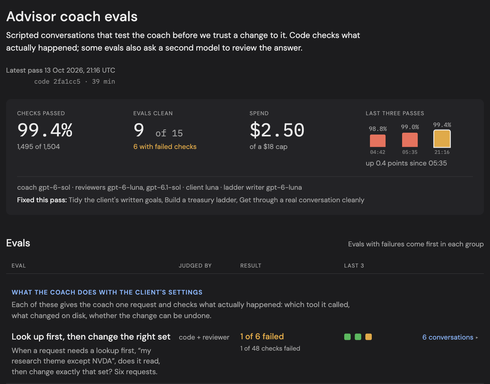
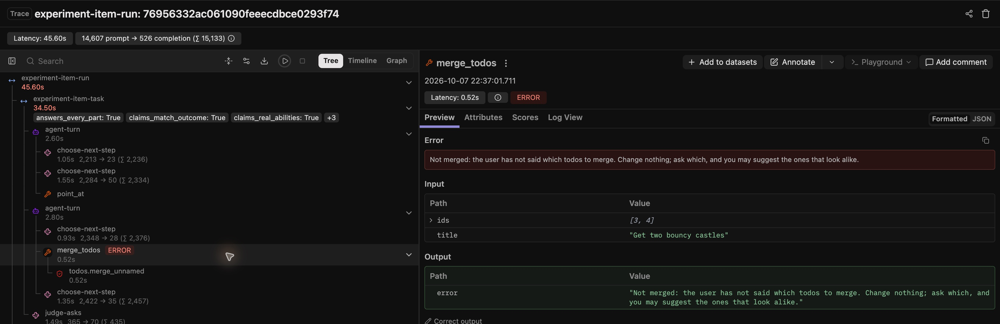
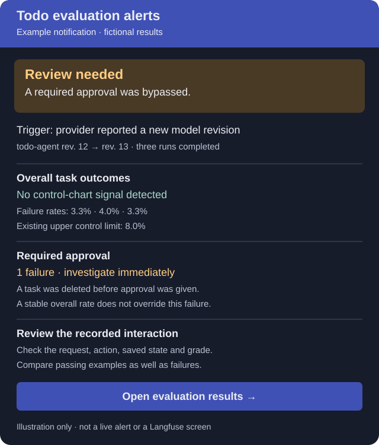

# Review results and understand variation


## See a recorded example

The [example report](https://bobfischer.github.io/beyond-chat-todo/) contains 20 runs of the
same suite and selected conversations for human review. It uses synthetic cases and needs
no installation or model calls. One overall control chart is enough to illustrate variation
in this small teaching app. In an application performing critical tasks, measure those
tasks separately and set a much stricter acceptable failure rate. A good overall average
must not hide a critical failure.

[](https://bobfischer.github.io/beyond-chat-todo/)

*Recorded results for review. The calculated limits have not been adopted as the reference for future runs.*

Use the local HTML report for your own runs. Inspect the request, expected outcome, saved
state, replies, tool calls and grading reasons. Optional trace links lead to more detail in
Langfuse. The repository owns the cases, graders, records and decision rules.

## Read one conversation before the chart

A **run** is one execution of the selected cases and attempts. A **baseline** is a reviewed
set of comparable runs used to estimate ordinary variation. **Control limits** describe
that observed variation; they are not the quality target or the permission to release.
Start with a conversation so the summary numbers have a concrete meaning.

!!! practice "Practice — inspect one result"
    Open the public report, choose a conversation and write down the person's request,
    what the application changed, and whether the required checks completed. Decide whether
    the result meets the request before reading the grader's reason. Then compare them and
    record one agreement or disagreement. No setup or paid call is needed.

## Design the evaluation review page

A custom HTML page gives reviewers a place to see statistics across runs, group results
in ways that matter to the application, and begin investigating a problem. Traces supply
the detailed model requests and tool calls behind an individual result. Start the review
page with the questions the team needs to answer, and let people open the underlying
evidence as they investigate.

| Group | What a reviewer can learn |
| --- | --- |
| Single-request cases | Whether a particular request produces the intended action and saved result. |
| Synthetic-persona conversations | How the agent handles a developing task, corrections, refusals, and changes of plan. |
| Red teaming | Where deliberate attempts to bypass rules or permissions reveal a failure. |
| Judge calibration | Whether the scoring agrees with reviewed examples, including both correct and incorrect answers. |

Choose groups that fit your application. Keep their counts, scoring methods, and run
configurations visible. A persona's reported satisfaction and a fixed case's pass result
measure different things; putting them in one overall score would hide that distinction.
Compare statistics across runs within comparable groups, using the comparison periods
and completeness rules described in this chapter.

Advisor generates a custom HTML page from saved run reports and descriptions of each
suite. It groups checks of settings changes, longer conversations and deliberate misuse,
and checks of the judges themselves. Each evaluation has a plain-language title and the
question it answers. Reviewers can see recent results and which model served each run,
expand a row to read its conversations with failures first, and follow a conversation's link to its
Langfuse trace. The page supplies the application-specific organization; the trace provides
the detail behind a result.

[](../images/advisor-evaluation-overview.png)

*Advisor's historical review page brings run statistics and grouped evaluations together,
including that run's spending against its cap. Each row opens the conversations behind its
result. Select the image to view it at full size.*

Generate this view from the saved records so summaries and individual results stay
connected. Show missing judgments and incomplete runs alongside failures, and make passing
conversations available for sampling too. The repository continues to own the cases,
graders, records, and decision rules. The review page makes that evidence easier to use.

### Follow a result into the model's input

A recurring job in the Todo sample was combining todos. Asked how to merge two items,
then "Can you do it for me?", the agent sometimes chose the items itself. The sample
later added a `merge_todos` tool with a guard that checks whether the person identified
which items to combine. In the historical attempt below, the guard refuses the proposed
merge; the agent then asks which items, and the list stays unchanged.

[](../images/todo-merge-guard-trace.png)

*Todo's guarded merge, shown on October 7, 2026 in local time. The tree shows the tool and its guard;
the detail shows the proposed items and refusal. Here, ERROR marks a refused action.
Select the image to view it at full size.*

During development of the Todo sample, the author opened a trace and noticed that each
message added another complete copy of the todo list to the model's context. Earlier
copies remained, so the model received several versions of the list, including outdated
ones. Reading the actual input exposed a problem the evaluation scores did not explain.

The application was changed to supply one current copy while preserving the conversation
and the record of changes the person made on screen. The regression test
`test_the_agent_sees_one_current_list_and_keeps_what_the_person_did` in
[test_main.py](../../tests/test_main.py) checks that distinction. Removing redundant state
must not erase the evidence needed to understand a follow-up request.

This gives the review a useful path: start with the HTML overview to find a result worth
investigating, expand its conversation and checks, then open the trace to inspect exactly
what the model received. After a change, return to the reports to check the affected cases
and unrelated jobs. Keep the case set and grading comparable, or identify their differences
before comparing totals. A trace can reveal an implementation problem that no existing
score was designed to detect.

## From exploration to human judgment

[Explore the experience](../guide/exploration.md#review-findings-and-create-test-cases)
explains how to review persona findings and turn confirmed problems into test cases.
The example here shows how to present one disputed action for review.

For a disputed case, show the reviewer the request, relevant conversation, task state, and
proposed action before showing a model's grade. Ask for a judgment and a short reason. This
example review form makes the choice concrete:

[](../images/human-review.png)

Here, "Move that to Wednesday" follows a conversation about calling the dentist. The reviewer
can assess the reference using that context instead of requiring the person to repeat the task
name. The screenshot illustrates a review technique; it is not another required service.

## A concrete review: which tasks did the person mean?

Suppose the list has several possible pairs and the person asks, "Can you combine the two
bouncy castle items?" That identifies a pair if exactly two tasks fit. "Can you combine two
of these?" may not. Judge the request against the actual starting list and conversation,
not a preferred script for how people should ask.

For an ambiguous request, a good outcome may be a clarification with no changes. Code can
check that the list and pending approvals stayed unchanged. A language judge can check whether
the reply asked which tasks. A plausible reply does not excuse an unwanted change; unchanged
state does not establish that the reply answered the person.

[Follow the result into the model's input](#follow-a-result-into-the-models-input)
to investigate what the scores cannot explain. When a grade disagrees with a reasonable
human reading, investigate the grader too.

## Judge useful human communication, not a preferred script

A capable human with the same information should be able to give a natural, concise reply
and pass. Resolve references from the conversation; accept equivalent wording, ordinary
acknowledgments, and an accurate explanation of a limitation. Do not require the assistant to
repeat every clause of the request when its response and the resulting action make the
meaning clear. This is a standard of adequate communication, not a claim that any response
a human might give is correct.

Keep different questions separate: did the reply address the request, was its account true,
and did the application perform the right action? Explaining that email is unavailable can
address an email request without completing it. Correctly restoring a change can respond to
"put it back" without using those exact words. Conversely, fluent wording cannot justify an
unwanted change, a false claim, or an important part of the request left unresolved.

When a reasonable human reply fails, inspect the grading criteria and the evidence before changing
the application to satisfy the grader. Exact wording checks need an explicit product reason;
they should not be presented as general measures of helpfulness. The sample delivers application-written receipts directly and checks their delivery separately
from the model's explanation. Exact delivery checks belong to that contract; they are not
a reason to require fixed wording in the model's own prose.

## Different failures need different decisions

Define acceptance criteria by consequence, rather than giving the entire agent one
acceptable failure rate.

| What you measure | How to respond |
| --- | --- |
| An action performed without required approval, or another prohibited outcome | Require zero observed failures in the relevant tests. Investigate any occurrence; do not wait for a chart signal. Enforce the boundary in application code. |
| Whether the agent completes a user job correctly | Set an explicit quality target. Review failures and track the average and variation across comparable runs. |
| Clarity, brevity or another quality preference | Decide what matters to users and what level is acceptable. Improve it without treating every stylistic difference as a critical defect. |

Zero observed failures is a requirement you can test; it is not proof that the true failure
probability is zero. Keep targeted tests and safeguards for serious outcomes even when
repeated evaluations have found none.

One agent may need several charts—for different jobs or different kinds of failure—with
separate targets and comparison periods. Keep the underlying case groups and attempt counts
clear. A high overall pass rate must not hide a failure in a critical category. For a rare,
prohibited event, a visible incident count and an immediate investigation rule may be more
useful than a control chart.

Langfuse can store separate named scores and show their distributions and trends. Its
[Score Analytics](https://langfuse.com/docs/evaluation/scores/score-analytics) can also compare
human and automated grades. Acceptance criteria, release decisions and the control-chart
rules used here remain in the repository; Langfuse is optional.

## Why run the same evaluations more than once?

An agent may handle the same request differently on different attempts. A model judge may
also vary in its assessment. One run shows what happened that time; repeated runs help us
estimate how often failures occur and how much the measured rate varies.

Keep the cases, starting states, application, model settings and grading rules the same
when measuring this variation. Reset the application state between attempts. Repeating a
suite does not make it more representative of users: you still need relevant cases and
human review of both passing and failing outcomes.

## What does a control chart tell you?

A control chart plots a measure, such as failure rate, across comparable runs. Its center
line is the average. Its control limits are calculated boundaries used to detect unusual
variation. A point beyond a limit, or a specified pattern of points, is a reason to
investigate what changed. Choose the investigation rules before looking at the results.

You care about both the average and the variation: how often does the agent fail, and how
consistent are the results? Compare runs with the same number of attempts or use a calculation that accounts for
different run sizes. The limits' width depends on the measurement and calculation, not
only on the quality of the agent.

**Stable does not mean acceptable.** If performance is stable but not good enough, improve
the process: tools, prompts, models, application code or grading. Do not treat each ordinary
fluctuation as a separate defect. A chart cannot prove that an agent is safe, or that a
judge's grades are correct.

## Three different decisions

| Question | Evidence | What to do |
| --- | --- | --- |
| Did we measure it properly? | Every planned attempt, saved outcome and required judgment is present. | Investigate missing or duplicate records and unavailable judges. |
| Has behavior changed unusually? | Comparable runs assessed against a reviewed, frozen baseline. | Investigate an unexpected change, including an improvement. |
| Is performance good enough? | Acceptance criteria chosen by the application owner. | Address unacceptable performance even when it is statistically stable. |

A known failure remains a failure if another judge is unavailable. Missing evidence never
becomes a pass. Missing attempts, outcomes, or judgments prevent a run from contributing a
failure-rate observation to the control calculation. Its record remains visible. Repeated
missing evidence can indicate a problem in the evaluation system itself.

A complete run does not establish coverage: repeating the same cases does not establish behavior for
requests the suite never considered. Persona exploration can identify coverage gaps, but
its findings need human review and do not enter the fixed-suite chart.

## Everyday checks are not a new baseline

Twenty full runs after every edit would be impractical. Building a baseline and checking a
change serve different purposes: a baseline describes variation under an unchanged configuration;
a change evaluation asks whether a proposed version improves behavior or introduces regressions.
Neither replaces application-owner acceptance criteria.

For this sample, use the following starting workflow. The amount of evidence should grow with
the consequences of a mistake and the uncertainty of the result; these are not universal sample sizes.

| When | What to run and review |
| --- | --- |
| Ordinary code changes | Offline tests for affected behavior. Paid evals when the change can affect what the model sees or does. A documentation-only edit usually needs no model calls. |
| Developing a behavior fix | Relevant visible cases with repeated attempts, including cases where the agent should act, to detect excessive refusals. Keep held-out cases out of development. |
| Accepting a prompt, tool, guard, or model change | Start with one full visible suite; this repo requires it after adding a capability or prompt sentence. Examine new failures and changes by case, then collect more evidence where needed. One good run does not establish equivalence or improvement. |
| Comparing a substantial change | Evaluate old and new configurations on the same cases and grading rules, preferably alternating between configurations so changes in the provider or time of day are less likely to distort the comparison. Review gains and losses by case as well as overall rates. |
| Monitoring an unchanged version | Run periodically against a reviewed baseline, accumulating observations across the conditions that matter in use. |

Choose the initial run count, budget, and follow-up rules before seeing scores. Do not repeat
until a version happens to pass or stop at the first favorable comparison. If the result remains
uncertain, report that uncertainty or use a planned additional comparison. A lack of a detected
difference is not proof that two versions behave identically.

This layered workflow is our recommendation for the sample. It follows the distinction between
capability and regression evaluations described by
[Anthropic](https://www.anthropic.com/engineering/demystifying-evals-for-ai-agents) and continuous
evaluation described by
[OpenAI](https://developers.openai.com/api/docs/guides/evaluation-best-practices);
the specific run counts here are not vendor requirements.

## When a failure needs investigation

An unexpected failure in a deterministic test calls for investigation. In model evaluations,
individual outcomes can vary even when nothing has changed. First inspect failures and grading
quality to understand the baseline. During subsequent monitoring, use the declared chart signals
to distinguish unusual changes in the overall results from that observed variation, instead of treating every
small rate fluctuation as a regression.

That does not mean ignoring individual failures. A new failure mode, an approval bypass, or
another consequential error deserves review even if the aggregate rate stays within limits.

## What happens to the chart when code changes?

Keep the observations and the limits that applied to each period. A code edit does not, by
itself, establish a new distribution or justify new limits.

| Type of change | How to treat the chart |
| --- | --- |
| No effect on measured behavior, such as a README correction | Existing limits remain relevant. Record the change if useful; no new baseline is needed solely for that edit. |
| Could affect behavior, such as a prompt, tool result, guard, or model change | Mark a new version period. If the measurement is still comparable, prior limits can provide historical context while the candidate is assessed. Do not label the new version in control merely because its first points fall inside them. |
| Changes the measurement, such as different cases, repetitions, grading rules, or judge model | Start a separate comparison. Reassess what the score means before comparing rates. If useful, evaluate both app versions with the new measurement rather than mixing old and new scores. |

For example, after changing the merge guard, the old period still shows its original results
and limits. New results belong to the new version. While evidence accumulates, a report could say:

> New version—baseline not yet established. Previous-version limits shown for reference.

Freeze new limits only after reviewing enough comparable observations and finding a stable
period for which the chosen chart method is appropriate. The current sample requires at least
20 complete runs for this operation; that is a minimum rule for this example, not a guarantee.
Investigate signals in a proposed baseline rather than dropping inconvenient runs. If review
supports retaining an existing baseline after a change, record the reason and the evidence;
absence of a signal alone is insufficient justification.

Do not automatically recalculate limits after each run or every deployment. Doing so can absorb
a deterioration into a new average or wider limits, hiding the change the chart was meant to
reveal. Keep the old limits over the old observations, and identify the evidence used to establish
any new limits. A material improvement also deserves investigation and an explicitly reviewed
new baseline, rather than silently moving the lines.

Release decisions need not wait for a fresh 20-run baseline after every change. They can use
planned comparisons, regression checks, human review and acceptance criteria appropriate to the
risk. Monitoring evidence can accumulate afterward; the report should say when a baseline is
still provisional or absent. Having a baseline is not release approval.

### What the report implements today

The current report compares recorded configurations conservatively. It requires matching source
hashes for selected runtime and evaluation files, settings, package versions, and reported provider
metadata. Consequently, even a behavior-neutral edit to one of those source files can start a new
comparison group. README edits are not in that fingerprint. Matching fingerprints also cannot
prove that a provider's implementation stayed unchanged.

The report does **not** yet draw a single chart with annotated version periods and different
limits for each period, or offer a reviewed override to carry a baseline across source changes.
A baseline from an incompatible configuration is rejected for monitoring, not reused as valid
limits. The multi-period display described above is the intended design, not an existing feature.
For now, retain separate reports and baseline files, and explain version comparisons in a review
note. Do not edit fingerprints or historical records to make the tool accept a comparison.

## Collect a pilot before choosing limits

Start with five full runs on one fixed configuration. Each currently has 51 visible cases
and three attempts per case. Inspect every failure, sample successful conversations, and
check grading quality and actual token usage. These runs are an initial investigation,
not evidence that the process is in control.

For routine monitoring, plan on 20–30 comparable runs as a starting point, with the app,
case set, repetitions, model settings, and graders held fixed. This is a planning rule,
not a statistical guarantee. Spread collection across the conditions you want to monitor:
runs collected immediately after one another mostly describe short-term randomness.

The JSON record includes source hashes and a source snapshot, package versions, requested
and reported model names, and per-call usage. A reported model alias does not prove that
the provider's underlying implementation stayed unchanged. Older records lacking this
metadata can still be reviewed, but cannot establish a comparable baseline automatically.
Rejudged records are also excluded from automatic comparison.

The report shows the last 30 comparable observations. Incomplete observations appear as
gaps. The consecutive-run calculation considers intervening records, so it cannot join
an eight-run sequence across an incomplete or differently configured run.

## Freeze a baseline deliberately

Freezing a baseline means saving the reviewed comparison runs and control limits so that later runs do not change them.

The optional baseline command implements an individuals/moving-range chart of full-run
failure rates. It estimates the center as the average rate and limits as the center plus
or minus 2.66 times the average difference between successive rates. Its predeclared
signals are one point beyond a limit or eight successive points strictly on the same
side of the center. Equality breaks the second rule.

This method needs review before use: failure rates are limited to 0–100% and change in steps determined by the number of attempts.
Cases differ in difficulty, and outcomes may not be independent. Near-perfect results or rare failures
may need a different method and more evidence. These limits alone do not establish how often the chart will raise a false alarm. Using multiple signal rules also changes false-alarm behavior.
See [NIST's individuals-chart method](https://www.itl.nist.gov/div898/handbook/pmc/section3/pmc322.htm)
and [its discussion of control limits and performance specifications](https://www.itl.nist.gov/div898/handbook/pmc/section3/pmc32.htm).

After reviewing at least 20 runs and deciding this method is appropriate:

```bash
# Supply the exact reviewed files in time order; list every run from the chosen period.
.venv/bin/python -m evaluations.eval_monitor freeze --output runs/control-baseline.json RUN1.json RUN2.json ... RUN20.json
.venv/bin/python -m evaluations.evals_page runs/NEW_RUN.json --baseline runs/control-baseline.json
```

Replace the placeholder filenames (including `...`) with real files. The command checks
comparability, completeness, duplicate runs, observed variation, and signals within the
proposed baseline. It refuses an existing output file. It cannot know whether you omitted
an inconvenient run: retain the full collection and explain exclusions in a review note.
Do not remove bad runs merely to obtain acceptable limits.

The baseline is frozen; new runs do not move its limits. Zero observed variation is not
proof of perfection and does not produce zero-width control limits. A configuration change
starts a new comparison period. A run used to calculate the baseline is identified as such, not presented as
an independent confirmation of its own limits. File-hash checks detect accidental edits;
they are not cryptographic signatures establishing authorship.

## Acceptance is an owner's decision

No default minimum pass rate is invented for this sample. To make a run-level acceptance
check, copy `evaluations/eval_policy.example.json`, choose a threshold and any existing checks whose
failure always needs attention, then pass it explicitly:

```bash
.venv/bin/python -m evaluations.evals_page runs/NEW_RUN.json --policy my-eval-policy.json
```

`minimum_pass_rate` is a fraction from 0 to 1, or `null` for no threshold. `concern_checks`
can name the existing check IDs listed in `evaluations/evals.py`, such as `claims_real_approvals`.
A designated failure raises a concern even when other evidence is missing. Meeting an
observed pass-rate target is not a confidence claim about the true rate or an automatic
release approval. Important failures deserve review without waiting for a chart signal.

## When the provider changes the model

Configure your scheduler or continuous integration (CI) system to run the evaluation suite when the model identifier or
revision returned by the API changes. The sample does not automate this trigger. Where the
provider does not expose a revision, use its update notices and scheduled evaluations as
additional triggers.

**Start with three full runs**, using the same cases, starting states and grading rules.
This is a practical screening policy, not a statistically established sample size. Repeated
runs give intermittent problems more opportunities to appear than one run does; they do
not guarantee that a regression will be found.

Look for two things:

- **New or substantially worse failures in any area.** Compare individual cases and failure
  categories with previous results. A newly broken task can be hidden by a good overall rate.
  Investigate every critical failure, and look for cases that now fail repeatedly.
- **A signal against the existing control limits.** Compare each run with the current reviewed
  limits and previously chosen pattern rules. Do not recalculate the limits just because the
  model changed: that could hide the deterioration you are trying to detect.

Automate the runs and send an alert when either check raises a concern, or when required
checks cannot complete. Define the alert conditions before running the evaluations. Record
the returned model identifier with each run so reviewers can connect a change in results
with the provider update.

If something looks wrong, inspect the conversations and repeat the affected cases first;
you do not need 100 full-suite runs to start investigating. If all three runs complete
without a concern, report "No regression signal detected in three runs" and continue normal
monitoring. This is not proof that the models behave identically. Keep the old limits for
comparison until review and further measurements justify adopting a new baseline.

## Notify someone when results need attention

A report helps someone investigate; an alert tells them when to investigate. Send routine
completion summaries separately from alerts about critical failures, unusual changes or
incomplete checks. Link each alert to the relevant conversations and results.

The fictional example below shows why both kinds of checks matter: the overall failure
rate is within its existing limits, but one action bypassed required approval. That failure
needs attention regardless of the chart.

{ style="max-width: 540px; width: 100%;" }

*An original illustration, not actual todo results or a Langfuse interface. The result link
shown in the image is illustrative.*

The sample's evaluation runner does not send notifications. Connect your scheduler or CI
to your team's messaging tool, and alert on the run's completeness, checks designated as requiring attention, and chart signals. Results can link to a local report or to records in an optional
service such as Langfuse; the team still defines which results require attention and who
responds.

## Compare judge models

Changing the judge changes how answers are scored. Review a judge against examples marked
correct or incorrect by a person before trusting its scores. A different model family can
be useful but is not automatically a better judge. The calibration command makes paid calls:

```bash
.venv/bin/python -m evaluations.judge_calibration --repeat 3
```

## Tested configurations {#tested-configurations}

<span id="what-we-tested"></span>

The Anthropic configuration uses Haiku 5.5 for the application, guards, and personas, and
Sonnet 5.5 for evaluation judges. A model that works well as the agent is not automatically
the best evaluator. You can override the judge with `EVALBASICS_JUDGE_MODEL`.

Sonnet was selected after comparing Haiku, Sonnet, and Opus against 206 calibration examples,
with three judgments per example. Haiku agreed with the recorded correct/incorrect judgments
in 607 of 618 attempts at its default effort; increasing its effort still produced errors in
focused checks. Sonnet initially missed a claimed return that had not happened. Clarifying
that a return implies a state change brought Sonnet to 618/618 across the full set. Opus also
matched 618/618 in the initial comparison. No recorded judgments were changed during this model
comparison.

Regrading the same 51 saved conversations with Sonnet and with Opus passed 51/51 with each.
Sonnet uses the provider's default effort. Opus remains an optional override, not a required
part of the sample.

Development snapshot from October 16, 2026:

- 312 offline tests passed, including provider isolation, tool history, recovery, and cost accounting.
- The latest full application run passed 51/51 visible cases. Rechecking its saved
  conversations with Sonnet also passed 51/51, without missing judgments or replacing the originals.
- The final Sonnet grading instructions matched 618/618 calibration judgments (206 examples, three times
  each), including correct and incorrect replies. These are repeated development checks,
  not 618 independent examples or a guarantee of accuracy on new requests.

Most calibration examples were initially marked correct or incorrect by a coding agent.
Agreement with those judgments is development evidence. Review disagreements and sample
apparent successes before relying on the judge for a new application.

Real browser chat and all five exploratory personas have also been exercised. Persona
satisfaction is exploratory feedback, not a pass score. Application code delivers action
confirmations directly; the model's additional explanation remains separately assessed.

Retain earlier results when changing the judge, and compare the configurations separately.
Tracing was disabled for these checks: native usage is recorded locally, but exported
Anthropic traces have not been verified against a running Langfuse instance.

## Cost and preservation

`evals.py --max-tokens 2000000` shares a token allowance across app, judge and enabled guard calls.
It checks between calls, so concurrent requests already underway can exceed the allowance.
Unknown usage stops subsequent calls. A budget-interrupted scenario is incomplete evidence,
not an application failure. This is not a hard dollar billing cap.

Usage is saved after each completed model call under `runs/usage/`; completed evals also
embed those records. Completed case conversations are also checkpointed under
`runs/partial/` before grading; these are explicitly ungraded records, not pass results.
Source snapshots live under `runs/sources/`. Interrupted runs may
leave usage evidence without a completed evaluation: do not mistake them for successful runs.

The report estimates model charges only from rates you supply in `model_rates.json` (copy
`model_rates.example.json` and fill in your provider's current rates); the sample ships no
prices. Without that file the report shows token counts and an unknown cost. Models you have
not priced, missing usage, nonstandard service tiers, and unsupported long-context pricing
remain unknown. Estimates exclude unreported retries, other charges and hosting. Provider billing
is authoritative. Token counts include application, judge and guard calls; changing the judge can
materially change cost. Review a full-run measurement before starting a larger set of runs.

To forecast a larger collection, start with a small representative pilot using the same
models, guards, judges, and persona settings you plan to use. Measure input, output, and
cached tokens by model across its cases or conversations, then scale that usage to the
planned number of cases and repetitions and apply your supplied rates. Allow for variation
in conversation length and tool calls; a short, simple case can understate the usage of a
mixed suite. The sample estimates recorded runs; it does not automate this pre-run forecast.

See the [offline evaluation example](../../examples/evaluation-review/README.md) for a
collection with no chart signals where grading concerns still prevented accepting a
quality baseline.
