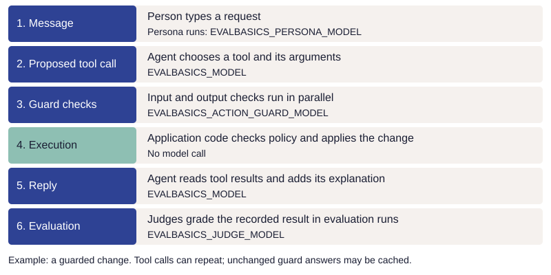

<span id="bring-your-own-model"></span>

# Choose models

Choose a provider, run the sample, then change one model and measure the result. The settings
below belong in `.env` at the repository root; restart the app after changing them.

Models have four jobs here: the agent proposes application actions, guards check proposed
actions, personas play simulated users, and judges evaluate recorded results. Each job can use
its own model. Start with the provider defaults, then change one job at a time.

## Select models

Run `./setup.sh`, then edit `.env` in the repository root. Choose a provider and add its key:

```dotenv
EVALBASICS_PROVIDER=anthropic
ANTHROPIC_API_KEY=
```

Or choose OpenAI:

```dotenv
EVALBASICS_PROVIDER=openai
OPENAI_API_KEY=
```

Fill in the blank key for your choice. The [sample configuration](../../.env.example) supports
both providers; you need only one key. Leave the optional model overrides commented out to use
the defaults below. The provider setting chooses a default model for each job.

| Job | OpenAI default | Anthropic default | Setting and required capability |
| --- | --- | --- | --- |
| Application agent | `gpt-6-luna` | `claude-haiku-5-5` | `EVALBASICS_MODEL`: tool calls and results |
| Evaluation judges | `gpt-6-luna` | `claude-sonnet-5-5` | `EVALBASICS_JUDGE_MODEL`: structured output |
| Simulated users | `gpt-4.1-mini` | `claude-haiku-5-5` | `EVALBASICS_PERSONA_MODEL`: structured output |
| Intent/action guards | `gpt-6-luna` | `claude-haiku-5-5` | `EVALBASICS_ACTION_GUARD_MODEL`: structured boolean output |
| Probability merge guard | `gpt-6-luna` through Decisions | Uses the boolean action guard instead | `GUARD_MODEL` in `todo/agent.py`: probability output |

Defaults live in [model_provider.py](../../todo/model_provider.py). The Anthropic
configuration makes no OpenAI calls. Check model availability and account access when choosing
a replacement. Both configurations have development-run evidence; evaluate the behavior your
own application needs.

### Run the sample

Restart the app or command after changing settings:

```bash
.venv/bin/python -m streamlit run todo/app.py --server.address 127.0.0.1
```

Try an addition and read it back. Chat and evaluation calls incur provider charges. The manual
list and offline tests need no key. Langfuse stays off in the sample configuration.

Process environment variables override `.env`. Keep keys out of source control. Leave provider base URLs unset for the standard endpoints.

## Change one model

Set `EVALBASICS_MODEL`, `EVALBASICS_JUDGE_MODEL`, `EVALBASICS_PERSONA_MODEL`, or
`EVALBASICS_ACTION_GUARD_MODEL` to replace a role's model. The chosen provider must serve that
model. For a mixed setup, also set the corresponding provider override:
`EVALBASICS_AGENT_PROVIDER`, `EVALBASICS_JUDGE_PROVIDER`, `EVALBASICS_PERSONA_PROVIDER`, or
`EVALBASICS_ACTION_GUARD_PROVIDER`. Values are `openai`, `anthropic`, or `auto` (infer from a
`claude-` prefix). If `EVALBASICS_PROVIDER` is unset, names starting with `claude-` use
Anthropic; other names use OpenAI.

For example, to compare only the agent while keeping OpenAI judges and guards:

```dotenv
EVALBASICS_PROVIDER=openai
EVALBASICS_AGENT_PROVIDER=anthropic
EVALBASICS_MODEL=claude-haiku-5-5
```

That mixed configuration needs both keys. Judge and guard changes should be measured
separately from agent changes when you want to attribute a difference.

### Updating an existing .env

Setup preserves existing settings. Comment out explicit model overrides to use the new
provider's defaults. If your file sets `EVALBASICS_GUARDS`, compare that selection with
[.env.example](../../.env.example) to include the current default guards.

## Try a replacement and measure it

Use the [exploratory tester's scratch list](../guide/start.md#try-three-different-requests)
and leave trace export off. These first commands make no model calls until you send a chat
message:

```bash
.venv/bin/python -m pytest -q
.venv/bin/python -m streamlit run todo/app.py --server.address 127.0.0.1
```

Try adding a todo, reading it back, changing a date, undoing a change, asking an ambiguous
question, and requesting deletion. Check both the resulting state and the explanation.
Approval remains a person's action. Permission comes from the application's policy, whatever
tools the model chooses to call.

Next, run a small visible eval before paying for the full suite:

```bash
.venv/bin/python -m evaluations.evals --case read-fresh --repeat 1 --max-tokens 50000
.venv/bin/python -m evaluations.evals --repeat 3 --max-tokens 2000000
```

These commands incur charges at your provider. Token allowances are stop conditions between
calls, not dollar caps; an in-flight call can exceed the allowance. Inspect the JSON/HTML
record for provider errors, missing judgments and token usage, not just passes. The small run
checks the connection; the full visible suite checks wider behavior. Keep held-out cases
separate from development feedback, following the [held-out case
rules](../principles/implementation.md#check-6-9).

When comparing assistant models, keep the judge, cases, tool order and other settings fixed.
Changing the judge at the same time changes the measuring instrument. Review a judge against
examples marked correct or incorrect by a person before trusting its scores; a different model
family can be useful but is not automatically a better judge. The existing calibration command
makes paid calls:

```bash
.venv/bin/python -m evaluations.judge_calibration --repeat 3
```

Keep results from different settings separate when comparing runs. Local records retain
requested and served model details, plus hashes that identify endpoint settings without saving
their URLs or credentials. These details form the configuration fingerprint: a record used to
tell whether two runs used the same setup. See [Review results and understand
variation](evaluation-results.md) for comparisons over time.

## Model costs

[](../images/model-call-costs.svg)

One request can involve several model calls: the agent, guards, and, in evaluation and
persona runs, judges and simulated users. Repeated runs multiply them. Providers charge
for the input and output tokens of each call; see your provider's pricing page and usage
dashboard for current rates and actual charges. The sample includes no prices. To see cost
estimates in run reports, copy `model_rates.example.json` to `model_rates.json` and fill in
your provider's current rates; without it, reports show token counts only. Your provider's
billing is authoritative.

## Guards

Guards check whether the proposed action fits the person's request. Their judgments can be
wrong. Application code separately enforces validation, permissions, current-state checks, and
deletion approval, and maintains undo where supported.

All declared guards are enabled by default. The Streamlit app, persona runner and eval
runner use the same selection: `EVALBASICS_GUARDS` in the environment takes precedence over
this repo's `.env`, then the code default. An explicitly empty shell environment value
disables guards. `evals.py --guard NAME` adds a guard to the configured selection.

The default selection includes these checks and `todos.merge_unnamed`:

```text
todos.target_identified,todos.extra_tasks,todos.omitted_tasks,todos.operation_matches,todos.wrong_values
```

### The merge guard

The existing merge guard asks a separate model whether the user identified which todos to
merge.

With the OpenAI configuration, this guard uses `GUARD_MODEL` in `todo/agent.py` (`gpt-6-luna`)
and the Decisions API, which returns a probability for a yes/no question. [The merge call in
agent.py](../../todo/agent.py) shows the question and how it is sent. With the Anthropic
configuration, it uses the action-guard model and the same question with a boolean answer.

`EVALBASICS_MERGE_GUARD_MODE` can explicitly select `decisions` or `boolean`. By default, an
Anthropic action-guard provider selects boolean; an OpenAI action-guard provider selects
Decisions. Boolean mode can also be evaluated with an OpenAI structured-output model. The
report records an answer or a probability according to the mode actually used. An invalid or
unavailable judgment prevents the merge. Include the mode and model in comparisons.

### Checks of proposed changes

The completion, due-date, and deletion-request actions declare checks of user intent and
proposed actions. They use `EVALBASICS_ACTION_GUARD_MODEL` and the action-guard provider,
independently of the assistant model. Each provider configuration uses its own key; no second
account is needed.

The input check receives dialogue through the latest user request, current todos, and date. It
receives neither the proposed action nor the model's narration of that proposal. The output
checks also receive that action, tool meanings, and computed calendar facts. Both requests run
concurrently before a write. Each returns boolean answers, not calibrated confidence scores.
Date changes additionally check the proposed values.

Checks apply to one operation at a time: a request containing several operations need not be
completed by one call. The final-response eval checks completeness across the request. A
missing key, timeout, refusal, or invalid answer prevents that invocation; the assistant
receives an error and the person can still use the app's controls. Local tool records and the
HTML eval report include the answers; Langfuse is optional.

These checks cover the three measured operations; adding one to another operation requires
evaluation. The merge question runs separately. It receives the user and assistant messages
available when the merge is proposed, including any text accompanying that proposal.
The todo list, tool results, and system prompt are excluded from that input.

Check both false refusals and incorrect approvals when changing these models. Ambiguous
references and dates require particular attention. Computed weekdays help with calendar
arithmetic; they do not establish that a date matches the person's intent.

### Boolean answers and probabilities

A conversational LLM can interpret a request, propose tool calls, and explain results. A
purpose-built decision model answers narrower questions for application code, such as "Has the
user uniquely identified a task?" Its interface returns typed answers, often with
probabilities, rather than a conversational reply.
[Jev](https://docs.typesafe.ai/introduction.md) is one example.

An LLM can also answer a narrow question using structured output. That makes it usable as a
decision step; it does not make a yes/no answer a calibrated probability.

A boolean answer gives code a yes/no decision. A probability also allows code to apply a
threshold measured against examples. Evaluate either form for false refusals and incorrect
approvals. Jev is not integrated into this sample.

## Use a compatible endpoint

The sample's OpenAI-compatible adapter uses the OpenAI Chat Completions API, including its
tool-calling format and structured outputs described with JSON Schema. JSON Schema is a
standard for describing and validating JSON data. The Chat Completions API is a
provider-defined interface that other services also implement, rather than a universal
standard for model APIs.

Compatibility must include the features used by each role: the agent calls application tools,
while guards, personas and evaluation judges return structured results. A server that accepts
chat messages or returns JSON text does not necessarily support all of these features. See
[Compatibility limits to check](#compatibility-limits-to-check) for the requirements and [Try
a replacement and measure it](#try-a-replacement-and-measure-it) for the verification steps.
The native Anthropic integration uses its Messages API instead.

Leave `OPENAI_BASE_URL` unset for the default OpenAI endpoint. For a gateway or local server,
set its documented API base URL, for example:

```dotenv
OPENAI_BASE_URL=http://localhost:8000/v1
OPENAI_API_KEY=your-local-server-key
```

This is an illustrative address, not a server installed by this sample. Use the endpoint's
actual URL and authentication requirements. The SDK requires a nonempty key; use a placeholder
only if your own local endpoint explicitly does not authenticate. For a hosted endpoint, use
that provider's key. Requests and task data go to the configured endpoint.

`OPENAI_BASE_URL` and `OPENAI_API_KEY` apply to roles routed to OpenAI-compatible APIs.
`ANTHROPIC_BASE_URL` and `ANTHROPIC_API_KEY` apply to native Anthropic roles. Separate
endpoints within one provider require a code change. A gateway's Claude model can use the
OpenAI-compatible path with an explicit `openai` role override; a model name alone does not
establish compatibility.

If you use Langfuse, verify tracing with a new provider separately from task behavior; see
the [Langfuse guide](langfuse.md).

## Compatibility limits to check

- Tool protocol: the adapter must preserve call IDs, arguments, and matching results.
  The native Claude adapter retains thinking blocks (provider-returned reasoning data required in later requests) and rejects truncated tool responses
  before execution. A text-only model is insufficient.
- Structured results: personas return their message plus approval choices, completion, and
  reactions as named fields; judges return a verdict and supporting quote. The
  [walkthrough explains the persona turn](walkthrough.md#how-a-persona-takes-a-turn). Both
  require the declared field names and types; an endpoint that
  merely returns JSON text may not enforce it. Check refusals and truncated output as well as
  successful calls. An unavailable judgment must remain missing evidence, never a pass.
- Generation options: `agent.options()` currently sends `reasoning_effort='none'` for names
  starting with `gpt-5` or `gpt-6`. The OpenAI judge path sends `reasoning_effort='low'` for those
  prefixes and `temperature=0` otherwise. Personas use the agent options or `temperature=0.7`.
  These are code choices for the existing integrations, not universal model capabilities.
  A gateway alias or another model may require different options. If the endpoint rejects a
  parameter, adapt the client options against its documentation; there is no generic options
  environment variable today.

## If you need another native API

Add a provider adapter at the model-call boundary for messages, tool calls, results,
structured output, errors and usage. Keep domain operations and authority in
`capabilities.execute`; do not reimplement todo actions for each provider. Agent, judge, guard
and persona paths need separate verification. OpenAI-compatible and native Anthropic paths are
implemented; other native APIs and independent endpoints within one provider remain extension
work.

## Tested configurations {#tested-configurations}

<span id="what-we-tested"></span>

The Anthropic configuration uses Haiku 5.5 for the application, guards, and personas, and
Sonnet 5.5 for evaluation judges. A model that works well as the agent is not automatically
the best evaluator. You can override the judge with `EVALBASICS_JUDGE_MODEL`.

Sonnet was selected after comparing Haiku, Sonnet, and Opus against 206 calibration examples,
with three judgments per example. Haiku agreed with the recorded correct/incorrect judgments
in 607 of 618 attempts at its default effort; increasing its effort still produced errors in
focused checks. Sonnet initially missed a claimed return that had not happened. Clarifying
that a return implies a state change brought Sonnet to 618/618 across the full set. Opus also
matched 618/618 in the initial comparison. No recorded judgments were changed during this model
comparison.

Regrading the same 51 saved conversations with Sonnet and with Opus passed 51/51 with each.
Sonnet uses the provider's default effort. Opus remains an optional override, not a required
part of the sample.

Development snapshot from October 16, 2026:

- 312 offline tests passed, including provider isolation, tool history, recovery, and cost accounting.
- The latest full application run passed 51/51 visible cases. Rechecking its saved
  conversations with Sonnet also passed 51/51, without missing judgments or replacing the originals.
- The final Sonnet grading instructions matched 618/618 calibration judgments (206 examples, three times
  each), including correct and incorrect replies. These are repeated development checks,
  not 618 independent examples or a guarantee of accuracy on new requests.

Most calibration examples were initially marked correct or incorrect by a coding agent.
Agreement with those judgments is development evidence. Review disagreements and sample
apparent successes before relying on the judge for a new application.

Real browser chat and all five exploratory personas have also been exercised. Persona
satisfaction is exploratory feedback, not a pass score. Application code delivers action
confirmations directly; the model's additional explanation remains separately assessed.

Retain earlier results when changing the judge, and compare the configurations separately.
Tracing was disabled for these checks: native usage is recorded locally, but exported
Anthropic traces have not been verified against a running Langfuse instance.
