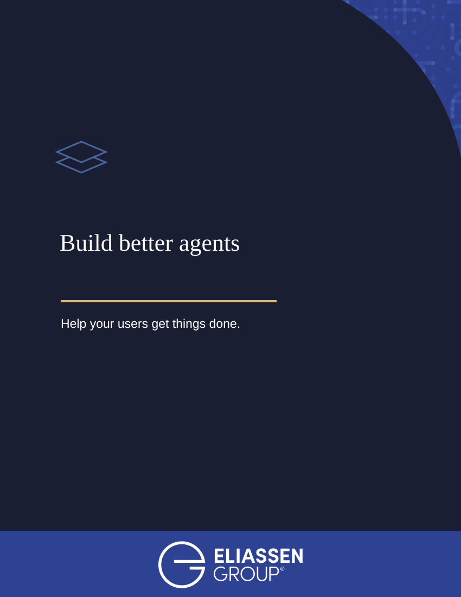
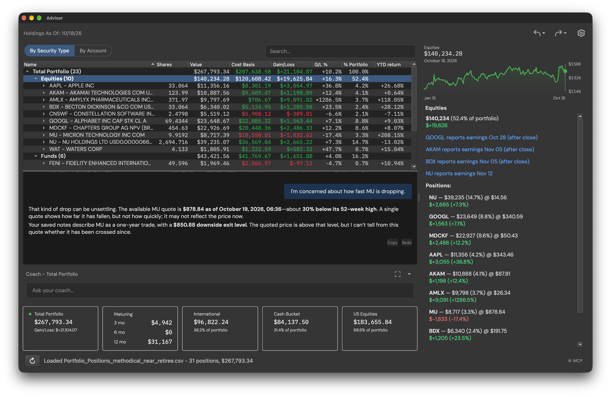
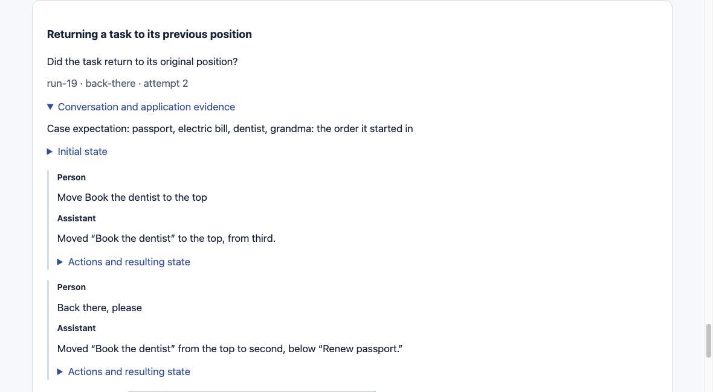
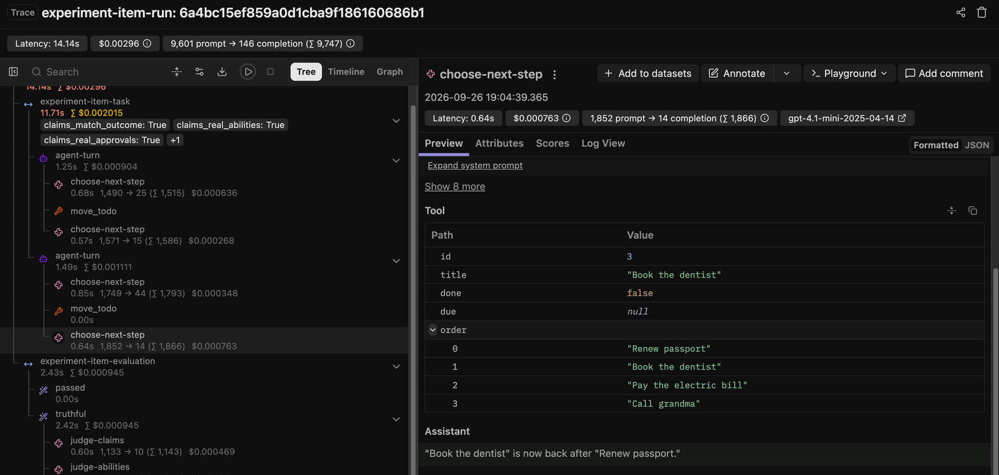
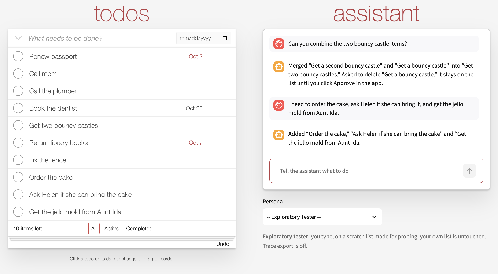

<h1 id="cover" class="cover-anchor" aria-label="Cover"></h1>

{ .publication-cover }

<h1 id="introduction">Introduction</h1>

An AI agent embedded in an application can help people find useful capabilities,
understand unfamiliar workflows, and get work done.

For that agent to be useful, it needs a connection to the application. Depending on the
job, it may need to see what the user is doing, control the interface, and perform tasks on
the user's behalf. It must also be safe and trustworthy. High-impact actions should require
the user's approval through a process enforced by application code. The application needs
controls and evaluation to keep the agent's advice and actions within applicable policies.
Where required, it should keep an audit trail of the interaction, approvals and actions taken.

Building this kind of agent can be challenging: designing tools, tuning prompts, and writing
application code to guide its behavior. A second model can help classify a request or check
a draft answer before it is shown. Building reliable assistance requires deliberate
experimentation, measurement, and ongoing evaluation as models and applications change.

That effort should be weighed against the friction your users already face: struggling to complete tasks, finding help that does
not help, being unable to reach a person when they need one, and encountering dead ends.

If your users experience these frustrations—or never discover capabilities that could
make their work easier—building an embedded agent may be worth the investment.

This guide explains how to approach that work. It is for developers, architects, and
product people adding an agent to an application or website—or improving one they already
have. A small TodoMVC-style application makes the design choices concrete without
requiring you to learn a complicated business domain.

Throughout this guide, "application" includes desktop applications, web applications, and
the services behind them. The principles apply across these environments: shared operations,
application-enforced permissions, and agents working with current data. Where the code runs
changes how the parts connect. The examples run locally; a hosted web application will
usually put shared operations and access controls on its server. The
[interfaces chapter](guide/interfaces.md#choose-where-the-mcp-server-runs) explains local and remote connections.

We also draw examples from Advisor, a separate investment application that combines
portfolio information with an embedded agent called the coach. It illustrates how these
ideas work with richer user context: learning about a person's goals, navigating to relevant
controls, and testing conversations with simulated users. The todo application is included
with the guide; Advisor appears in examples and screenshots.

*Advisor's embedded coach uses portfolio data and saved notes to respond to a person's
concern about a holding. Shown with disguised example data. Select the image to see it at full size.*

> Security scope: These practices address agent behavior and do not make an application secure. Authentication, authorization, encryption, transport security, and other application security controls require separate design and review under your organization's security policies.

## See the same evidence

Evaluation is part of building the agent. An evaluation checks how it handles a request:
what it says, what it changes, and whether the person gets the intended result. People
and coding agents need access to the same evidence so they can investigate a problem
together and check whether a change helped.

An HTML report makes a recorded conversation and its outcome easy to review. A trace
shows the model calls, tools, results, and checks behind the interaction. The person can
read these views while a coding agent reads the underlying records through files or an
API. Both should be able to point to the same request, action, and result.

*The report exposes a concrete problem: "Back there, please" returned the task to second
place, although it started third.*

*The same task-return scenario in a separate recorded run, shown in Langfuse. The selected
call exposes the task order and the reply. These are historical examples of inspecting
behavior; select either image to see it at full size.*

The [evaluation chapters](guide/evaluation.md) explain how to define success and use these
records to improve the agent. The [inspection appendix](reference/inspection.md) gives an
example of connecting application records to existing tracing tools.

## Choose a way through the guide

You do not need prior experience with agents. The design chapters assume
familiarity with an application's screens and workflows. The implementation chapters add
Python and API details; you can read the examples without running them.

| If you want to… | These chapters explain… |
| --- | --- |
| Decide where an agent could help | [Why an embedded agent?](guide/why.md) — Consider where users struggle in your applications today and how an agent could help them get things done. |
| See how to build one | [Run the sample](guide/start.md) and [Follow a request](guides/walkthrough.md) — See how the UI and agent use the same application capabilities, with different permissions. |
| Evaluate and iteratively tune an agent | [Evaluate outcomes](guide/evaluation.md) and [Review results and understand variation](guides/evaluation-results.md) — Evaluate how well it helps users, review failures, and distinguish normal variation from changes that need investigation. Use what you learn to improve the agent and evaluate it again. |
| Apply this to your application | [Apply it to your app](guide/apply.md) — Choose a first capability, define its safeguards, and decide how to test it. |

We've added Consider and Practice boxes throughout the document to help you deepen
your understanding and apply the ideas to your own application.

## See the ideas in a working application

The guide includes a small todo application with an embedded AI agent. You can use its
controls yourself or ask the agent to help. Both use the same application capabilities
and data, with permissions appropriate to each.

*Trying the agent while watching what changes in the application.*

[Watch a recorded session](demos/persona-replay.html) in which a simulated user (a persona)
works with the agent. Use the Next and Play buttons to step through the conversation,
approval requests, and changes to the list without installing anything or supplying an
API key. You can also explore the code. The sample is designed for local, single-user use.

The sample has been tested with OpenAI and Anthropic models; see
[Choose models](guides/models.md#select-models) for the tested provider profiles and model IDs.
You can also connect hosted or local models through an OpenAI-compatible API. That chapter
explains the required features and how to check compatibility.

You can also explore detailed traces with Langfuse, which records model requests, tool
calls and results to help you understand what happened. Langfuse can run locally in
containers, without a cloud subscription. It is one example of a tracing tool; the sample
and its evaluation reports work without it. [Optional tracing](guides/langfuse.md)
explains how to connect it to the todo app.

## Apply the principles to your own application

The examples show one way to implement the principles. Your starting point may be a new
application or an established system with its own architecture, and your priorities will
shape which principles you adopt and how. Use the reasoning and examples to decide what
fits, what needs adapting, and where you would take a different approach.

The [implementation and acceptance checks](principles/implementation.md) are written so
you can give them to a coding agent such as Claude Code. Adapt them to your application and
the goals your team has agreed on. The coding agent can then assess your existing
architecture, propose changes, and verify that the application behaves as intended. The
[sample assessment](guides/sample-assessment.md) shows which principles the todo app
demonstrates and where you will need to do more for your own application.

Models and tools will change. Prompt instructions, context handling, and additional model
checks that help today may become unnecessary as models improve. When your evaluations
show the agent behaves correctly without one of them, remove it. Permissions, approvals,
validation, and recording what changed stay in application code whatever model you use,
because they come from the product's requirements.

[Sources and further reading](reference/sources.md) provide additional background.

© Eliassen Group. All rights reserved. Confidential draft.
