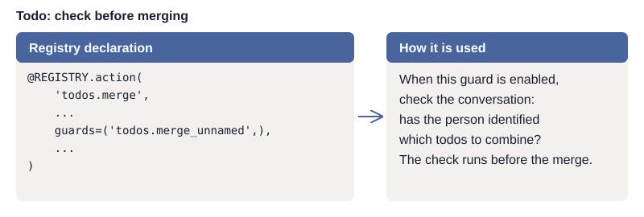
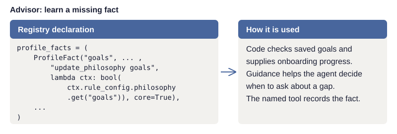

# How to build and extend your registry

A capability registry is where each operation the application supports is declared once, so the
UI, agents, and checks all read the same description. Those declarations can also drive a
command-line interface. This appendix gives practical options for your own registry. It follows
the [order-placement example](../guide/design.md#example-placing-an-order) and explains how to
extend that pattern.

The shopping examples use illustrative declarations and outputs; the implementation notes refer
to the smaller Todo sample and to Advisor, a separate financial application with an embedded
agent (its coach). An embedded agent runs inside the application; an external agent connects
from outside through Model Context Protocol (MCP) to discover and call application tools.

## Start with one operation

Choose one operation people already perform through your application, such as placing an order.
Locate its implementation and validation, then declare its identity, inputs, tool description,
caller permissions, and the result used to describe a completed change. For a change, also
specify how far it reaches—one order or every open order, for example—and whether it can be
undone.

Connect the embedded agent first. Verify that a tool call reaches the same implementation as the
UI, invalid inputs are rejected, and the application enforces the caller's permissions. Check
that the reported result matches what changed. Once that works, add declarations when a specific
feature or repeated problem calls for them. The table below helps make that choice.

## Decide what code will use each declaration

For every field you add, identify the code that reads it and the behavior it controls. A
permission declaration must be checked during execution. A control location must connect to
working navigation code. A fact only informs a model if code includes it in the request.

Start with three questions:

- What information is being repeated or becoming inconsistent?
- Which parts of the application use it, and for what purpose?
- What would demonstrate that changing the declaration changes the intended behavior?

Keep declarations beside the implementation they describe. Register them together so other parts
of the application can find them. The registry need not become a single file containing all
business logic, prompts, screens, and checks.

Registries will need different data elements according to their applications. The shared
principle is to keep capability-specific information with the capability it describes.
When adding information or behavior that belongs to a particular tool or capability, ask
how the registry can incorporate it. A guard, a fact to learn, guidance, or a presentation
hint can live with the capability it describes, and the relevant code can read that
declaration. This keeps additions discoverable and avoids maintaining a parallel catalog
of the same tools. Choose fields because code will use them. Separately reviewed access
policy can remain separate, as in Advisor's policy lists described below.

## Choose the declarations you need

The following categories distinguish the information from the code that uses it. An adapter is
code that turns a declaration into a tool definition for one kind of caller and routes its calls
back to the application. The save path is the code every change goes through for checks and
execution.

| Declaration | What it contains | What uses it | Add when… |
| --- | --- | --- | --- |
| Identity and implementation | Stable name and implementation function | Execution code locates and calls the operation. | Start here. |
| Data schema and validation | Types, allowed values, and domain checks | The save path validates changes. | Start here. |
| Change description | A description built from the applied change | Receipts and history explain what changed. | Start with writes. |
| Tool parameters and description | Tool name, inputs, purpose, and limits | Adapters build embedded-agent and MCP tools. | When exposing an operation to an agent. |
| Caller policy and availability | Who may discover, propose, or execute it | Adapters offer tools; execution code checks permission. | Before exposing an operation to another caller. |
| Recovery and impact | How to undo a change, if possible, and how far it reaches | The save path applies the relevant policy. | Before allowing changes. |
| Version | An identifier for the declaration being used | Evaluation records identify the behavior tested. | When changes affect the behavior you evaluate. |
| Input normalization | Corrections for known formatting mistakes | The save path corrects inputs before validation. | When repeated input mistakes have an unambiguous correction. |
| Application facts | Maintained statements about behavior and limitations | Tool descriptions and answer checks use the same facts. | When agents explain application behavior or responses are checked. |
| Agent guidance | Usage instructions and their intended audience | Code assembles instructions for each agent. | When external agents connect or tool choice needs guidance. |
| Profile facts | Stored fact, how code tells whether it is known, and how to record it | Onboarding code calculates progress and relevant gaps. | When assistance depends on learning about the person. |
| Named agent actions | Operations such as stopping setup questions | Tool-building code exposes the supported actions. | When the person should control a workflow through conversation. |
| Interface actions | Control names, destinations, and navigation functions | UI tools open or highlight controls; descriptions support instructions. | When adding "Tell me how" or "Show me." |
| Guards | Check names, questions, and evidence inputs | The save path checks the proposed action against its context. | When a save depends on what the person meant. |
| Presentation | A card or view associated with a capability | A compatible host displays the result. | When a visual result helps and the host supports it. |
| Command-line interface (CLI) metadata | Command names and argument descriptions | Command-handling code builds commands and help. | If the application has a command interface. |

Not all of these belong on every capability. A read operation may expose a tool without any save
validation. A UI preference may be writable without being offered to an agent. A presentation
declaration does not mean every host can render it.

## Expose the same capability to an embedded agent and through MCP

Here is one complete declaration for this worked example. The function names refer to code in
the shopping application; the following sections show what the code reading the declaration produces from it.

```yaml
operation: orders.place
version: 1
implementation: place_order
input_schema:
  type: object
  properties:
    cart_id:
      type: string
  required: [cart_id]
  additionalProperties: false
validate: validate_cart_for_order
change_description: describe_placed_order
result_fields: [order_id, status, total]
tool:
  name: place_order
  description: Ask to place an order for the specified cart.
  audiences: [embedded_agent, mcp_agent]
policy:
  person: allowed
  agent: approval_required
approval_handler: ask_to_place_order
impact: one_order
undo: unavailable
facts:
  - Placed orders cannot be changed or undone.
  - The application does not monitor orders in the background.
interface:
  screen: Cart
  control: Place order
  open: open_cart
  highlight: highlight_place_order
```

`result_fields` lists what the implementation returns; `impact: one_order` says how far the
change reaches; `approval_handler` names the function that creates the approval request.

### Build the embedded agent's tool definition

The adapter reads `tool.name`, `tool.description`, and `input_schema`, then appends the
application facts to the description. It writes those fields in the format the model provider
expects. Without provider-specific wrapping, the content is:

```json
{
  "name": "place_order",
  "description": "Ask to place an order for the specified cart. Placed orders cannot be changed or undone. The application does not monitor orders in the background.",
  "parameters": {
    "type": "object",
    "properties": {"cart_id": {"type": "string"}},
    "required": ["cart_id"],
    "additionalProperties": false
  }
}
```

The agent can now request `place_order` with `{"cart_id": "cart-42"}`. The adapter maps the tool
name back to `orders.place` and passes the request to application execution code.

### Build the MCP tool

An MCP server reads the same fields. Its tool definition uses `inputSchema` for the inputs:

```json
{
  "name": "place_order",
  "description": "Ask to place an order for the specified cart. Placed orders cannot be changed or undone. The application does not monitor orders in the background.",
  "inputSchema": {
    "type": "object",
    "properties": {"cart_id": {"type": "string"}},
    "required": ["cart_id"],
    "additionalProperties": false
  }
}
```

The server implements the MCP connection and routes the tool call to the same operation. In this
example, `tool.audiences` allows both kinds of agent to discover the tool.

### Execute through the same checks

For either agent, the application establishes the caller's identity, checks permission, and
validates the cart. The declared policy routes the request to `ask_to_place_order`. Only after
the person approves the specific order does application code call `place_order`. The model's
arguments cannot change the caller's identity or grant approval.

Suppose the implementation returns this result after approval and a successful save:

```json
{"order_id": "order-1042", "status": "placed", "total": "42.50"}
```

The declared change-description function can produce a receipt such as "Placed order order-1042.
Total: 42.50." Tool responses carry the actual result back to the calling agent. Before
approval, the result instead reports that approval is pending. This keeps the result consistent
with the stage the application has reached.

The two adapters produce different protocol formats from the same declaration, and both reach
the same checks and implementation. Review which tools each caller should receive and which
evidence its checks can access. An external agent may have neither the embedded agent's screen
state nor its conversation history.

## Give guidance to the right agent

Add guidance when a tool description alone leaves agents choosing the wrong operation or missing
a necessary step. Declare the intended audience with each instruction, then assemble
instructions for that audience.

For example, an external agent may be told to read the person's onboarding progress before
asking setup questions. The embedded agent already receives that information with each request.
Other guidance may name a tool available only to an external agent. Advisor marks these audience
differences and tests that shared guidance names only tools callable by every agent receiving
it.

Server instructions are text the MCP server sends when a client connects. The client can provide
them to its model alongside the tool descriptions (see [server instructions in the MCP
schema](https://modelcontextprotocol.io/specification/2026-07-28/schema#discoverresult)).
Hosts may keep those instructions from when they connected. In the tested Advisor connection,
Claude's desktop app retains them until restarted. After changing guidance, reconnect or restart
the host as needed and verify the instructions it received before testing the agent's behavior.

## Connect capabilities to "Tell me how" and "Show me"

The worked declaration identifies the Cart screen and Place order control, and references
functions to open the screen and highlight the control. Code supplies that information to the
tools the agent uses to open screens and highlight controls, and to the descriptions the agent
uses to explain them.

There are three different uses:

| Person asks | How the declaration is used |
| --- | --- |
| "How do I place my order?" | Code supplies the screen and control names to the agent, which explains the steps using the application's terminology. |
| "Show me where." | The agent requests navigation; application code calls the declared functions to open the cart and highlight the control. |
| "Place the order for me." | The agent requests the business operation; execution code checks permissions and obtains the required approval. |

Implement and test the navigation and highlighting functions, then connect them through the
declaration. Check their behavior against current state: an empty cart, an open dialog, and a
person without access are useful cases.

Keep guidance distinct from execution. Showing the Place order button must not place the order.
See [Interfaces and views](../guide/interfaces.md) for the broader interaction design.

## Separate validation, normalization, and guards

Start with schema and domain validation in the save path. Add normalization for recurring
formatting mistakes and guards where interpreting the request matters. Choose the execution
order deliberately: normalization precedes validation, and the checks required for a save
complete before the application applies it.

Validation checks whether data is acceptable to the application. A cart ID must have the right
type, refer to an accessible cart, and satisfy the operation's business rules. Some rules can be
expressed in a schema; others require code and current application data.

Normalization corrects known formatting mistakes without changing the person's intent. For
example, if a field ignores case and surrounding spaces, a normalization function could turn `"
STANDARD "` into `"standard"` before validation. It should not choose a shipping option the
person did not request, infer a missing address, or turn an uncertain preference into a firm
instruction. Record enough information to inspect the original arguments and the correction when
troubleshooting.

A guard checks a narrower question about the proposed action and its context. For example: "Has
the person identified which cart they want to order?" A model-based guard may interpret the
conversation, but it can be wrong. Code-enforced permissions and required approval still apply
regardless of its answer.

A guard declaration should identify:

- The question being checked and what counts as a pass or refusal.
- The evidence it receives, such as the user's words, current state, or proposed arguments.
- What happens on refusal, uncertainty, or a failed check.
- Where in the save path the check runs.

The [Todo registry](../../todo/todos.py) registers each guard separately and lets operations
reference guards by name. Each guard declares its evidence and how to interpret the answer.
The [two worked examples](../guide/authority.md#two-guard-questions-from-todo) show a yes-to-proceed
question and a no-to-proceed question, and link to the execution code and tests.

[](../images/registry-guard.svg)

*The merge operation references its registered guard by name. Ellipses omit other fields;
operations use the guards they declare and the execution configuration enables.*

In the todo app, these guards use `provider='chat'` and return Boolean answers.
`require_yes=True` permits execution on yes; `require_yes=False` permits it on no.
The [`Guard.refuses` method](../../todo/capabilities.py) applies that declaration.
For a provider returning a probability, it compares the score with the declared threshold.
Test the threshold boundary as well as values on either side; Boolean answers use the
answer rule directly.

<span id="give-response-checks-evidence-about-the-application"></span>

## Give answer checks evidence about the application

An answer check examines a proposed reply before the person sees it. Use code, a model,
or both according to the claim being checked. Keep this separate from a guard, which
checks a proposed action before execution.

Use the facts in the worked declaration both in the tool description and in the answer check's
evidence. If the agent says "I'll watch your order and tell you if anything changes," the fact
that the application does not monitor orders in the background gives the check a reason to flag
the claim.

Keep the application facts available to the agent available to its answer checks too. Otherwise, an
answer check may flag a true statement simply because it did not receive the supporting fact.
Advisor follows this rule by supplying the registered application facts to its review stages.

Application facts describe behavior and limitations. They do not prove that a particular
operation succeeded. To check "Your order was placed," an answer check also needs the result of that
call—for example, an application-generated order ID and status. To check an amount, it needs the
relevant returned data, not just a general statement about the application.

If a check finds a problem, the application may send the answer back for revision with the
specific issue and supporting evidence. Define a retry limit and what happens if the revised
answer still fails; do not assume another pass guarantees correctness. Test answer checks on
acceptable answers as well as incorrect ones.

Update the facts when application behavior changes, and verify that both the agent and its
answer checks receive the new version.

The [evaluation chapters](../guide/evaluation.md) explain how to examine these checks and the
agent's results.

<span id="use-profile-declarations-for-onboarding"></span>

## Declare facts for learning and maintaining personal context

Some applications become more useful as they learn relevant information about the person.
Advisor, for example, records financial goals and other planning context. A profile declaration
can identify the stored fact, how code determines whether it is known, which operation records
it, and whether it is one of the few facts onboarding asks for first. These declarations
can support both initial learning and keeping the application's understanding of the person current during later use.

For ongoing maintenance, consider declaring how to retrieve a fact's last-confirmed date,
which events make it worth reviewing, and which operation records a confirmation or correction.
Code supplies the saved information and elapsed time; guidance helps the agent decide whether
checking it would help with the current request. A confirmation can refresh the date while
leaving the value unchanged. Choose these fields for the application's needs, and keep
record-specific guidance with the capability that owns the record.

The Advisor example below shows the narrower case of identifying a missing fact during
onboarding. Its `ProfileFact` declaration checks whether goals are known; it does not declare
confirmation dates or review events.

[](../images/registry-profile.svg)

*Advisor declares this fact on its philosophy capability. Ellipses omit the label and other
facts. Onboarding guidance is declared separately on the onboarding capability; the profile
snippet shown here checks whether goals are known.*

For Advisor's embedded agent, onboarding code calculates progress from saved data and the
declarations on every request. It includes the relevant gaps in the state the application sends
with that request. An external agent obtains the same calculation through a read operation when
its guidance tells it to. The agent can answer the person's current question and, when
appropriate, ask about one of those gaps. A save goes through the same validation and applicable
checks as other changes.

"Known" must mean more than a nonempty field. Preserve qualifications: "early retirement might
be nice" is not a commitment to retire at a particular age. In Advisor, a remark about one stock
is not the person's comfort with risk overall. Checks on the proposed save should reflect that
distinction.

Named actions such as `stop_asking` and `resume` can let the person control the experience
through conversation. The application implements their state changes. Code counts app sessions in which the person sends a message
so onboarding stops after a set number of sessions, even if some facts are still missing.
See [Learn about me](../guide/onboarding.md).

## Describe results, recovery, and presentation

The implementation should return what actually happened. Change-description functions can turn
those results into receipts and history entries: "Changed delivery option from standard to
express," for example. Generate that description from the applied change, not merely the model's
request. A failed save must not produce a success receipt.

An undo declaration should identify a real recovery operation and its limits. A description of a
change is not enough to reverse it. In the shopping example, placed orders cannot be undone;
that limitation belongs both in the declared policy and in the implementation's behavior.

A presentation declaration can connect a capability to a card showing its result in a host that
supports it. The adapter must handle hosts without that presentation support, for example by
returning an understandable text result. Presentation does not grant permission to read or
change the underlying data.

## Check that the declarations work together

Use focused checks for the connections your application implements:

- Change a tool description and verify the intended embedded-agent and MCP definitions change.
- Call a restricted operation directly and confirm execution still rejects it when the tool is hidden.
- Submit invalid data through each supported interface and confirm the save path validates it.
- Check that normalization fixes supported formatting mistakes without inventing intent.
- Exercise guards with both acceptable and unacceptable requests, including missing evidence.
- Ask to see a control and confirm navigation does not execute the business operation.
- Test answer checks against both unsupported claims and accurate answers.
- Save, correct, or remove a profile fact and verify onboarding progress reflects the saved state.
- Verify receipts describe committed changes and that any declared recovery actually works.
- Check that guidance names only tools available to its audience, and reconnect external hosts
  when testing updated server instructions.
- Verify that response answer checks receive the application facts supplied to the agent.

As the registry grows, check for declarations that no code uses and lists kept by hand
elsewhere, such as which tools external agents may call. Advisor deliberately keeps four
tool lists governing reads, writes, tools omitted from the coach's list, and coach-only
tools. These form a reviewed policy: declaring a capability alone grants no agent access.
Exposing a new capability therefore takes a second, deliberate policy update.

Version declarations when a change affects the behavior being evaluated. Keep enough information
with evaluation results to identify which implementation, declarations, prompts, and models
produced them. A single registry reduces inconsistency. Tests, evaluation, and human review are
still needed.

## Read the smaller implementation

The Todo sample's [registry code](../../todo/capabilities.py) defines actions, guards,
registration checks, and shared execution. The
[walkthrough](../guides/walkthrough.md#follow-a-declaration-through-the-registry) follows a
declaration through the working application. Use those to understand the smaller design, then
add only the declarations and supporting code your application needs.
